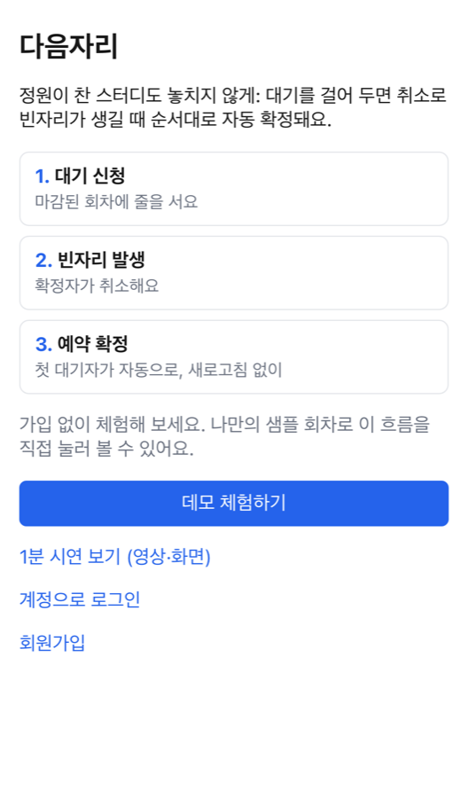
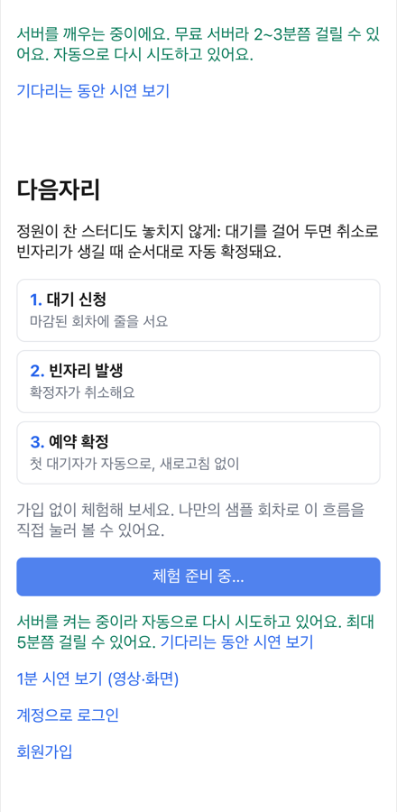

# 실시간 예약 대기열

**다음자리** — 오프라인 개발 스터디 회차 예약·취소 대기 서비스.

정원이 찬 회차에 대기를 걸어 두면, 확정자가 취소해 빈자리가 생기는 순간 **대기 순서대로 자동 확정**되고 화면은 새로고침 없이 바뀐다.

| | |
|---|---|
| 공개 서비스 | https://waiting-mauve.vercel.app (가입 없이 `데모 체험하기`) |
| 시연 자료 | [/tour](https://waiting-mauve.vercel.app/tour) — 34초 영상 + 단계별 화면. 백엔드 응답 없이 열리고, 서버 기동 안내에서 새 탭으로 연결된다 (영상 [`demo-flow.mp4`](frontend/public/tour/demo-flow.mp4) H.264 · [`demo-flow.webm`](frontend/public/tour/demo-flow.webm) 원본) |
| 실행 | 아래 [실행](#실행) (`docker compose up -d` → `./gradlew bootRun` → `npm run dev`) |
| 부하·정합성 검증 | [`loadtest/`](loadtest/README.md), 결과 [마지막 자리·취소/승격](loadtest/results/2026-11-21-local.md) · [정원 증설](loadtest/results/2026-11-21-local-capacity.md) (로컬) |
| 직무별 포트폴리오 | [프런트엔드](docs/portfolio/frontend.md) · [백엔드](docs/portfolio/backend.md) · [풀스택](docs/portfolio/fullstack.md) · [면접 답변 초안](docs/portfolio/interview.md) |
| 미검증·확인 대기 | [미검증 항목](#미검증확인-대기-항목) |
| 공개 배포 검증 | [공개 배포 검증 (2026-11-21)](#공개-배포-검증-2026-11-21) |

<p>
  
  
  
</p>

## 아키텍처

```
브라우저 ──HTTPS──▶ Vercel (Next.js, sin1)
                     ├─ 화면·정적 자산(/tour 시연 포함): 백엔드 없이 응답
                     └─ /api/* Route Handler 프록시
                          · 클라이언트 IP 를 X-Forwarded-For 로 다시 쓰고 공유 비밀 토큰을 붙인다
                          · 업스트림 85초 제한 → 503 + Retry-After (Vercel 504 대신)
                          ▼
                   Render Free (Spring Boot 4, Singapore) ── 토큰 없는 직접 호출은 403
                          ▼
                   Neon Free (PostgreSQL 16) ── 예약·대기·세션(Spring Session JDBC)
```

쿠키(`JSESSIONID`, `XSRF-TOKEN`)는 모두 프런트 주소의 같은 출처 쿠키다. 무료 백엔드는 15분 무요청 시 잠들고, 브라우저는 502/503/504 를 받으면 "서버를 깨우는 중" 안내와 함께 최대 5분 자동 재시도한다.

## 핵심 검증 결과

| 무엇을 | 결과 | 환경 · 근거 |
|---|---|---|
| 마지막 자리 동시 예약 (정원 1, N=10·50·100·200·400) | 모든 단계 확정 정확히 1건, 나머지 `409 SESSION_FULL`, 예상 못한 오류 0. N=400: 460ms, 870 req/s, p95 429ms | 로컬 실제 PostgreSQL · [결과](loadtest/results/2026-11-21-local.md) |
| 취소·승격 혼합 (확정자 5명 취소 + 신규 예약·대기 동시) | 먼저 대기한 5명이 id 순서대로 승격, 신규 예약은 모두 409, 오류 0. N=400 대기 + 205건 혼합: p95 303ms | 로컬 실제 PostgreSQL · [결과](loadtest/results/2026-11-21-local.md) |
| 정원 증설 동시 (정원 1 + 대기 N, 증설 1→6·축소·취소·신규 요청 혼합) | 모든 단계 최종 정원 6, 확정 = 대기 순번 1~6, 신규 예약 409, 축소는 순서에 따라 200/`409 CAPACITY_BELOW_CONFIRMED`, 오류 0. N=400: C2 203건 p95 288ms | 로컬 실제 PostgreSQL · [결과](loadtest/results/2026-11-21-local-capacity.md) |
| SQL 정합성 (정원 초과·활성 중복·대기 추월·승격 누락) | 4종 모두 0행. 검사식은 일부러 만든 위반을 각각 검출함(셀프테스트) | [`checks.sql`](loadtest/checks.sql) |
| 공개 서비스 정상 흐름 (데모 3회 순차 + 동시 3건, 21요청) | 3회 모두 `대기 신청 → 샘플 취소 → 확정`, 상태 200·201 만, p50 221ms · p95 514ms · max 637ms (웜) | 공개 배포 2026-11-21 10:46 UTC · [결과](loadtest/results/2026-11-21-public-smoke.txt) |
| 절전 후 첫 체험 시작 | 클릭 → 체험 화면 **170.9초 (2분 51초)**, 버튼은 1.6초에 노출, 안내 4.7초, 중복 요청 0 | 공개 배포 · [측정 조건과 한계](#절전-후-첫-접속-2026-11-21-0420-utc) |
| 자동 테스트 | 백엔드 JUnit(Testcontainers PostgreSQL), 프런트 e2e(Playwright, 실제 백엔드), 프록시 단위(node:test) | 아래 [실행](#실행) |

### 실행 환경

- **로컬 부하:** Apple M4 Pro(12코어, 24GB), macOS 27.2, JDK 17.0.13(Zulu), Spring Boot 4.1.2 local 프로필, Hikari 기본 풀 10, PostgreSQL 16.16(docker 27.3.1, Docker Desktop 12 CPU·8GB), Node 23.7.0. 부하 발생기·서버·DB 가 한 기기에 있다.
- **공개 배포:** Vercel Hobby(Function 리전 sin1) → Render Free(Singapore) → Neon Free(Singapore). 측정은 서울의 Mac 에서 했다.

## 기술 설명: 문제 → 방식 → 확인한 테스트

| 주제 | 해결한 문제 | 방식 | 확인한 테스트 |
|---|---|---|---|
| 회차 행 잠금 | 마지막 자리에 동시에 예약하면 정원을 넘길 수 있다 | 예약·대기·취소가 회차 행을 `SELECT … FOR UPDATE` 로 잠근 뒤 같은 트랜잭션에서 잔여석·대기열을 판단. 같은 회차는 직렬화, 다른 회차는 서로 막지 않음. 활성 신청은 부분 unique 인덱스로 한 건 | [`ReservationConcurrencyTests`](backend/src/test/java/com/daumjari/ReservationConcurrencyTests.java), [`CapacityConcurrencyTests`](backend/src/test/java/com/daumjari/CapacityConcurrencyTests.java), [`SchemaConstraintTests`](backend/src/test/java/com/daumjari/SchemaConstraintTests.java), 부하 시나리오 A |
| 취소·승격 트랜잭션 | 취소와 승격 사이에 신규 예약이 끼면 대기자가 밀린다. 승격만 실패하면 좌석이 사라진다 | 취소와 첫 대기자(id 순) 승격을 같은 트랜잭션·같은 회차 잠금 아래에서 처리(`WaitlistPromoter` 는 `MANDATORY`). 대기자가 있으면 빈자리가 보여도 신규 예약은 409. 실패하면 취소까지 롤백. 탈퇴도 같은 규칙(계정 → 회차 순 잠금) | [`PromotionRollbackTests`](backend/src/test/java/com/daumjari/PromotionRollbackTests.java), [`WaitlistConcurrencyTests`](backend/src/test/java/com/daumjari/WaitlistConcurrencyTests.java), [`WaitlistApiTests`](backend/src/test/java/com/daumjari/WaitlistApiTests.java), [`WithdrawalConcurrencyTests`](backend/src/test/java/com/daumjari/WithdrawalConcurrencyTests.java), 부하 시나리오 B·SQL ③④ |
| 5초 폴링 | 다른 사람의 취소로 내가 확정돼도 화면이 그대로다 | 상세 화면이 보이고 온라인일 때만 5초마다 조회, 탭 복귀(`visibilitychange`)·네트워크 복구(`online`) 때 즉시 조회, 늦게 온 옛 응답은 버림. 숨긴 탭은 요청 0 | [`auto-refresh.spec.ts`](frontend/e2e/auto-refresh.spec.ts) (반영 4.8초, 탭 복귀 28ms, [측정](#회차-상세-자동-갱신)) |
| 방문자별 데모 격리 | 가입 없는 공개 체험이 서로의 데이터를 보거나 바꾸면 안 된다 | 체험마다 방문자·샘플 계정·회차를 `demo_trial_id` 로 묶고, 회차는 같은 체험 계정에게만 보임(아니면 404). 샘플 취소는 파라미터 없이 세션의 체험에서 대상을 찾음. 30분 뒤 통째로 정리 | [`DemoApiTests`](backend/src/test/java/com/daumjari/DemoApiTests.java), [`demo.spec.ts`](frontend/e2e/demo.spec.ts) (두 브라우저 격리) |
| 프록시 전달 헤더 | 프록시 뒤에서는 모든 요청이 프록시 IP 로 보여 IP 제한이 무의미하고, 클라이언트가 `X-Forwarded-For` 를 위조할 수 있다 | 프런트(Vercel·`server.mjs`)가 클라이언트가 보낸 전달 헤더를 버리고 실제 접속 주소로 다시 씀. 백엔드는 공유 비밀 토큰이 맞을 때만 그 IP 를 믿고(토큰 없는 직접 호출 403), 로컬은 loopback 프록시만 신뢰 | [`ProxyTokenTests`](backend/src/test/java/com/daumjari/ProxyTokenTests.java), [`ForwardedHeaderTrustTests`](backend/src/test/java/com/daumjari/ForwardedHeaderTrustTests.java), [`proxy.test.mjs`](frontend/test/proxy.test.mjs), 공개 배포 IP 집계 실측(모바일 데이터 vs Mac) |
| 로그인 제한 | 비밀번호 대입을 막되, 남의 아이디로 일부러 틀려 그 사람을 잠그게 하면 안 된다 | (아이디+IP) 15분 5회, IP 15분 50회. 비밀번호 확인 전에 PostgreSQL upsert 로 원자적으로 셈. 탈퇴 비밀번호 재확인도 같이 셈. 가입·데모 시작도 IP 한도 | [`LoginThrottleApiTests`](backend/src/test/java/com/daumjari/LoginThrottleApiTests.java), [`LoginThrottleConcurrencyTests`](backend/src/test/java/com/daumjari/LoginThrottleConcurrencyTests.java) (동시 10건 → 정확히 5건만 인증까지), [`login-throttle.spec.ts`](frontend/e2e/login-throttle.spec.ts) |

### 절전 후 체험 시작 2분 51초: 조건과 한계

- **조건:** 2026-11-21 04:20 UTC, 공개 사이트에 약 55분 요청 없음, Playwright 새 컨텍스트(저장 상태 없음), 데스크톱 1280x800, 배포 커밋 `4ed83a75`(앱 코드 `5489d26c`). Vercel Hobby sin1 → Render Free Singapore → Neon Free Singapore.
- **결과:** 버튼 1.6초 노출 → 클릭 → 첫 `/api` 응답이 87.3초에 503(프록시가 85초에 끊음) → 5초 뒤 자동 재시도 → 체험 화면까지 **170.9초**. 상세는 아래 [절전 후 첫 접속](#절전-후-첫-접속-2026-11-21-0420-utc).
- **한계:** 대부분이 Render Free 인스턴스 기동 시간이라 앱 코드로 줄일 수 없고, 날·시간대·Render 상태에 따라 달라진다 (2026-11-20 측정 약 2분 40초~2분 52초, 한 번씩만 잼). 브라우저 자동 재시도 상한은 5분이라 그보다 오래 걸리면 `다시 시도하기` 로 돌아온다(시뮬레이션으로 확인). 기다리는 동안 볼 수 있게 `/tour` 를 연결했다.

## 구조

```
.
├── frontend/           # Next.js (App Router) + TypeScript + ESLint
├── backend/            # Java 17, Spring Boot 4.1, Gradle (Kotlin DSL)
│   └── src/main/resources/db/migration/   # Flyway 마이그레이션
├── docker-compose.yml  # 로컬 PostgreSQL 16
└── .env.example
```

## 사전 요구사항

- Node.js 20.9+ / npm
- JDK 17
- Docker (Docker Desktop) + Docker Compose v2

## 실행

```bash
# DB 기동 / 종료 (데이터는 볼륨 daumjari-pgdata 에 유지)
docker compose up -d
docker compose down
docker compose down -v   # 볼륨까지 삭제

# backend (http://localhost:8080, 헬스체크 /actuator/health)
cd backend
./gradlew bootRun
./gradlew test           # Testcontainers 사용: Docker 실행 중이어야 함 (없으면 스킵)
./gradlew build

# frontend (http://localhost:3000, /api 는 BACKEND_URL 로 프록시)
cd frontend
npm install
npm run dev                                   # node server.mjs --dev, BACKEND_URL 기본값 http://localhost:8080
BACKEND_URL=http://localhost:8080 npm run build && npm run start   # node server.mjs (전달 헤더 정리, 아래 "클라이언트 IP 판별")
npm run lint
npm test                                      # /api 프록시 단위 검증 (node:test)

# 브라우저 e2e (Playwright, 실제 백엔드 + 프런트 프로덕션 빌드)
docker compose up -d                          # 루트에서 먼저
cd frontend
npm run test:e2e                              # bootRun·next start 를 자동으로 띄움
```

### 로컬에서 화면 확인 순서

1. 루트: `docker compose up -d`
2. `backend`: `./gradlew bootRun` (local 프로필, 시드 계정 생성)
3. `frontend`: `npm install` 후 `npm run dev`
4. http://localhost:3000 → 시드 계정으로 로그인 (참가자 `alice`, 운영자 `operator`)

e2e 는 3000·8080 포트에 이미 뜬 서버가 있으면 그 서버를 재사용한다 (CI 환경변수가 있으면 새로 띄움). 개발 서버를 띄워 둔 채 최신 코드로 검증하려면 다른 포트를 쓴다:

```bash
E2E_PORT=3100 E2E_BACKEND_PORT=18080 npm run test:e2e
```

## 화면

| 경로 | 대상 | 내용 |
|---|---|---|
| `/login` | 모두 | 시드 계정 로그인. 성공 시 참가자 `/sessions`, 운영자 `/operator` |
| `/sessions` | 로그인 | 회차 목록, 잔여석·상태·내 예약 표시 |
| `/me/reservations` | 참가자(데모 방문자 포함) | 내 신청 모아보기: 확정·대기 신청을 시작 순으로, 회차명·시작·장소·상태(예약 확정 / 대기 N번)와 상세 링크. 신청이 없으면 회차 목록 안내. 상세와 같은 폴링(보이는 동안 5초, 탭 복귀·재연결 즉시). 운영자 메뉴에는 없음 |
| `/sessions/{id}` | 로그인 | 회차 상세, 예약하기·예약 취소, 마감 시 대기 신청·대기 순번·대기 취소. 요청 뒤 서버 상태를 다시 조회 |
| `/operator` | OPERATOR | 회차 등록(시작 일시는 서울 기준 입력), 회차 목록 |
| `/operator/sessions/{id}` | OPERATOR | 확정 명단, 정원·확정·대기 인원, 정원 변경(시작 전). 참가자가 직접 열면 서버 403 → 명단 없이 "권한이 없습니다." |

화면의 역할 분기는 표시용이고, 명단 비노출의 근거는 백엔드 403 이다 (e2e 에서 응답 코드까지 확인).

예약 안내 문구:

| 결과 | 안내 |
|---|---|
| 201 | 예약이 확정됐어요. |
| 200 (이미 활성 예약) | 이미 예약된 회차예요. 기존 예약을 보여드릴게요. |
| 409 `SESSION_FULL` | 정원이 마감됐어요. 다른 회차를 확인해 주세요. |
| 409 `SESSION_STARTED` | 이미 시작된 회차라 예약·취소할 수 없어요. |
| 대기 201 | 대기 N번으로 신청했어요. |
| 대기 200 (이미 대기 중) | 이미 대기 중이에요 (대기 N번). |
| 409 `SEATS_AVAILABLE` | 빈자리가 생겼어요. 대기 대신 바로 예약해 주세요. |

### 회차 상세 자동 갱신

- 화면이 보이고 온라인인 동안 `GET /api/sessions/{id}` 를 **5초**마다 조회한다 (`NEXT_PUBLIC_SESSION_POLL_MS`, 빌드 시점 값).
- 탭이 숨겨지거나(`visibilitychange`) 오프라인이 되면(`offline`) 폴링을 멈춘다. 탭으로 돌아오거나 네트워크가 복구되면(`online`) 즉시 한 번 조회하고 폴링을 다시 시작한다.
- 겹친 조회는 마지막에 시작한 것만 화면에 반영한다 (늦게 온 옛 응답이 새 상태를 덮지 않음). 첫 조회·복귀 조회도 같은 순번 검사를 거친다.
- **다른 화면에 갔다가 돌아올 때:** `cacheComponents` 는 떠난 화면을 상태째 숨겨 두고 다시 보일 때 효과만 다시 실행한다. 그래서 복귀 조회 응답 전에 숨기기 전 상태(예: 승격 전 `대기 1번`)가 보였다 (공개 배포 2026-11-21 실측 0.79초). 지금은 숨겨질 때 '확인 필요' 로 표시해 두고, 다시 보이면 즉시 한 번 조회하며 응답 전에는 "최신 상태 확인 중…" 과 함께 잔여석·상태·대기·내 예약을 `확인 중…` 으로 바꾸고 예약·취소·대기 버튼을 잠근다. 실패하면 오류와 "다시 시도". 내 신청 화면도 같다. 검증: [`detail-return.spec.ts`](frontend/e2e/detail-return.spec.ts) (응답 지연·실패/재시도·응답 순서 역전, 복귀 뒤 조회 1회).
- 대기 → 확정으로 바뀐 순간에만 `role="status"` 로 "대기 순번이 되어 예약이 확정됐어요." 를 한 번 안내한다. 폴링마다 반복하지 않는다.
- 조회 실패·오프라인은 오류 경고를 반복하지 않고 "연결이 끊겼어요…" 한 줄만 보여주며, 다음 성공 때 사라진다.

측정 (로컬, 실제 프런트·백엔드, Playwright 두 브라우저 컨텍스트, 각 10회):

| 경우 | 반영 시간 (최소 / 중앙 / 최대) |
|---|---|
| B 화면 취소 응답 → A 화면 "확정" (폴링) | 4799 / 4810 / 4822 ms |
| 탭 복귀 → 반영 | 25 / 28 / 30 ms |
| 네트워크 복구 → 반영 | 24 / 26.5 / 28 ms |

폴링 반영 시간은 이론상 0 ~ 5초 + 요청 왕복이다. 위 값이 4.8초 근처로 몰린 건 테스트 흐름상 취소가 늘 폴링 직후 같은 위치에 오기 때문이다.

2026-11-15 재측정 (폴링 간격 5000ms, B 취소 성공 응답 → A 화면 `확정`, A 는 새로고침·조작 없음):

| 회차 | 반영 시간 |
|---|---|
| 1 | 4813 ms |
| 2 | 4813 ms |
| 3 | 4810 ms |

실행 환경: Apple M4 Pro (Mac16,8, 12코어, 24GB), macOS 27.2, Node 23.7.0, OpenJDK 17.0.13 (Zulu), Playwright 1.64.1 / Chromium 156.0.8078.4 (headless), Next 16.4.6 `next build && next start -p 3100`, Spring Boot `bootRun --server.port=18080` (local 프로필), PostgreSQL 16.16 (docker compose). A·B 는 서로 다른 Chromium 프로세스(브라우저 인스턴스)로 각자 로그인했다.

```bash
cd frontend
E2E_PORT=3100 E2E_BACKEND_PORT=18080 npx playwright test e2e/auto-refresh.spec.ts --grep "새로고침 없이" --repeat-each=3
```

부하 메모: 상세 화면 1개당 5초에 요청 1번(초당 0.2건), 요청 1번에 SQL 약 4~5개(회차, 확정 수, 대기 수, 내 신청, 내 순번). 동시에 상세를 보고 있는 사람이 N명이면 약 0.2 × N 건/초 (100명이면 초당 20건). 숨긴 탭과 오프라인 탭은 0건이다.

결과는 `role="status"`, 오류는 `role="alert"` 로 보조 기술에 전달한다.

DB 접속 기본값: `localhost:5432`, DB/계정/비밀번호 모두 `daumjari` (로컬 전용). `.env` 로 바꿀 수 있다.
시각은 UTC로 저장한다 (Hibernate `jdbc.time_zone=UTC`, 시각 컬럼은 `timestamptz` 예정).

## 시드 계정

`./gradlew bootRun` 은 기본으로 `local` 프로필로 뜨고, DB에 계정이 하나도 없을 때만 아래 시드를 넣는다 (로컬 전용, 다른 프로필에서는 동작하지 않음). 초기화하려면 `docker compose down -v` 후 다시 기동한다.

| 아이디 | 비밀번호 | 역할 | 이름 |
|---|---|---|---|
| `operator` | `daumjari-local-1!` | OPERATOR | 운영자 |
| `alice` | `daumjari-local-1!` | PARTICIPANT | 앨리스 |
| `bob` | `daumjari-local-1!` | PARTICIPANT | 밥 |
| `carol` | `daumjari-local-1!` | PARTICIPANT | 캐롤 |

| 회차 | 시작 (서울) | 정원 | 시드 확정 | 용도 |
|---|---|---|---|---|
| Spring 트랜잭션 스터디 | 시드 시점 +7일 19:00 | 5 | alice | 빈자리 있는 회차 |
| PostgreSQL 잠금 스터디 | 시드 시점 +3일 19:00 | 2 | carol | 마지막 1석 회차 |

## 인증 (서버 세션)

시드 계정이나 직접 가입한 계정으로 로그인한다. 서버가 세션(`JSESSIONID`, HttpOnly, SameSite=Lax, 30분)에서 계정·역할을 확인하며, 요청 본문의 사용자 ID·역할은 신뢰하지 않는다.

| 메서드 | 경로 | 인증 | 설명 |
|---|---|---|---|
| GET | `/api/auth/csrf` | 불필요 | CSRF 토큰 발급 (`XSRF-TOKEN` 쿠키 + 본문 `{headerName, token}`) |
| POST | `/api/auth/login` | 불필요 | 본문 `{"loginId","password"}`, 성공 시 `{id, loginId, displayName, role}` |
| POST | `/api/auth/signup` | 불필요 | 본문 `{"loginId","password","passwordConfirm"}`, 201 `{id, loginId, role}`. 로그인은 하지 않는다 |
| POST | `/api/auth/logout` | 필요 | 세션 무효화, 204 |
| GET | `/api/auth/me` | 필요 | 현재 사용자 |
| POST | `/api/me/withdraw` | PARTICIPANT (데모 제외) | 본문 `{"password"}`, 204. 탈퇴 후 이 세션은 끝난다 (아래 "회원탈퇴 정책") |
| * | `/api/operator/**` | OPERATOR | 운영자 API (참가자는 403) |

### 회원가입 정책

- **역할:** 항상 `PARTICIPANT`. 요청에 `role` 이 있어도 무시한다. 운영자는 기존대로 부트스트랩으로만 만든다.
- **아이디:** 앞뒤 공백을 지우고 소문자로 바꾼 뒤 `^[a-z0-9_]{4,20}$`. 하이픈을 받지 않아 데모(`demo-…`)·탈퇴(`deleted-…`) 계정 아이디와 겹치지 않는다. 표시 이름은 아이디와 같다. 로그인 요청 검증(최대 50자)은 그대로다.
- **비밀번호:** 8자 이상, UTF-8 72바이트 이하(BCrypt 한도), 확인 칸 일치. 기존 `PasswordEncoder`(`{bcrypt}`)로 해시 저장.
- **유일성:** DB `account.login_id` unique 가 보장한다. 사전 조회(대소문자 무시)는 안내용이고, 동시 가입으로 제약 위반이 나도 같은 `409 LOGIN_ID_TAKEN` 으로 답한다 (같은 아이디 8개 동시 가입 → 201 하나, 나머지 409).
- **입력 오류:** `400 VALIDATION_FAILED` 와 칸별 안내 `fields` (`{"loginId": "...", "password": "...", "passwordConfirm": "..."}`). 화면도 같은 규칙으로 보내기 전에 검사한다.
- **남용 방지:** 같은 클라이언트 IP 의 가입 시도(성공·실패 무관)를 로그인 제한과 같은 창(15분)에 5회까지 (`daumjari.signup.max-per-ip`, `SIGNUP_MAX_PER_IP`). 넘으면 `429 TOO_MANY_ATTEMPTS` + `Retry-After`.

### 회원탈퇴 정책

| 항목 | 처리 |
|---|---|
| 확인 | 비밀번호 재입력. 틀리면 `400 PASSWORD_MISMATCH`. 재확인 시도도 로그인 시도 제한(아이디+IP 15분 5회)에 함께 센다 (훔친 세션으로 비밀번호 대입 방지) |
| 계정 행 | 지우지 않는다 (신청 FK·시작된 회차 기록). `login_id` → `deleted-{id}`, 이름 → `탈퇴한 회원`, 비밀번호 해시 → 매칭 불가 값, `deleted_at` 기록 (V7) |
| 시작 전 회차 | 확정 예약 취소 → 기존 승격 로직으로 첫 대기자 확정. 대기 신청 취소 |
| 시작된 회차 | 확정 기록은 참가 기록으로 남고 운영자 명단에 `탈퇴한 회원` 으로 보인다. 남은 대기는 취소 |
| 같은 아이디 재가입 | 즉시 가능 (원래 아이디가 풀린다). 새 계정이라 예전 기록과 연결되지 않는다 |
| 운영자·데모 계정 | `403 WITHDRAWAL_NOT_ALLOWED`. 운영자는 운영을 이어가야 하고, 데모 계정은 만료되면 통째로 정리된다. 화면에 메뉴도 없다 |
| 로그인·세션 | 탈퇴한 계정은 로그인 불가. 탈퇴한 세션은 즉시 무효화하고, 같은 계정의 다른 기기 세션은 요청마다 계정 상태를 확인하는 필터가 무효화해 `401 UNAUTHENTICATED` (메모리·JDBC 세션 저장소 공통) |
| 일관성 | 한 트랜잭션: 계정 행 `FOR UPDATE` → 활성 신청이 있는 회차를 id 순으로 `FOR UPDATE` → 정리 → 익명화. 중간 실패는 전부 롤백. 예약·대기는 계정 행을 `FOR SHARE` 로 먼저 잠가(잠금 순서 계정 → 회차) 탈퇴와 겹치면 탈퇴 뒤 `401` 이 된다. 탈퇴와 예약 동시 요청 20회 반복에서 탈퇴된 계정의 활성 신청 0건 |

## 회차 API

시각은 ISO-8601 UTC(`2026-11-22T10:00:00Z`)로 주고받는다. 화면에서 서울 시간으로 바꿔 표시한다.

| 메서드 | 경로 | 권한 | 설명 |
|---|---|---|---|
| GET | `/api/sessions` | 로그인 | 회차 목록 (시작 시각순) |
| GET | `/api/sessions/{id}` | 로그인 | 회차 상세 |
| POST | `/api/operator/sessions` | OPERATOR | 회차 등록 `{title, startsAt, location, capacity}`, 201 |
| GET | `/api/operator/sessions/{id}/roster` | OPERATOR | 확정 명단 `[{reservationId, accountId, loginId, displayName, reservedAt}]` |
| PATCH | `/api/operator/sessions/{id}/capacity` | OPERATOR | 정원 변경 `{capacity}` (1~1000 정수). 응답 `{session, promotedCount}` — 변경 후 회차와 늘어난 자리로 확정된 대기 인원 |

회차 응답: `{id, title, startsAt, location, capacity, confirmedCount, remainingSeats, waitingCount, status, myReservation}`

- `status`: `OPEN`(예약 가능) · `FULL`(잔여석 0) · `STARTED`(시작 시각 이후, 예약·취소 불가)
- `status` 는 대기자가 있으면 빈자리가 보여도 `FULL` 이다 (대기자 우선).
- `waitingCount`: 대기 인원.
- `myReservation`: 조회한 본인의 활성 신청 `{id, status, waitingPosition}`, 없으면 `null`. `waitingPosition` 은 `WAITING` 일 때만 1부터. 다른 참가자 정보는 포함하지 않는다.
- 등록 시 `capacity` 는 1~1000, `startsAt` 은 현재 이후여야 한다 (아니면 400 `VALIDATION_FAILED`).

## 예약 API (PARTICIPANT 전용)

대상 계정은 항상 세션 사용자다. 운영자 계정은 403 `FORBIDDEN`.

| 메서드 | 경로 | 설명 |
|---|---|---|
| POST | `/api/sessions/{id}/reservations` | 예약. 새로 확정하면 201, 이미 활성 신청이 있으면 그 신청을 200 으로 반환 |
| POST | `/api/reservations/{id}/cancel` | 본인 예약 취소. 이미 취소된 건이면 변경 없이 200 |
| GET | `/api/me/reservations` | 내 신청 목록 (최근순, 취소 포함). 세션 계정 기준이라 경로에 사용자 id 를 받지 않는다. 항목: 회차 id·제목·시작·장소, 상태, 대기 순번(대기일 때만). 데모 방문자는 자기 체험만, 체험 만료 뒤 410 |

| POST | `/api/sessions/{id}/waitlist` | 마감 회차 대기 신청. 새로 대기하면 201, 이미 활성 신청(확정·대기)이 있으면 그 신청을 200. 빈자리가 있으면 409 `SEATS_AVAILABLE` |

예약 응답: `{id, sessionId, sessionTitle, startsAt, status, waitingPosition, createdAt, cancelledAt}` (`status`: `CONFIRMED`·`WAITING`·`CANCELLED`, `waitingPosition` 은 대기일 때만)

- 예약 API(`/reservations`)의 계약은 그대로다. 마감이면 409 `SESSION_FULL` 을 주고, 대기는 별도 API 로 명시적으로 신청한다. 사용자가 원하지 않는 대기에 자동으로 들어가지 않게 하고, 기존 화면·테스트의 `SESSION_FULL` 처리와 충돌하지 않게 하려는 선택이다.
- 대기 취소도 `POST /api/reservations/{id}/cancel` 을 쓴다.

## 로그인 시도 제한

| 항목 | 기본값 | 설정 (환경변수) |
|---|---|---|
| 같은 아이디 + 같은 클라이언트 IP | 15분 창에 5회 | `daumjari.login-throttle.max-per-account-ip` (`LOGIN_MAX_PER_ACCOUNT_IP`) |
| 같은 클라이언트 IP (아이디 무관 실패) | 15분 창에 50회 | `daumjari.login-throttle.max-per-ip` (`LOGIN_MAX_PER_IP`) |
| 창 | 15분 (고정 창, 첫 시도부터) | `daumjari.login-throttle.window` (`LOGIN_THROTTLE_WINDOW`) |

- **응답:** 한도 안에서는 기존과 같은 401 `INVALID_CREDENTIALS`. 한도를 넘으면 429 `TOO_MANY_ATTEMPTS` 와 `Retry-After`(창이 끝날 때까지 남은 초). 제한 중에는 올바른 비밀번호여도 비밀번호를 확인하기 전에 429 다.
- **존재하지 않는 아이디:** 같은 키 규칙·같은 401·같은 429 본문. 계정 존재 여부를 드러내지 않는다.
- **키 설계:** 계정 단독으로 잠그지 않는다. 계정만으로 세면 누구나 남의 아이디로 5번 틀려 그 사람을 막을 수 있기 때문이다. 대신 (정규화한 아이디 + 클라이언트 IP) 로 세서 다른 곳의 정상 사용자는 영향이 없고, IP 단독 상한(50)으로 한 IP 가 아이디를 바꿔 가며 대는 시도를 늦춘다.
- **성공 시:** 그 (아이디+IP) 카운터를 지우고, IP 카운터에서는 성공한 시도 1회만 뺀다 (IP 카운터는 실패만 남는다).
- **집계 방식:** 시도를 비밀번호 확인 전에 PostgreSQL `INSERT ... ON CONFLICT DO UPDATE` 로 원자적으로 센다. 동시에 실패 요청이 몰려도 누락되거나 한도를 넘겨 통과하지 않는다 (10개 동시 요청 → 정확히 5개만 401, 5개 429). 키는 원문 대신 SHA-256 으로 저장한다 (아이디 칸에 비밀번호를 잘못 넣는 경우 대비).
- **근거:** OWASP Authentication Cheat Sheet 와 NIST SP 800-63B 는 온라인 추측 공격에 시도 제한을 두되, 계정 잠금이 서비스 거부로 악용되지 않게 하라고 권한다. 5회/15분은 사람이 비밀번호를 몇 번 틀리는 경우는 막지 않으면서 자동 대입을 하루 수백 회 수준으로 줄이는 값으로 골랐다.
- **재시작·다중 인스턴스:** 집계가 DB 테이블(`login_attempt`, V4)에 있으므로 백엔드를 재시작해도 유지되고, 같은 DB 를 쓰는 여러 인스턴스가 함께 센다. 창이 지난 행은 10분마다 지운다 (여러 인스턴스가 같이 지워도 결과는 같음).
- **알려진 한계:** 고정 창이라 창 경계 앞뒤로 최대 2배까지 몰아서 시도할 수 있다. 여러 IP 에서 한 계정을 나눠 대는 분산 시도는 (아이디+IP) 키만으로는 막지 못한다 (후속 작업).

## 클라이언트 IP 판별

제한 키의 IP 는 백엔드 `HttpServletRequest#getRemoteAddr()` 이고, Tomcat RemoteIpValve(`server.forward-headers-strategy: native`)가 정한다. **접속한 쪽이 신뢰 프록시일 때만** `X-Forwarded-For` 를 오른쪽부터 읽어 신뢰 프록시가 아닌 첫 주소를 클라이언트 IP 로 쓴다. 그 밖에는 실제 접속 주소다.

Next `/api` 프록시 실측 (Next 16.4.6, 에코 서버로 캡처):

| 브라우저가 보낸 헤더 | `next start` 그대로일 때 백엔드가 받은 XFF | `server.mjs` 를 거칠 때 |
|---|---|---|
| 없음 | 없음 (접속 주소만 `::1`) | `::1` (실제 접속 주소) |
| `X-Forwarded-For: 6.6.6.6` | `6.6.6.6` (그대로 통과) | `::1` |
| `X-Forwarded-For: 1.1.1.1, 2.2.2.2`, `Forwarded: for=9.9.9.9` | 둘 다 그대로 통과 | `::1`, `Forwarded`·`X-Forwarded-Proto` 제거 |

Next rewrite 프록시는 XFF 를 붙이지 않고 클라이언트 값을 그대로 넘긴다. 그래서 `frontend/server.mjs` 로 Next 를 감싸 클라이언트가 보낸 전달 헤더를 버리고 실제 접속 주소로 다시 쓴다 (`npm run dev`·`npm run start` 가 이 서버를 쓴다). `next dev`·`next start` 를 직접 실행하면 이 보호가 빠진다.

| 환경 | 프런트 (`server.mjs`) | 백엔드 (`TRUSTED_PROXIES`, Tomcat internal-proxies) |
|---|---|---|
| 로컬 (브라우저 → Next → 백엔드, 모두 localhost) | `FRONT_TRUSTED_PROXIES` 비움: XFF = 실제 접속 주소 | 기본값 loopback(`127.0.0.1`, `::1`)만 신뢰 → Next 가 넘긴 XFF 사용 |
| 배포 (LB → Next → 백엔드) | `FRONT_TRUSTED_PROXIES` = LB 주소: LB 가 붙인 XFF 의 맨 오른쪽 비신뢰 값 사용 | `TRUSTED_PROXIES` = Next 서버 주소만 (정규식). 백엔드는 공개 인터넷에서 직접 닿지 않게 둔다 |

백엔드에 직접 접속한 클라이언트(신뢰 프록시가 아님)가 보낸 `X-Forwarded-For` 는 무시된다 (`ForwardedHeaderTrustTests`). e2e 는 제한 창을 10초로 줄여 띄운다 (`E2E_THROTTLE_WINDOW_SECONDS`).

## CSRF 정책

- 쿠키 이중 제출 방식. 서버가 `XSRF-TOKEN` 쿠키(JS에서 읽기 가능)를 내려주고, 상태 변경 요청(POST/PUT/PATCH/DELETE)은 같은 값을 `X-XSRF-TOKEN` 헤더로 보내야 한다. 로그인 요청도 포함.
- 프런트 흐름: `GET /api/auth/csrf` → 로그인 → 로그인 응답이 토큰 쿠키를 만료시키므로 다음 상태 변경 전에 다시 `GET /api/auth/csrf`.
- 로그인 시 세션 ID를 교체한다(세션 고정 방지).
- 쿠키를 같은 출처로 쓰기 위해 프런트는 Next rewrites 로 `/api/*` 를 `BACKEND_URL` 로 프록시한다 (`frontend/next.config.ts`). 브라우저는 백엔드 주소를 직접 부르지 않으므로 CORS 설정이 필요 없다.

## API 오류 규칙

오류 응답 본문은 항상 `{"code": "...", "message": "..."}` 이다. 화면은 `code` 로 분기하고 `message` 는 표시용이다.

| HTTP | code | 상황 |
|---|---|---|
| 400 | `VALIDATION_FAILED` | 요청 형식·값 오류 (가입은 칸별 `fields` 포함) |
| 409 | `LOGIN_ID_TAKEN` | 이미 사용 중인 아이디 (가입) |
| 400 | `PASSWORD_MISMATCH` | 탈퇴 비밀번호 재확인 실패 |
| 403 | `WITHDRAWAL_NOT_ALLOWED` | 운영자·데모 계정의 탈퇴 |
| 401 | `UNAUTHENTICATED` | 로그인 필요 (세션 없음·만료) |
| 401 | `INVALID_CREDENTIALS` | 아이디 또는 비밀번호 불일치 (계정 존재 여부는 구분하지 않음) |
| 403 | `FORBIDDEN` | 권한 없음 (참가자의 운영자 API 접근 등) |
| 403 | `CSRF_INVALID` | CSRF 토큰 누락·불일치 |
| 429 | `TOO_MANY_ATTEMPTS` | 로그인·가입·데모 시작 시도 제한. `Retry-After`(초) 헤더와 본문 `retryAfterSeconds` (아래 "로그인 시도 제한") |
| 404 | `SESSION_NOT_FOUND` | 회차 없음 |
| 404 | `RESERVATION_NOT_FOUND` | 예약 없음, 또는 다른 사람의 예약 (존재 여부를 구분하지 않음) |
| 409 | `SESSION_FULL` | 정원 마감 |
| 409 | `SESSION_STARTED` | 회차 시작 시각 이후의 예약·대기·취소 |
| 409 | `SEATS_AVAILABLE` | 빈자리가 있는 회차에 대기 신청 (바로 예약하면 됨) |
| 409 | `CAPACITY_BELOW_CONFIRMED` | 현재 확정 인원보다 적게 정원 변경 |
| 404 | `DEMO_NOT_FOUND` | 데모 체험이 없는 계정의 샘플 취소 |
| 410 | `DEMO_EXPIRED` | 데모 체험 시간이 지난 방문자의 요청 |

정원 변경의 `VALIDATION_FAILED` 는 0·음수·1000 초과·소수(`2.5`)·문자·`null` 을 모두 포함한다. 정수 필드에 소수가 와도 잘라 받지 않는다 (`spring.jackson.deserialization.accept-float-as-int: false`). 시작 시각 이후 변경은 `SESSION_STARTED`, 참가자 요청은 `FORBIDDEN` 이며, 거절되면 정원과 신청 상태는 바뀌지 않는다.

## 마감 정책

- **시작 시각 기준 마감:** 회차 `startsAt` 이 되는 순간부터(`now >= startsAt`) 예약과 취소를 모두 거절한다 (409 `SESSION_STARTED`). 시각 비교는 서버 UTC `Clock` 기준.
- **정원:** 확정(`CONFIRMED`) 수가 정원과 같으면 새 예약은 409 `SESSION_FULL`. 잔여석 = 정원 − 확정 수로 매번 계산하므로 취소를 반복해도 좌석은 한 번만 돌아온다.
- **1인 1건:** 회차·계정별 활성 신청(확정·대기)은 하나. 중복 요청은 기존 신청을 돌려주고, DB 부분 유니크 인덱스가 한 번 더 막는다. 취소 후 시작 전이고 자리가 있으면 다시 예약할 수 있다 (새 신청 행 생성).
- **대기 순번:** 저장하지 않고 같은 회차 `WAITING` 행 중 id 가 더 작은 수 + 1 로 계산한다. 신청은 회차 행 잠금 아래 하나씩 들어오므로 id 순서가 곧 신청 순서다 (같은 시각이어도 순서가 갈림). 대기를 취소하고 다시 신청하면 새 행이라 맨 뒤로 간다.
- **자동 승격:** 확정자가 취소하면 같은 트랜잭션·같은 회차 잠금 아래에서 가장 앞 대기자를 확정한다. 승격이 실패하면 취소도 함께 롤백된다. 대기 취소나 이미 취소된 건의 재취소는 승격하지 않는다. 시작 시각 이후에는 취소·승격 모두 일어나지 않는다.
- **대기자 우선:** 대기자가 있으면 빈자리가 보여도 새 예약은 409 `SESSION_FULL` 이고 대기로만 들어올 수 있다.
- **정원 변경:** 시작 전에만, 운영자만, 현재 확정 인원 이상으로만 바꿀 수 있다. 회차 행 잠금 아래 한 트랜잭션에서 정원을 바꾸고, 늘어난 자리만큼 기존 승격 로직(`WaitlistPromoter`)을 대기 순서대로 반복해 확정한다. 예: 정원 3·확정 3·대기 3 에서 5 로 늘리면 대기 1·2번 확정, 3번은 대기 1번. 대기자를 모두 확정하고도 자리가 남으면 일반 예약이 열린다(`OPEN`). 승격 중 실패하면 정원 변경과 앞선 승격이 함께 롤백된다. 줄일 때 대기자는 그대로 둔다.
- **동시성:** 예약·대기·취소는 회차 행을 `SELECT ... FOR UPDATE` 로 잠근 트랜잭션 안에서 잔여석·대기열 판단과 상태 변경을 함께 한다. 잠금 순서는 회차 → 신청.


## 공개 데모 (가입 없는 체험)

| 단계 | 경로 |
|---|---|
| 첫 화면 | `/` (비로그인) → `데모 체험하기`. `/login` 에도 같은 버튼 |
| 체험 시작 | `POST /api/demo/start` (CSRF 필요, 로그인 불필요) → 201 `{sessionId, expiresAt}`, 방문자 세션 발급 → `/sessions/{sessionId}` |
| 대기 | 체험 회차 상세에서 `대기 신청` → `대기 1번` |
| 샘플 취소 | `샘플 참가자 취소` → `POST /api/demo/sample-cancel` → 기존 취소·승격 로직 → 새로고침 없이 `예약 확정` |
| 다시 체험 | `처음부터 다시 체험` 또는 첫 화면 버튼 → 새 체험 (세션 ID 재발급, 이전 체험은 만료 때 삭제) |

- **체험 하나:** `demo_trial` 행, 방문자 계정, 샘플 참가자 계정 2개, 정원 2 체험 회차(샘플 2명 확정, 시작은 7일 뒤), 지정 샘플 예약 1건. 체험에 속한 계정·회차는 `demo_trial_id` 로 묶인다.
- **격리 (서버 강제):** 회차는 `demo_trial_id` 가 같은 계정에게만 보인다. 일반 계정은 일반 회차만, 방문자는 자기 체험 회차만 목록·상세·예약·대기할 수 있고, 아니면 404 (존재 비노출). 남의 예약 취소는 기존대로 404. 샘플 취소는 파라미터를 받지 않고 세션의 체험에서 지정 샘플을 찾으므로 다른 체험을 가리킬 수 없다 (일반 계정은 404 `DEMO_NOT_FOUND`). 운영자 목록·명단·정원 변경에서 체험 회차는 보이지 않고(404), 방문자는 운영자 API 에 403. 데모 계정은 비밀번호 로그인이 막혀 있다.
- **만료·정리:** 기본 30분(`DEMO_TTL`). 지나면 방문자의 API 요청은 410 `DEMO_EXPIRED`(체험 시작·인증 API 제외)이고 화면은 새 체험 시작 버튼을 보여준다. 10분마다 만료 체험의 예약 → 회차 → 계정 → 체험 순으로 지운다 (여러 인스턴스가 함께 돌아도 결과가 같다).
- **남용 제한:** 체험 시작은 클라이언트 IP 당 15분에 10회 (`DEMO_MAX_STARTS_PER_IP`, 로그인 제한과 같은 집계·IP 판별). 넘으면 429 와 남은 시간 안내.

## 배포 (무료 구성, 월 0원)

아직 배포하지 않았다 (계정 생성·결제수단 등록 없음). 아래는 무료 구성 기준 설정과 절차다.

| 역할 | 서비스 | 무료 조건 (2026-11-18 공식 문서 확인) |
|---|---|---|
| 프런트 (공개 HTTPS 주소) | Vercel Hobby (`*.vercel.app`) | 무료·결제 주기 없음. 월 Fast Data Transfer 100GB, Function 호출 100만, Active CPU 4시간. 초과 시 과금 없이 30일 사용 중지. Function 최대 300초 (`/api` Route Handler `maxDuration` 90초). 절전 없음 |
| 백엔드 | Render Free web service (Docker) | 워크스페이스당 월 750 인스턴스 시간(1개 상시 실행 가능). 15분 무요청 시 절전, 깨는 데 1~3분 (2026-11-20 실측: 첫 요청부터 사용 가능까지 약 2분 40초~2분 52초). private service 없음 → 공개 주소. 트래픽·빌드 한도 수치는 대시보드에서 확인. 초과 시 결제수단이 없으면 그달 정지, 있으면 추가 과금 |
| DB | Neon Free (PostgreSQL) | $0, 만료·비활성 삭제 없음. 프로젝트당 저장 1GB, 월 100 CU-시간, 전송 5GB. 5분 무활동 시 절전(끌 수 없음). 복원 이력 6시간. CU·전송 초과 시 다음 달까지 정지, 저장 초과 시 쓰기 실패 (과금 없음, 데이터 유지) |

Render Free Postgres 는 30일 뒤 만료되어 쓰지 않는다. Render 에는 결제수단을 등록하지 않는다 (등록하면 한도 초과분이 과금되고, 미등록이면 정지만 된다).

구성: `브라우저 → Vercel(Next, /api Route Handler) → Render 백엔드(공개 주소지만 프록시 토큰 필요) → Neon`

- **백엔드 직접 호출 차단:** prod 프로필은 `/actuator/health` 외 모든 요청에 `X-Daumjari-Proxy-Token`(= `PROXY_SHARED_SECRET`)을 요구하고, 없거나 틀리면 403 `PROXY_REQUIRED` (상수 시간 비교).
- **방문자 IP:** Vercel 이 `x-forwarded-for` 를 자기가 본 주소로 덮어쓰고, Route Handler 가 그 첫 값을 `X-Daumjari-Client-IP` 로 넘긴다. 백엔드는 토큰이 맞을 때만 이 값을 쓰고 다른 전달 헤더는 보지 않는다 (`forward-headers-strategy: none`).
- **세션:** prod 는 Spring Session JDBC (`spring_session`, V6). 백엔드 절전·재시작 뒤에도 로그인·데모 세션이 남는다. 쿠키 `JSESSIONID`·`XSRF-TOKEN` 은 Secure, `JSESSIONID` 는 HttpOnly·SameSite=Lax, 도메인 미지정 (브라우저는 vercel.app 쿠키로만 본다).
- **시드:** `local` 프로필 전용이라 prod 에서는 만들어지지 않는다 (`ProdProfileTests`).
- **절전과 스케줄:** 만료 체험·로그인 집계·세션 정리는 백엔드가 깨어 있을 때만 돈다. 잠든 동안 쌓인 만료 행은 다음 기동 뒤 정리된다. DB 커넥션은 쉬는 것을 남기지 않아(`minimum-idle: 0`) Neon 이 절전할 수 있다.

### 환경변수

| 위치 | 변수 | 값 |
|---|---|---|
| Render | `SPRING_PROFILES_ACTIVE` | `prod` (Dockerfile 기본값) |
| Render | `DB_URL` | Neon direct(비 pooled) 연결 JDBC URL, `?sslmode=require` |
| Render | `DB_USERNAME`, `DB_PASSWORD` | Neon 역할 |
| Render | `PROXY_SHARED_SECRET` | 32자 이상 무작위, Vercel 과 같은 값 |
| Render | `BOOTSTRAP_OPERATOR_LOGIN_ID`, `BOOTSTRAP_OPERATOR_PASSWORD` | 첫 배포 때만 (아래 운영자 계정) |
| Render (선택) | `DEMO_TTL`, `DEMO_MAX_STARTS_PER_IP`, `LOGIN_*` | 기본 30m / 10 / 5·50·15m |
| Vercel | `BACKEND_URL` | `https://<render 서비스>.onrender.com` |
| Vercel | `PROXY_SHARED_SECRET` | Render 와 같은 값 |
| Vercel (선택) | `NEXT_PUBLIC_SESSION_POLL_MS` | 기본 5000 |

### 배포 순서

1. Neon: 프로젝트 생성 — PostgreSQL 16, 리전 AWS Asia Pacific (Singapore), Neon Auth 끔. Connect 에서 Connection pooling 을 끈 direct 연결 문자열을 쓴다 (Flyway 마이그레이션·Hikari 풀이 PgBouncer 를 거치지 않게, 풀은 최대 5개라 연결 수 여유 충분). Render·Vercel Function 리전도 Singapore 로 맞춘다.
2. Render: 저장소 연결 → `render.yaml` Blueprint (또는 `backend` 디렉터리 Docker web service, plan free, health check `/actuator/health`) → 위 환경변수. 첫 기동 때 Flyway 가 V1~V6 을 적용한다. 마이그레이션이 실패하면 앱이 뜨지 않고 이전 배포가 계속 서비스된다.
3. Vercel: 저장소 import, Root Directory `frontend`, 프레임워크 Next.js → 환경변수 → 배포. 기본 주소 `https://<프로젝트>.vercel.app` 이 포트폴리오 링크.

### 운영자 계정 생성

Render 에 `BOOTSTRAP_OPERATOR_LOGIN_ID`·`BOOTSTRAP_OPERATOR_PASSWORD`(12자 이상)를 넣고 재배포 → 로그 `operator bootstrap created account '<id>'` 확인 → 두 변수를 지우고 다시 배포. 이미 있는 아이디면 아무것도 바꾸지 않고, 비밀번호는 로그에 남지 않는다.

### 백업과 롤백

- **백업:** Neon Free 는 최근 시점 복원 범위가 짧다 (요금 페이지 확인). 배포 전마다 수동 덤프: `pg_dump "postgresql://<user>:<pw>@<host>/<db>?sslmode=require" -Fc -f daumjari-$(date +%F).dump`, 복원은 `pg_restore -d <url> --clean daumjari-YYYY-MM-DD.dump`.
- **롤백:** Vercel·Render 모두 대시보드에서 이전 배포로 되돌린다. Flyway 는 전진 전용이라, 새 마이그레이션이 들어간 배포를 되돌릴 때는 배포 전 덤프로 DB 를 복원한 뒤 이전 배포로 돌린다 (V1~V6 은 모두 추가형).

### 로컬에서 운영 이미지 확인 (VM 대안과 같은 구성)

```bash
cd deploy
DB_PASSWORD=... PROXY_SHARED_SECRET=... SESSION_COOKIE_SECURE=false WEB_PORT=3400 docker compose -f docker-compose.prod.yml up -d --build
```

2026-11-18 로컬 실측 (Apple M4 Pro, 백엔드 컨테이너 메모리 512MB 제한): 기동 3.2초, 데모 흐름 뒤 메모리 358MiB/512MiB, 토큰 없는 직접 호출 403·health 200, 백엔드 재시작(4초) 뒤 같은 쿠키로 세션 유지. Render Free 의 실제 기동 시간은 CPU 가 작아 이보다 길다 (배포 후 실측).

VM 대안 (월 약 $7~12, 예: Lightsail 1~2GB): 위 compose 앞에 Caddy 를 두면 Let's Encrypt HTTPS 가 붙지만 도메인(또는 sslip.io 같은 IP 기반 이름)이 필요하고, OS·백업을 직접 관리해야 한다.

### 배포 후 검증 체크리스트

- [ ] 모바일·시크릿 창: 첫 화면 → `데모 체험하기` → `대기 1번` → `샘플 참가자 취소` → 새로고침 없이 `예약 확정`
- [ ] 다른 기기(다른 방문자)의 체험이 그대로인지
- [ ] `JSESSIONID`·`XSRF-TOKEN` 이 Secure 이고 `JSESSIONID` 가 HttpOnly·SameSite=Lax 인지
- [ ] 방문자 IP 집계: 서로 다른 네트워크 두 기기에서 같은 아이디로 6번 틀리면 한쪽만 429 (Vercel 주소 하나로 모이지 않는지), 위조 `X-Forwarded-For` 를 붙여도 한도가 그대로인지
- [ ] 백엔드 직접 호출: `curl https://<render>.onrender.com/api/auth/csrf` → 403 `PROXY_REQUIRED`, `/actuator/health` → 200
- [ ] 콜드 스타트: 15분 이상 쉰 뒤 첫 화면에 `데모 체험하기`가 바로 보이는지, 누르면 "서버를 깨우는 중이에요" 안내가 뜨고 자동 재시도 끝에 체험 화면으로 들어가는지

콜드 스타트 처리: 백엔드가 깨는 동안 프록시는 `maxDuration`(90초)보다 5초 먼저 업스트림을 끊고 `503 BACKEND_UNAVAILABLE` + `Retry-After: 5` 로 답한다 (Vercel 504 대신). 브라우저는 502/503/504·연결 실패를 받으면 안내를 띄우고 `Retry-After`(없으면 5초) 간격으로 최대 5분까지 다시 보낸다 (실측 기동 약 2분 50초에 여유를 둔 값). 조회(GET)만 다시 보내고, 변경 요청은 데모 시작만 예외로 다시 보낸다: 두 번 처리돼 체험이 하나 더 생겨도 아무도 쓰지 않고 만료(30분) 뒤 정리 작업이 지우며, IP 한도(15분 10회)를 1회 더 쓸 뿐이다. 예약·대기·취소 같은 변경은 다시 보내지 않고 오류를 보여준다.

한계: 무료 백엔드는 절전 뒤 첫 요청이 1~3분 걸리고, 한 인스턴스라 재시작 중 짧게 끊길 수 있다. 무료 한도를 넘으면 서비스가 정지된다.

### 공개 배포 검증 (2026-11-21)

- **배포 커밋:** `5489d26c` (PR #17 병합: 데모 버튼 로딩 상태, 회원가입, 회원탈퇴). 프런트 반영 02:46 UTC, 백엔드 반영 02:48 UTC (가입 API 가 칸별 `fields` 로 응답, `ddl-auto: validate` 로 기동하므로 V7 적용).
- **URL:** https://waiting-mauve.vercel.app
- **방법:** Mac 에서 Playwright(Chromium)로 공개 URL 을 실제로 조작. 테스트 계정은 `qa_` 접두로 만들고 검증 뒤 모두 탈퇴. 운영자 비밀번호는 쓰지 않았다 (회차 20 은 사용자가 운영자 화면에서 만들고 정원을 1 로 바꿨다).

| 항목 | 결과 (UTC) |
|---|---|
| 데모 버튼, 데스크톱 키보드 | Space 직후 `체험 준비 중…`, `aria-busy=true`, 포커스 유지. Enter·Space 를 더 눌러도 `/api/demo/start` 1회. 체험 화면까지 7.4초 (02:49) |
| 데모 버튼, iPhone 13 | 탭 직후 `체험 준비 중…`, `aria-busy=true`. 다시 탭해도 요청 1회. 체험 화면까지 2.8초 |
| 데모 버튼, 절전 상태 | 아래 "절전 후 첫 접속" 참고 (04:20 UTC 실측, 클릭→체험 시작 170.9초) |
| 가입 칸별 오류 | 형식·8자 미만·확인 불일치가 보내기 전에 칸별로 표시, 가입 요청 0회 |
| 가입 → 로그인 | `qa_apt72g1` 가입 → 로그인 화면에 완료 안내·아이디 채움 → 로그인 → `/sessions` (7.6초) |
| 중복 아이디 | 409 → "이미 사용 중인 아이디예요" |
| 키보드만 가입 | `qa_kpt72g1` Tab·입력·Enter 로 가입 (1.6초) |
| 탈퇴 (브라우저 A·B 두 세션) | A 탈퇴 3.1초 → `/login?withdrawn=1` 완료 안내. A `/api/auth/me` 401, B 다음 요청 401 → `/sessions` 가 `/login` 으로 이동 |
| 탈퇴 후 재로그인·재가입 | 같은 아이디·비밀번호 로그인 401 `INVALID_CREDENTIALS`. 같은 아이디 재가입 후 로그인 성공 |
| 대기자 승격 (회차 20, 정원 1) | A 예약 201 확정 → B 대기 201 `대기 1번` → A 탈퇴 4.9초 뒤 B 화면이 새로고침·페이지 이동 없이 `예약 확정`. API: B 확정, 확정 1/1, 대기 0 (03:19) |
| 대기 취소 | C 대기 201 `대기 1번` → C 탈퇴 → 대기 1명 → 0명 |
| 정리 후 회차 20 | 참가자 화면(새 확인용 참가자 계정 `qa_vpuhzk5`, 확인 후 탈퇴)에서 확인: 모집 중(`OPEN`), 확정 0/1, 남은 1, 대기 0 (03:25:28, 참가자 화면이 쓰는 `GET /api/sessions/20` 응답) |
| 정리 후 테스트 계정 | `qa_apu9hsx`·`qa_bpu9hsx`·`qa_cpu9hsx` (03:25:25~26), `qa_apt72g1`·`qa_kpt72g1` (03:25:36) 모두 원래 비밀번호로 로그인 401 `INVALID_CREDENTIALS` (탈퇴로 아이디가 `deleted-{id}` 로 바뀜) |

운영자 화면(회차 20 명단·정원·탈퇴한 회원 표시)은 **미검증**이다 (운영자 비밀번호를 쓰지 않았다).

#### 절전 후 첫 접속 (2026-11-21 04:20 UTC)

- **배포:** 커밋 `4ed83a75` (PR #18 병합, 문서만 변경). 앱 코드는 `5489d26c` (PR #17) 와 같다.
- **절전 조건:** 마지막 공개 접속 03:25:36 UTC 뒤 약 55분 동안 요청 없음 (재배포는 03:28 병합이 마지막, 저장소에 cron·keep-alive 없음). 브라우저·스크립트·curl 모두 종료한 상태에서 시작했다.
- **방법:** Playwright 새 컨텍스트(저장 상태 없음, 시크릿 창과 같음), 1280x800. 홈 로드 → 버튼이 보이자마자 마우스 클릭 → 곧바로 추가 클릭 2회 + Enter.
- **콜드였다는 근거:** 첫 `/api/auth/me`·`/api/auth/csrf` 가 87.3초에 `503 BACKEND_UNAVAILABLE` + `Retry-After: 5` (프록시가 85초에 끊음). 깨어 있을 때는 같은 요청이 0.2초 안팎이다.

| 항목 | 결과 (홈 로드 시작 기준 초) |
|---|---|
| 홈·버튼 노출 | 1.6초 (로그인 확인을 기다리지 않음) |
| 클릭 직후 (300ms) | 문구 `체험 준비 중…`, `aria-busy=true`, `aria-disabled=true`, 포커스가 버튼에 그대로, `disabled` 아님 |
| 눌린 모양 | 클릭 전 `opacity 1`·`cursor pointer` → 클릭 뒤 `opacity 0.8`·`cursor progress`·`class=loading` (로딩 스타일). `transform`·`box-shadow`·`filter`·배경색 변화 없음, `:active` 아님, 탭 강조 투명. 3초 뒤에도 같음 |
| 중복 클릭 | 추가 클릭 2회 + Enter 에도 `/api/demo/start` 는 1회 (사용자발 1회, 자동 재시도 0회: 재시도는 앞선 `/api/auth/csrf` 에서 일어남), 201 |
| 서버 기동 안내 | 4.7초 (클릭 3.1초 뒤): 상단 "서버를 깨우는 중이에요…", 버튼 아래 "서버를 켜는 중이라 자동으로 다시 시도하고 있어요…" |
| 응답 순서 | 87.3초 `me` 503 · `csrf` 503 → 92.3초 둘 다 자동 재시도 → 164.3초 `csrf` 200 → `POST /api/demo/start` → 164.6초 `me` 401 → 166.8초 `demo/start` 201 → 172.4초 `GET /api/sessions/21` 200 |
| 체험 화면 | 172.5초에 `/sessions/21` 도착, 안내가 사라짐. **클릭→체험 시작 170.9초** (약 2분 51초) |

#### 최대 대기 초과 후 복구 (시뮬레이션, 04:24 UTC)

실서버를 5분 넘게 못 쓰게 만들 수 없어 **시뮬레이션**으로 확인했다. 공개 프런트(같은 배포)에서 Playwright `route` 로 `/api/demo/start` 를 `503 BACKEND_UNAVAILABLE` + `Retry-After: 5` 로 가로채고(실서버 미호출), `page.clock` 으로 페이지 시계를 5초씩 진행했다.

- 가로챈 요청 61회 (첫 요청 + 5초 간격 재시도 60회 = 5분 상한) 뒤 버튼이 `다시 시도하기` 로 돌아오고 `aria-busy`·`aria-disabled` 가 풀림. 오류 안내 "서버에 연결하지 못했어요. 잠시 후 다시 시도해 주세요."
- 가로채기를 풀고 `다시 시도하기` 를 누르자 2.2초 만에 체험 화면(`/sessions/23`)으로 이동.

스크린샷: `docs/screenshots/cold-start-loading-desktop.png` (클릭 3초 뒤 로딩·안내), `cold-start-arrived-desktop.png` (체험 화면 도착), `timeout-recovered-simulated-desktop.png` (상한 초과 뒤 복구, 시뮬레이션).

#### 2026-11-22 PR #23: 첫 화면 재구성·내 신청 (2026-11-21 21:22~21:23 UTC, 서울 2026-11-22 06:22)

- **배포:** `main` `cd6d49e6` (PR #23 병합, 21:18 UTC). 프런트는 21:18:39 UTC 에 새 화면(`/me/reservations` 200, 첫 화면 새 구조)을 확인. 백엔드는 21:22:08 UTC 에 데모 시작 뒤 `GET /api/me/reservations` 응답에 새 필드 `location: "온라인 체험룸"` 이 있어 반영을 확인했다.
- **방법:** Playwright 새 컨텍스트, 데스크톱 1280x800 과 **iPhone 13 에뮬레이션**(Chromium, 실제 기기 아님). 서버는 이미 깨어 있었다 (첫 `/api` 응답이 바로 옴). 데모 시작은 확인용 3회만.

| 항목 | 결과 |
|---|---|
| 첫 화면 순서 | 통과. 데스크톱·모바일 모두 소개 → 3단계 흐름 → 데모 버튼 → 첫 접속 대기 안내("무료 서버라 … 첫 시작에 1~3분") → 1분 시연 보기 → 로그인·회원가입(같은 줄) |
| 상단 전역 기동 안내 | 통과. 첫 화면에 없음 (안내는 버튼 아래 상태 영역) |
| 3단계 카드 | 통과. 데스크톱 가로 한 줄, 모바일 세로. 카드 제목 글자 줄 수 1·1·1 (중간 끊김 없음) |
| 가로 넘침 | 통과. 데스크톱·모바일 없음 |
| 데모 체험 (모바일) | 통과. 탭 직후 `체험 준비 중…`·`aria-busy=true`, 체험 화면까지 1.5초 / 재측정 1.0초 (서버 깨어 있음) |
| 내 신청 | 통과. 대기 신청 뒤 메뉴 `내 신청` → 1건 "체험 회차 · 마감된 스터디, 시작 일시 · 온라인 체험룸, 대기 1번", 상세 링크 `/sessions/{id}`. 머리글 메뉴 글자 줄 수 1·1, 가로 넘침 없음 |
| 승격 반영 | 통과. 같은 방문자의 다른 탭에서 `샘플 참가자 취소` → 내 신청 탭이 새로고침·페이지 이동 없이 `예약 확정` (2.3초 / 재측정 2.8초) |
| 상세와 일치 | 통과(관찰 있음). 내 신청에서 상세로 가면 최종 `예약 확정` 으로 일치. 다만 같은 탭에서 전에 연 상세라 **도착 직후 0.79초 동안 이전 상태 `대기 1번`** 이 보였다가 다시 조회돼 바뀌었다 (`cacheComponents` 가 떠난 화면을 남겨 두는 동작). → 이후 수정: 복귀 즉시 재조회, 응답 전 "최신 상태 확인 중…" ([회차 상세 자동 갱신](#회차-상세-자동-갱신)) |
| 비로그인 `/me/reservations` | 통과. `/login` 으로 이동 |

스크린샷: `docs/screenshots/public-home-desktop.png`, `public-home-mobile.png`, `public-my-reservations-waiting-mobile.png`, `public-my-reservations-confirmed-mobile.png`, `public-detail-confirmed-mobile.png`.

못 한 범위: 실제 iPhone Safari(실기기), 공개 운영자 화면, 절전 상태에서의 새 첫 화면 기동 안내(서버가 깨어 있어 로컬 e2e·시뮬레이션으로만 확인), 일반 가입 계정으로 공개 환경의 내 신청(데모 방문자로만 확인).

#### 2026-11-22 PR #25: 상세 복귀 시 이전 상태 표시 수정 (2026-11-21 21:47~21:49 UTC, 서울 2026-11-22 06:47)

- **배포:** `main` PR #25 병합(21:46 UTC). 21:46:54 UTC 에 공개 페이지의 JS 에 새 안내 문구("최신 상태 확인 중")가 들어 있는 것으로 프런트 반영을 확인했다.
- **방법:** Playwright 새 컨텍스트, **iPhone 13 에뮬레이션**(Chromium, 실제 기기 아님), 데모 방문자만 사용(비밀번호 로그인 없음), 데모 시작 1회.
  - 대기 신청한 상세 → `내 신청` → 같은 방문자의 다른 탭에서 `샘플 참가자 취소` 로 승격 → `내 신청` 이 `예약 확정` 이 된 뒤 같은 탭에서 상세로 복귀.
  - 복귀 직후 4초 동안 화면 프레임마다(requestAnimationFrame) 보이는 `내 예약` 값과 확인 중 안내를 기록했다.
- **참고:** 데모 시작에 135.4초가 걸렸다. 재배포 직후라 백엔드가 기동 중이었다 (자동 재시도로 체험 화면 진입).

| 항목 | 결과 |
|---|---|
| 옛 상태 노출 | **통과.** 241 프레임 중 `대기 1번` 이 보인 프레임 0개. 보인 값은 `확인 중…` → `예약 확정` 뿐 (수정 전 같은 흐름에서 0.79초 동안 `대기 1번`) |
| 확인 중 안내 | **통과.** 복귀 직후 "최신 상태 확인 중…" 표시 (11 프레임) |
| 확정까지 시간 | 복귀 탭부터 `예약 확정` 표시까지 293ms (프레임 기준 252ms), 서버가 깨어 있던 상태 |
| 불필요한 요청 | **통과.** 복귀 뒤 4초 동안 상세 조회 1회 (폴링 5초 간격 안, 중복 없음) |

스크린샷: `docs/screenshots/public-detail-return-1-my-confirmed-mobile.png` (내 신청 확정), `public-detail-return-2-checking-mobile.png` (복귀 직후 확인 중), `public-detail-return-3-confirmed-mobile.png` (확정).

남은 항목: 일반 가입 계정으로 공개 내 신청 확인은 운영 환경 비밀번호 로그인이 필요해, 사용자가 [`loadtest/public-my-reservations-check.mjs`](loadtest/public-my-reservations-check.mjs) 를 실행하기를 기다린다 (로컬 리허설은 아래 소절에서 통과). 실제 iPhone Safari·공개 운영자 화면도 확인 대기.

#### 일반 가입 계정 '내 신청' 점검: 로컬 리허설 완료, 공개 실행은 사용자 대기 (2026-11-21 21:57 UTC)

스크립트 [`loadtest/public-my-reservations-check.mjs`](loadtest/public-my-reservations-check.mjs) `[회차id]`:

- **인자:** 점검할 회차의 id (기본 20 = 사용자가 운영자 화면에서 만든 정원 1 공개 회차).
- **회차에 가하는 변경:** B 가 예약 → A 가 대기 → B 취소로 A 승격 → A·B 탈퇴(A 의 확정도 취소). 회차의 확정·대기 수는 시작 전으로 돌아오고, 취소된 신청 2건이 '탈퇴한 회원' 기록으로 남는다.
- **계정:** `qa_a…`·`qa_b…`·확인용 `qa_c…` 3개 가입(IP 15분 5회 한도 안) → 모두 탈퇴. 비밀번호는 실행 중에만 무작위로 만들고 출력·저장하지 않는다.
- **안전장치:** 시작 전 회차가 "모집 중·남은 자리 1·대기 0" 이 아니면 신청 전에 멈춘다. 오류가 나도 `finally` 에서 A·B 탈퇴, C 로 회차 상태 확인 뒤 C 탈퇴.

로컬 리허설 (로컬 프런트 3100·백엔드 18080·PostgreSQL 16, 정원 1 새 회차 503, `BASE_URL=http://localhost:3100`) 실제 출력:

```
21:57:02 가입·로그인 A 201/200 B 201/200
21:57:02 회차 503 시작 전 (참가자 화면 값): OPEN 확정 0/1 대기 0
21:57:02 B 예약 201 CONFIRMED, A 대기 201 WAITING 1번
21:57:02 A 내 신청: [[871,"공개 점검 리허설","로컬 리허설룸","WAITING",1]]
21:57:02 B 내 신청: [[870,"공개 점검 리허설","로컬 리허설룸","CONFIRMED",null]]
21:57:02 A 목록에 B 신청 없음: true | B 목록에 A 신청 없음: true
21:57:02 B 취소 뒤 A 내 신청: [[871,"CONFIRMED"]]
21:57:02 정리: A 탈퇴 204 B 탈퇴 204
21:57:02 확인용 C 가입·로그인 201/200
21:57:02 회차 503 정리 뒤 (참가자 화면 값): OPEN 확정 0/1 대기 0
21:57:02 C 탈퇴 204
```

결과: 일반 계정의 예약(B: 예약 확정)·대기(A: 대기 1번, 장소 포함)가 각자의 내 신청에 보이고, 서로의 신청은 보이지 않았다. 승격 뒤 A 는 예약 확정. 정리 뒤 회차는 시작 전과 같은 확정 0/1·대기 0, DB 에는 취소된 신청 2건만 남고 활성 테스트 계정은 0개.

공개 실행을 Claude 가 하지 않은 이유: 이 점검은 공개 운영 주소에 비밀번호로 로그인한다. Claude 의 안전 규칙은 운영 환경에서 비밀번호로 인증하는 일을 사용자가 요청해도 하지 않으며, 로컬이나 이름에 staging·preview 같은 테스트 표시가 있는 주소에서만 허용한다. 회차 20 의 적합성 확인(회차 조회)도 로그인이 필요해 같은 이유로 하지 않았다 (스크립트가 신청 전에 직접 확인하고, 맞지 않으면 멈춘다). 사용자가 실행할 명령:

```bash
cd "/Users/wonjun/code/waiting/실시간 예약 대기열" && node loadtest/public-my-reservations-check.mjs 20
```

#### 일반 가입 계정 '내 신청' 공개 실행 (사용자 실행, 2026-11-21 22:12 UTC): 운영 로그인 500 발견·수정

사용자가 공개 주소에서 `node loadtest/public-my-reservations-check.mjs 20` 을 실행한 출력:

```
22:12:02 가입·로그인 A 403/401 B 201/500
22:12:03 회차 20 시작 전 (참가자 화면 값): undefined 확정 undefined/undefined 대기 undefined
22:12:03 중단: 남은 자리 1·대기 0 인 시작 전 회차가 아니라 멈춤
22:12:04 정리: A 탈퇴 401 B 탈퇴 401
22:12:08 확인용 C 가입·로그인 201/500
22:12:08 회차 20 정리 뒤 (참가자 화면 값): undefined 확정 undefined/undefined 대기 undefined
22:12:08 C 탈퇴 401
```

- **A 가입 403:** 백엔드가 잠들어 있어(직전 접속 21:49 UTC) 첫 CSRF 토큰 요청이 503 이었고, 스크립트가 토큰 없이 가입을 보내 `403 CSRF_INVALID`. 스크립트 문제 (계정은 만들어지지 않음).
- **B·C 로그인 500: 실제 서버 버그.** prod 프로필(Spring Session JDBC)을 로컬에서 띄워 같은 스크립트로 재현했다. 로그: `DataIntegrityViolationException … INSERT INTO SPRING_SESSION … value too long for type character varying(100)`.
  - `SessionUser` 가 인증 이름을 정의하지 않아 세션 저장소의 `principal_name`(varchar(100)) 에 record 의 `toString()` 전체(약 76자 + 아이디 길이 x2)가 들어갔다.
  - **아이디가 11자 이상인 일반 회원은 운영에서 로그인할 수 없었다** (가입은 4~20자 허용). 메모리 세션을 쓰는 로컬·e2e, 짧은 아이디(이전 공개 검증의 10자 `qa_apt72g1` 등), 이름이 짧은 데모 계정에서는 드러나지 않았다.
  - **수정:** `SessionUser` 가 `AuthenticatedPrincipal` 을 구현해 인증 이름을 아이디(최대 50자)로 한다. 회귀 테스트 [`ProdSessionTests`](backend/src/test/java/com/daumjari/ProdSessionTests.java) `signedUpMemberWithTheLongestAllowedLoginIdCanLogIn`: prod 프로필에서 20자 아이디 가입 → 로그인 200, `principal_name` = 아이디. 수정 전 500 으로 실패하는 것을 먼저 확인했다.
- **회차 조회 undefined:** 로그인 실패로 비로그인 요청이 401 이었다. 스크립트가 상태 코드를 확인하지 않아 `undefined` 로 찍혔다.
- **남은 계정:** 가입만 되고 로그인에 실패한 `qa_b…`·`qa_c…` 2개는 비밀번호를 남기지 않아 탈퇴할 수 없다. 신청은 하지 않아(안전 중단) 회차 20 은 바뀌지 않았다. 정리는 아래 SQL 초안으로 사용자가 Neon SQL 콘솔에서 한다 (Claude 는 실행하지 않음).

스크립트 보강:
- CSRF 토큰을 서버가 깰 때까지 최대 5분 다시 받는다.
- 응답 코드·오류 코드를 출력한다.
- 계정마다 가입 → 로그인 200 을 확인한 뒤에만 다음 단계로 간다. 로그인이 실패하면 남는 아이디를 알리고 멈춘다.
- 확인용 세 번째 계정 없이 B 로 최종 상태를 본다.

수정 뒤 prod 프로필 로컬 실행 결과:

```
22:22:08 A qa_a11212222 가입 201 / 로그인 200
22:22:08 회차 2 시작 전 (참가자 화면 값): OPEN 확정 0/1 대기 0
22:22:09 B qa_b11212222 가입 201 / 로그인 200
22:22:09 B 예약 201 CONFIRMED, A 대기 201 WAITING 1번
22:22:09 A 내 신청: [[2,"운영 프로필 재현 2","재현룸","WAITING",1]]
22:22:09 B 내 신청: [[1,"운영 프로필 재현 2","재현룸","CONFIRMED",null]]
22:22:09 A 목록에 B 신청 없음: true | B 목록에 A 신청 없음: true
22:22:09 B 취소 200 뒤 A 내 신청: [[2,"CONFIRMED"]]
22:22:09 정리: A 탈퇴 204
22:22:09 회차 2 정리 뒤 (참가자 화면 값): OPEN 확정 0/1 대기 0
22:22:09 정리: B 탈퇴 204
22:22:09 남은 로그인 계정 없음
```

공개 재실행은 이 수정이 배포된 뒤 사용자가 한다: `cd "/Users/wonjun/code/waiting/실시간 예약 대기열" && node loadtest/public-my-reservations-check.mjs 20`.

남은 공개 계정 정리 SQL 초안 (Neon SQL 콘솔, 사용자가 실행). 탈퇴와 같은 익명화이고, 활성 신청이 없는 계정만 바꾼다. 아이디는 스크립트가 실행 시각으로 만든 `qa_[bc]` + `MMDDHHmm` 이다 (`1121221x`, 22:11~22:12 UTC 시작).

```sql
-- 1) 먼저 확인: 대상 2행, active_reservations 모두 0 이어야 한다
select a.id, a.login_id, a.created_at, a.deleted_at,
       (select count(*) from reservation r where r.account_id = a.id and r.status <> 'CANCELLED') as active_reservations
from account a
where a.login_id ~ '^qa_[bc]1121221[0-9]$'
  and a.created_at between '2026-11-21 22:05:00+00' and '2026-11-21 22:20:00+00'
  and a.deleted_at is null;

-- 2) 위 결과가 맞으면 탈퇴와 같은 방식으로 익명화 (영향 행 수 2 확인 뒤 commit)
begin;
update account
set login_id = 'deleted-' || id,
    display_name = '탈퇴한 회원',
    password_hash = '!withdrawn-no-password',
    deleted_at = now()
where login_id ~ '^qa_[bc]1121221[0-9]$'
  and created_at between '2026-11-21 22:05:00+00' and '2026-11-21 22:20:00+00'
  and deleted_at is null
  and not exists (select 1 from reservation r where r.account_id = account.id and r.status <> 'CANCELLED');
commit;
```

#### 일반 가입 계정 '내 신청' 공개 실행 완료 (2026-11-21 22:36 UTC, 사용자 실행, PR #28 배포 뒤)

로그인 500 수정(PR #28, `main` `19a7ee25`, 22:29 UTC 병합)이 배포된 뒤 보강한 스크립트를 공개 주소에서 다시 실행한 출력 전문. 그 전에 22:12 실행의 남은 `qa_b`·`qa_c` 계정은 사용자가 위 SQL 로 익명화했다 (결과 행 수 `UPDATE 2` 는 기록으로 확인하지 못함).

```
22:36:14 A qa_a11212236 가입 201 / 로그인 200
22:36:16 회차 20 시작 전 (참가자 화면 값): OPEN 확정 0/1 대기 0
22:36:19 B qa_b11212236 가입 201 / 로그인 200
22:36:21 B 예약 201 CONFIRMED, A 대기 201 WAITING 1번
22:36:23 A 내 신청: [[102,"테스트입니다","잠실","WAITING",1]]
22:36:23 B 내 신청: [[101,"테스트입니다","잠실","CONFIRMED",null]]
22:36:23 A 목록에 B 신청 없음: true | B 목록에 A 신청 없음: true
22:36:24 B 취소 200 뒤 A 내 신청: [[102,"CONFIRMED"]]
22:36:26 정리: A 탈퇴 204
22:36:26 회차 20 정리 뒤 (참가자 화면 값): OPEN 확정 0/1 대기 0
22:36:27 정리: B 탈퇴 204
22:36:27 남은 로그인 계정 없음
```

| 항목 | 결과 |
|---|---|
| 12자 아이디 가입·로그인 (운영, JDBC 세션) | **통과.** A·B 모두 가입 201 / 로그인 200 (수정 전 500) |
| 일반 계정 예약·대기가 내 신청에 표시 | **통과.** B 예약 확정, A 대기 1번 (회차 "테스트입니다", 장소 "잠실") |
| 계정 간 비노출 | **통과.** A 목록에 B 신청 없음, B 목록에 A 신청 없음 |
| 승격 반영 | **통과.** B 취소 200 뒤 A 내 신청이 예약 확정 |
| 정리 | **통과.** A·B 탈퇴 204, 남은 로그인 계정 없음. 회차 20 은 시작 전과 같은 모집 중·확정 0/1·대기 0 (참가자 화면 값). 남는 것은 취소된 신청 기록 2건과 익명화된 계정 2개 |

## 미검증·확인 대기 항목

| 항목 | 상태 | 비고 |
|---|---|---|
| 휴대폰 화면 (공개 배포) | **에뮬레이션 통과**: Playwright Chromium 의 iPhone 13 기기 에뮬레이션, 2026-11-21 11:01 UTC (배포 `f985ac24`), 21:22 UTC (배포 `cd6d49e6`, 첫 화면·내 신청) | 첫 화면 흐름·가로 넘침 없음, `/tour` `/api` 0건·mp4 `readyState 4`·이미지 4/4, 데모 시작 2.1초. 실제 기기 아님 |
| 실제 iPhone Safari 영상 재생 | **확인 대기** (실기기 미확인) | H.264 mp4 를 먼저 제공하도록 했지만 실제 iOS Safari 에서 재생은 확인하지 못했다. 실기기 확인 뒤 이 행을 갱신한다 |
| 공개 내 신청 (일반 가입 계정) | **완료** (2026-11-21 22:36 UTC, 사용자 실행) | 예약·대기 표시, 계정 간 비노출, 승격, 탈퇴 정리 모두 통과. 위 "일반 가입 계정 '내 신청' 공개 실행 완료" |
| 공개 운영자 화면 (회차 명단·정원·탈퇴한 회원 표시) | **미검증** | 운영자 비밀번호를 쓰지 않았다. 정원 변경·명단은 로컬 자동 테스트로만 확인 |
| 공개 서버 부하 | **하지 않음** (의도) | 무료 서버라 소수 요청 점검만 했다. 부하는 로컬 결과만 있다 |

## 후속 작업

| 작업 | 시점 | 메모 |
|---|---|---|
| 분산 로그인 시도 대응 | 공개 배포 전 검토 | 여러 IP 에서 한 계정을 나눠 대는 시도: 계정 단위 지연·추가 확인(CAPTCHA)·알림 |
| HTTPS 배포 | 계정 생성 승인 후 | 위 "배포" 순서대로 Neon → Render → Vercel, 체크리스트 실측, 동시 요청·p95·오류율 기록 |
| 예약 변경 이력 | 다음 기능 후보 | 지금은 신청의 현재 상태만 저장해, 언제 대기 → 확정(승격)·취소됐는지 사후에 알 수 없다 (부하 검사 ③도 "직접 확정"과 "늦은 승격"을 구분 못 함). 상태 변경 이력 테이블(신청 id, 이전·이후 상태, 원인: 예약·취소·승격·정원 변경·탈퇴, 시각)을 같은 트랜잭션에서 남기고, 내 신청·운영자 명단에 이력 보기를 붙인다 |
| 실시간 푸시 | 필요 시 | 지금은 5초 폴링. 동시 접속이 커지면 SSE 등 서버 푸시와 부하 측정(p95, 오류율) 검토 |
