# 실시간 예약 대기열

**다음자리** — 오프라인 개발 스터디 회차 예약·취소 대기 서비스에서 출발해, 모임 활동(게시판·채팅·사진첩)까지 쓰는 무료 스터디 플랫폼.

정원이 찬 회차에 대기를 걸어 두면, 확정자가 취소해 빈자리가 생기는 순간 **대기 순서대로 자동 확정**되고 화면은 새로고침 없이 바뀐다.

## 지금 할 수 있는 것 (2026-11-28, main 기준)

| 영역 | 기능 |
|---|---|
| 회차 예약 | 예약·대기·취소와 자동 승격, 회차 만들기·수정·정원 변경·삭제(생성자), 회차 검색(기간·상태·정렬, 주소에 조건 유지), 내 신청·내가 만든 회차, 상세 5초 자동 갱신 |
| 커뮤니티 | 회원 게시판·서비스 공지, 댓글·한 단계 답글·추천·멘션, 알림함 |
| 모임 | 모임 만들기 신청·운영자 승인·가입·탈퇴, 역할(만든 사람·모임 운영자·회원)·권한 관리·생성자 넘기기, 모임 공지·게시판, 채팅(폴링·이전 기록 불러오기), 사진첩(EXIF 위치 제거·리사이즈·용량 상한) |
| 회원 | 가입·탈퇴, 프로필(소개·관심 태그)·공개 프로필·닉네임 규칙, 회차·모임 즐겨찾기, 카카오·네이버 계정 연결(기존 아이디 계정에 연결만, 최초 소셜 가입은 지원하지 않음) |
| 운영 | 대시보드(표·차트), 계정 이용 정지·해제, 모임 승인·반려, 서비스 역할(운영자·개발자), 개선사항 접수·처리, 에러 로그(민감 정보 가림) |
| 화면 | 계층형 메뉴(데스크톱 사이드바·모바일 서랍), 라이트·다크 모드 전환(기기 설정 기본·브라우저에 기억), 입력·버튼 44px 통일, 375px 가로 넘침 없음 |
| 체험 | 가입 없는 [데모 체험](#공개-데모-가입-없는-체험)(30분, 내 체험 회차만) · [/tour](https://waiting-mauve.vercel.app/tour) 시연 영상·화면 |

| | |
|---|---|
| 공개 서비스 | https://waiting-mauve.vercel.app (가입 없이 `데모 체험하기`) |
| 시연 자료 | [/tour](https://waiting-mauve.vercel.app/tour) — 예약·자동 승격 영상과 단계별 화면, 모임·커뮤니티 영상과 역할 관리 화면, 플랫폼 기능 화면(채팅·사진첩·공개 프로필·다크 모드). 2026-11-28 지금 화면으로 다시 촬영([촬영 기록](loadtest/results/2026-11-28-tour-recording.txt)). 백엔드 응답 없이 열리고, 서버 기동 안내에서 새 탭으로 연결된다 |
| 한 장 정리 | [플랫폼 확장 정리](docs/platform-expansion-summary.md) (7단계·후속 개발 PR #50~#65) |
| 실행 | 아래 [실행](#실행) (`docker compose up -d` → `./gradlew bootRun` → `npm run dev`) |
| 설계·검증 문서 | [확장 계획](docs/plans/platform-plan.md) · [커뮤니티 계획](docs/plans/community-plan.md) · [채팅 이전 기록](docs/plans/chat-history.md) · [사진 업로드](docs/plans/photo-upload.md) · [화면 정리](docs/plans/layout-fix.md) · [디자인 규칙](docs/design-system.md) · [소셜 연결 설정](docs/social-login-setup.md) |
| 부하·정합성 검증 | [`loadtest/`](loadtest/README.md), 결과 [마지막 자리·취소/승격](loadtest/results/2026-11-21-local.md) · [정원 증설](loadtest/results/2026-11-21-local-capacity.md) (로컬) |
| 직무별 포트폴리오 | [프런트엔드](docs/portfolio/frontend.md) · [백엔드](docs/portfolio/backend.md) · [풀스택](docs/portfolio/fullstack.md) · [면접 답변 초안](docs/portfolio/interview.md) |
| 미검증·확인 대기 | [미검증 항목](#미검증확인-대기-항목) |

<p>
  
  
  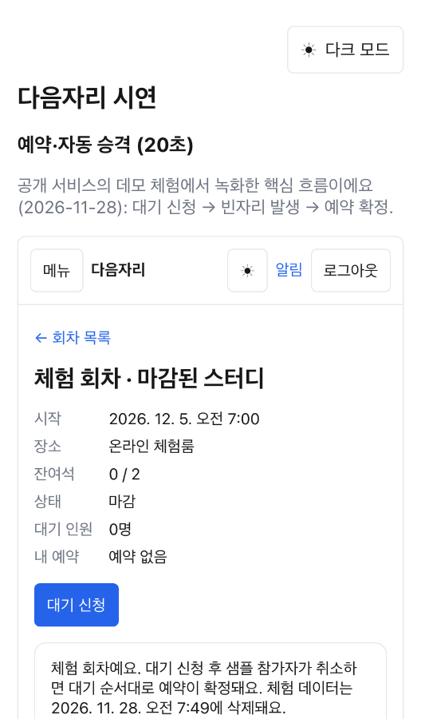
</p>

## 최근 변경 (2026-11-27~28)

| PR | 내용 | 확인 |
|---|---|---|
| #58 | 모임 채팅 이전 기록: `?before=id&limit` 역방향 페이지, 스크롤 위치 고정, 폴링과 겹쳐도 중복·누락 없음, '새 메시지 N개' | 로컬 e2e·백엔드, 공개 비밀번호 없는 점검 5/5 ([설계](docs/plans/chat-history.md)) |
| #59 | 사진 업로드: 층별 크기 한도(화면 4MB·Vercel 4.5MB·백엔드 5MB), 413 안내·다시 시도·취소, CMYK·HEIC 안내, 실패 시 남는 것 없음 | 로컬, 사용자 아이폰 실기기(위치 정보 제거) ([설계](docs/plans/photo-upload.md)) |
| #60·#62·#63 | 공식 문서 확인(Vercel WebSocket·본문 한도, Neon Free), 운영 Neon 용량 점검(DB 10MB, Storage 34.92MB) | [기록](loadtest/results/2026-11-27-storage-neon.txt) |
| #61 | Render 빌드가 Maven Central 429 로 실패 → Google Maven Central 미러, Docker 의존성 레이어 캐시, `--offline` bootJar | Render 배포 성공, 공개 회귀 15/15 ([기록](loadtest/results/2026-11-27-public-after-pr61.txt)) |
| #64 | 화면 정리: 날짜 입력 넘침, 버튼·선택창·메뉴 높이 44px, 공개 프로필·모임 상세·회차 관리 배치, 모임 신청 라디오 | e2e Chromium·WebKit(iPhone 에뮬레이션) ([원인·수정](docs/plans/layout-fix.md)) |
| #65 | 라이트·다크 모드 전환 버튼, 다크 버튼 글자 대비 4.5:1 이상 | 공개 점검 18/18 ([기록](loadtest/results/2026-11-28-public-theme-layout.txt)) |

**테스트 (마지막 로컬 기준):** 백엔드 848(JUnit·Testcontainers PostgreSQL), e2e 141(Playwright Chromium) + WebKit 배치·모드 18, 프런트 단위 57, `tsc`·`eslint` 0.

이전 확장 기록: **커뮤니티 확장 (2026-11-23~25)** — 단계별 검증은 아래 [커뮤니티 1단계](#커뮤니티-1단계-회원-게시판서비스-공지-v11-2026-11-23)~[6단계](#커뮤니티-6단계-전체-흐름화면-상태공개-검증-2026-11-24), 사례는 [포트폴리오](docs/portfolio/backend.md#8-커뮤니티-확장-2026-11-2325-권한경합알림). **플랫폼 확장 7단계 (2026-11-25~27)** — 단계별 결과는 [한 장 정리](docs/platform-expansion-summary.md), 공개 검증 기록은 [확장 계획](docs/plans/platform-plan.md).

## 아키텍처

```
브라우저 ──HTTPS──▶ Vercel (Next.js, sin1)
                     ├─ 화면·정적 자산(/tour 시연 포함): 백엔드 없이 응답
                     └─ /api/* Route Handler 프록시
                          · 클라이언트 IP 를 X-Forwarded-For 로 다시 쓰고 공유 비밀 토큰을 붙인다
                          · 업스트림 85초 제한 → 503 + Retry-After (Vercel 504 대신)
                          ▼
                   Render Free (Spring Boot 4, Singapore) ── 토큰 없는 직접 호출은 403
                          ▼
                   Neon Free (PostgreSQL 16) ── 예약·대기·세션(Spring Session JDBC)·게시판·채팅·사진(bytea)
```

쿠키(`JSESSIONID`, `XSRF-TOKEN`)는 모두 프런트 주소의 같은 출처 쿠키다. 무료 백엔드는 15분 무요청 시 잠들고, 브라우저는 502/503/504 를 받으면 "서버를 깨우는 중" 안내와 함께 최대 5분 자동 재시도한다.

## 핵심 검증 결과

| 무엇을 | 결과 | 환경 · 근거 |
|---|---|---|
| 마지막 자리 동시 예약 (정원 1, N=10·50·100·200·400) | 모든 단계 확정 정확히 1건, 나머지 `409 SESSION_FULL`, 예상 못한 오류 0. N=400: 460ms, 870 req/s, p95 429ms | 로컬 실제 PostgreSQL · [결과](loadtest/results/2026-11-21-local.md) |
| 취소·승격 혼합 (확정자 5명 취소 + 신규 예약·대기 동시) | 먼저 대기한 5명이 id 순서대로 승격, 신규 예약은 모두 409, 오류 0. N=400 대기 + 205건 혼합: p95 303ms | 로컬 실제 PostgreSQL · [결과](loadtest/results/2026-11-21-local.md) |
| 정원 증설 동시 (정원 1 + 대기 N, 증설 1→6·축소·취소·신규 요청 혼합) | 모든 단계 최종 정원 6, 확정 = 대기 순번 1~6, 신규 예약 409, 축소는 순서에 따라 200/`409 CAPACITY_BELOW_CONFIRMED`, 오류 0. N=400: C2 203건 p95 288ms | 로컬 실제 PostgreSQL · [결과](loadtest/results/2026-11-21-local-capacity.md) |
| SQL 정합성 (정원 초과·활성 중복·대기 추월·승격 누락) | 4종 모두 0행. 검사식은 일부러 만든 위반을 각각 검출함(셀프테스트) | [`checks.sql`](loadtest/checks.sql) |
| 공개 서비스 정상 흐름 (데모 3회 순차 + 동시 3건, 21요청) | 3회 모두 `대기 신청 → 샘플 취소 → 확정`, 상태 200·201 만, p50 221ms · p95 514ms · max 637ms (웜) | 공개 배포 2026-11-21 10:46 UTC · [결과](loadtest/results/2026-11-21-public-smoke.txt) |
| 절전 후 첫 체험 시작 | 클릭 → 체험 화면 **170.9초 (2분 51초)**, 버튼은 1.6초에 노출, 안내 4.7초, 중복 요청 0 | 공개 배포 · [측정 조건과 한계](#절전-후-첫-접속-2026-11-21-0420-utc) |
| 자동 테스트 | 백엔드 JUnit(Testcontainers PostgreSQL), 프런트 e2e(Playwright, 실제 백엔드), 프록시 단위(node:test) | 아래 [실행](#실행) |
| 커뮤니티 경합·삭제 정합성 (로컬, 각 20회) | 이중 추천·가입·승인 → 행 1, 생성자 이전 두 건 → 생성자 1, 모임·글 삭제 vs 글·댓글·답글·추천·가입 → 고아 0, 삭제 중 실패 → 전체 롤백 | 로컬 실제 PostgreSQL · [`ClubBoardConcurrencyTests`](backend/src/test/java/com/daumjari/ClubBoardConcurrencyTests.java), [`ClubPolicyReviewTests`](backend/src/test/java/com/daumjari/ClubPolicyReviewTests.java) |
| 커뮤니티 공개 검증 (API 확인 · Neon SQL 확인 구분) | 1~5단계·전체 흐름 로그인 점검 통과(정리 API 204), 각 점검이 만든 행은 Neon SQL 로 0건(물리 삭제) | 사용자 실행 2026-11-23~24 · [전체 흐름](loadtest/results/2026-11-24-public-community-flow.txt). 커뮤니티 성능은 측정하지 않음(위 req/s·p95 는 예약·정원 변경 결과) |

### 실행 환경

- **로컬 부하:** Apple M4 Pro(12코어, 24GB), macOS 27.2, JDK 17.0.13(Zulu), Spring Boot 4.1.2 local 프로필, Hikari 기본 풀 10, PostgreSQL 16.16(docker 27.3.1, Docker Desktop 12 CPU·8GB), Node 23.7.0. 부하 발생기·서버·DB 가 한 기기에 있다.
- **공개 배포:** Vercel Hobby(Function 리전 sin1) → Render Free(Singapore) → Neon Free(Singapore). 측정은 서울의 Mac 에서 했다.

## 기술 설명: 문제 → 방식 → 확인한 테스트

| 주제 | 해결한 문제 | 방식 | 확인한 테스트 |
|---|---|---|---|
| 회차 행 잠금 | 마지막 자리에 동시에 예약하면 정원을 넘길 수 있다 | 예약·대기·취소가 회차 행을 `SELECT … FOR UPDATE` 로 잠근 뒤 같은 트랜잭션에서 잔여석·대기열을 판단. 같은 회차는 직렬화, 다른 회차는 서로 막지 않음. 활성 신청은 부분 unique 인덱스로 한 건 | [`ReservationConcurrencyTests`](backend/src/test/java/com/daumjari/ReservationConcurrencyTests.java), [`CapacityConcurrencyTests`](backend/src/test/java/com/daumjari/CapacityConcurrencyTests.java), [`SchemaConstraintTests`](backend/src/test/java/com/daumjari/SchemaConstraintTests.java), 부하 시나리오 A |
| 취소·승격 트랜잭션 | 취소와 승격 사이에 신규 예약이 끼면 대기자가 밀린다. 승격만 실패하면 좌석이 사라진다 | 취소와 첫 대기자(id 순) 승격을 같은 트랜잭션·같은 회차 잠금 아래에서 처리(`WaitlistPromoter` 는 `MANDATORY`). 대기자가 있으면 빈자리가 보여도 신규 예약은 409. 실패하면 취소까지 롤백. 탈퇴도 같은 규칙(계정 → 회차 순 잠금) | [`PromotionRollbackTests`](backend/src/test/java/com/daumjari/PromotionRollbackTests.java), [`WaitlistConcurrencyTests`](backend/src/test/java/com/daumjari/WaitlistConcurrencyTests.java), [`WaitlistApiTests`](backend/src/test/java/com/daumjari/WaitlistApiTests.java), [`WithdrawalConcurrencyTests`](backend/src/test/java/com/daumjari/WithdrawalConcurrencyTests.java), 부하 시나리오 B·SQL ③④ |
| 5초 폴링 | 다른 사람의 취소로 내가 확정돼도 화면이 그대로다 | 상세 화면이 보이고 온라인일 때만 5초마다 조회, 탭 복귀(`visibilitychange`)·네트워크 복구(`online`) 때 즉시 조회, 늦게 온 옛 응답은 버림. 숨긴 탭은 요청 0 | [`auto-refresh.spec.ts`](frontend/e2e/auto-refresh.spec.ts) (반영 4.8초, 탭 복귀 28ms, [측정](#회차-상세-자동-갱신)) |
| 방문자별 데모 격리 | 가입 없는 공개 체험이 서로의 데이터를 보거나 바꾸면 안 된다 | 체험마다 방문자·샘플 계정·회차를 `demo_trial_id` 로 묶고, 회차는 같은 체험 계정에게만 보임(아니면 404). 샘플 취소는 파라미터 없이 세션의 체험에서 대상을 찾음. 30분 뒤 통째로 정리 | [`DemoApiTests`](backend/src/test/java/com/daumjari/DemoApiTests.java), [`demo.spec.ts`](frontend/e2e/demo.spec.ts) (두 브라우저 격리) |
| 프록시 전달 헤더 | 프록시 뒤에서는 모든 요청이 프록시 IP 로 보여 IP 제한이 무의미하고, 클라이언트가 `X-Forwarded-For` 를 위조할 수 있다 | 프런트(Vercel·`server.mjs`)가 클라이언트가 보낸 전달 헤더를 버리고 실제 접속 주소로 다시 씀. 백엔드는 공유 비밀 토큰이 맞을 때만 그 IP 를 믿고(토큰 없는 직접 호출 403), 로컬은 loopback 프록시만 신뢰 | [`ProxyTokenTests`](backend/src/test/java/com/daumjari/ProxyTokenTests.java), [`ForwardedHeaderTrustTests`](backend/src/test/java/com/daumjari/ForwardedHeaderTrustTests.java), [`proxy.test.mjs`](frontend/test/proxy.test.mjs), 공개 배포 IP 집계 실측(모바일 데이터 vs Mac) |
| 로그인 제한 | 비밀번호 대입을 막되, 남의 아이디로 일부러 틀려 그 사람을 잠그게 하면 안 된다 | (아이디+IP) 15분 5회, IP 15분 50회. 비밀번호 확인 전에 PostgreSQL upsert 로 원자적으로 셈. 탈퇴 비밀번호 재확인도 같이 셈. 가입·데모 시작도 IP 한도 | [`LoginThrottleApiTests`](backend/src/test/java/com/daumjari/LoginThrottleApiTests.java), [`LoginThrottleConcurrencyTests`](backend/src/test/java/com/daumjari/LoginThrottleConcurrencyTests.java) (동시 10건 → 정확히 5건만 인증까지), [`login-throttle.spec.ts`](frontend/e2e/login-throttle.spec.ts) |

### 절전 후 체험 시작 2분 51초: 조건과 한계

- **조건:** 2026-11-21 04:20 UTC, 공개 사이트에 약 55분 요청 없음, Playwright 새 컨텍스트(저장 상태 없음), 데스크톱 1280x800, 배포 커밋 `4ed83a75`(앱 코드 `5489d26c`). Vercel Hobby sin1 → Render Free Singapore → Neon Free Singapore.
- **결과:** 버튼 1.6초 노출 → 클릭 → 첫 `/api` 응답이 87.3초에 503(프록시가 85초에 끊음) → 5초 뒤 자동 재시도 → 체험 화면까지 **170.9초**. 상세는 아래 [절전 후 첫 접속](#절전-후-첫-접속-2026-11-21-0420-utc).
- **한계:** 대부분이 Render Free 인스턴스 기동 시간이라 앱 코드로 줄일 수 없고, 날·시간대·Render 상태에 따라 달라진다 (2026-11-20 측정 약 2분 40초~2분 52초, 한 번씩만 잼). 브라우저 자동 재시도 상한은 5분이라 그보다 오래 걸리면 `다시 시도하기` 로 돌아온다(시뮬레이션으로 확인). 기다리는 동안 볼 수 있게 `/tour` 를 연결했다.

## 구조

```
.
├── frontend/           # Next.js (App Router) + TypeScript + ESLint
├── backend/            # Java 17, Spring Boot 4.1, Gradle (Kotlin DSL)
│   └── src/main/resources/db/migration/   # Flyway 마이그레이션
├── docker-compose.yml  # 로컬 PostgreSQL 16
└── .env.example
```

## 사전 요구사항

- Node.js 20.9+ / npm
- JDK 17
- Docker (Docker Desktop) + Docker Compose v2

## 실행

```bash
# DB 기동 / 종료 (데이터는 볼륨 daumjari-pgdata 에 유지)
docker compose up -d
docker compose down
docker compose down -v   # 볼륨까지 삭제

# backend (http://localhost:8080, 헬스체크 /actuator/health)
cd backend
./gradlew bootRun
./gradlew test           # Testcontainers 사용: Docker 실행 중이어야 함 (없으면 스킵)
./gradlew build

# frontend (http://localhost:3000, /api 는 BACKEND_URL 로 프록시)
cd frontend
npm install
npm run dev                                   # node server.mjs --dev, BACKEND_URL 기본값 http://localhost:8080
BACKEND_URL=http://localhost:8080 npm run build && npm run start   # node server.mjs (전달 헤더 정리, 아래 "클라이언트 IP 판별")
npm run lint
npm test                                      # /api 프록시 단위 검증 (node:test)

# 브라우저 e2e (Playwright, 실제 백엔드 + 프런트 프로덕션 빌드)
docker compose up -d                          # 루트에서 먼저
cd frontend
npm run test:e2e                              # bootRun·next start 를 자동으로 띄움
npx playwright install webkit                 # (선택) Safari 엔진
E2E_WEBKIT=1 npm run test:e2e                 # 화면 배치·다크 모드 e2e 를 WebKit(iPhone 17 Pro 에뮬레이션)으로도
```

### 로컬에서 화면 확인 순서

1. 루트: `docker compose up -d`
2. `backend`: `./gradlew bootRun` (local 프로필, 시드 계정 생성)
3. `frontend`: `npm install` 후 `npm run dev`
4. http://localhost:3000 → 시드 계정으로 로그인 (참가자 `alice`, 운영자 `operator`)

e2e 는 3000·8080 포트에 이미 뜬 서버가 있으면 그 서버를 재사용한다 (CI 환경변수가 있으면 새로 띄움). 개발 서버를 띄워 둔 채 최신 코드로 검증하려면 다른 포트를 쓴다:

```bash
E2E_PORT=3100 E2E_BACKEND_PORT=18080 npm run test:e2e
```

## 화면

로그인 뒤에는 데스크톱 왼쪽 사이드바(접기 가능)·모바일 서랍의 계층형 메뉴로 이동한다. 메뉴 노출은 화면 편의이고 권한 판단은 서버가 매 요청 한다.

| 메뉴 묶음 | 경로 | 내용 |
|---|---|---|
| (로그인 전) | `/`, `/login`, `/signup`, `/tour`, `/notices` | 첫 화면·데모 체험하기, 로그인(카카오·네이버 연결 계정), 가입, 시연 자료, 서비스 공지 |
| 게시판 | `/board`, `/notices` | 회원 게시판(검색·쪽 이동, 글·댓글·답글·추천·멘션), 서비스 공지 |
| 모임 | `/clubs`, `/clubs/promo`, `/me/clubs`, `/clubs/new`, `/clubs/{id}` | 모임 목록(검색·초기화)·홍보·내 모임·만들기 신청. 모임 상세: 머리 상자(이름·가입 상태·정보·버튼) → 모임 안 메뉴(공지·게시판·채팅·사진첩·회원·권한 관리) → 소개 |
| 회차 | `/sessions`, `/me/sessions`, `/sessions/new`, `/sessions/{id}`, `/sessions/{id}/manage` | 회차 목록·검색, 내가 만든 회차, 만들기, 상세(예약·대기·취소, 5초 자동 갱신), 관리(회차 정보·정원 변경·확정 명단·관리 작업) |
| 내 활동 | `/me/reservations`, `/me/favorites`, `/me/notifications`, `/me/feedback` | 내 신청, 즐겨찾기, 알림함, 개선사항 |
| 내 정보 | `/me/profile`, `/me/accounts`, `/account/withdraw`, `/profiles/{id}` | 프로필·닉네임, 로그인 계정 연결, 회원 탈퇴, 공개 프로필(닉네임·소개·태그만) |
| 관리 (운영자) | `/operator`, `/operator/accounts`, `/operator/sessions`, `/operator/clubs`, `/operator/roles` | 대시보드(표·차트·기간), 계정 관리, 전체 회차, 모임 승인, 서비스 권한 관리 |
| 개발 (개발자) | `/dev/feedback`, `/dev/errors` | 개선사항 처리, 에러 로그 |

상단 막대의 **'다크 모드' 버튼**으로 라이트·다크를 바꾼다(로그인 전 화면은 오른쪽 위). 규칙은 [디자인 규칙](docs/design-system.md#라이트다크-모드-2026-11-27).

화면의 역할 분기는 표시용이고, 명단 비노출의 근거는 백엔드 403 이다 (e2e 에서 응답 코드까지 확인).

예약 안내 문구:

| 결과 | 안내 |
|---|---|
| 201 | 예약이 확정됐어요. |
| 200 (이미 활성 예약) | 이미 예약된 회차예요. 기존 예약을 보여드릴게요. |
| 409 `SESSION_FULL` | 정원이 마감됐어요. 다른 회차를 확인해 주세요. |
| 409 `SESSION_STARTED` | 이미 시작된 회차라 예약·취소할 수 없어요. |
| 대기 201 | 대기 N번으로 신청했어요. |
| 대기 200 (이미 대기 중) | 이미 대기 중이에요 (대기 N번). |
| 409 `SEATS_AVAILABLE` | 빈자리가 생겼어요. 대기 대신 바로 예약해 주세요. |

### 회차 상세 자동 갱신

- 화면이 보이고 온라인인 동안 `GET /api/sessions/{id}` 를 **5초**마다 조회한다 (`NEXT_PUBLIC_SESSION_POLL_MS`, 빌드 시점 값).
- 탭이 숨겨지거나(`visibilitychange`) 오프라인이 되면(`offline`) 폴링을 멈춘다. 탭으로 돌아오거나 네트워크가 복구되면(`online`) 즉시 한 번 조회하고 폴링을 다시 시작한다.
- 겹친 조회는 마지막에 시작한 것만 화면에 반영한다 (늦게 온 옛 응답이 새 상태를 덮지 않음). 첫 조회·복귀 조회도 같은 순번 검사를 거친다.
- **다른 화면에 갔다가 돌아올 때:** `cacheComponents` 는 떠난 화면을 상태째 숨겨 두고 다시 보일 때 효과만 다시 실행한다. 그래서 복귀 조회 응답 전에 숨기기 전 상태(예: 승격 전 `대기 1번`)가 보였다 (공개 배포 2026-11-21 실측 0.79초). 지금은 숨겨질 때 '확인 필요' 로 표시해 두고, 다시 보이면 즉시 한 번 조회하며 응답 전에는 "최신 상태 확인 중…" 과 함께 잔여석·상태·대기·내 예약을 `확인 중…` 으로 바꾸고 예약·취소·대기 버튼을 잠근다. 실패하면 오류와 "다시 시도". 내 신청 화면도 같다. 검증: [`detail-return.spec.ts`](frontend/e2e/detail-return.spec.ts) (응답 지연·실패/재시도·응답 순서 역전, 복귀 뒤 조회 1회).
- 대기 → 확정으로 바뀐 순간에만 `role="status"` 로 "대기 순번이 되어 예약이 확정됐어요." 를 한 번 안내한다. 폴링마다 반복하지 않는다.
- 조회 실패·오프라인은 오류 경고를 반복하지 않고 "연결이 끊겼어요…" 한 줄만 보여주며, 다음 성공 때 사라진다.

측정 (로컬, 실제 프런트·백엔드, Playwright 두 브라우저 컨텍스트, 각 10회):

| 경우 | 반영 시간 (최소 / 중앙 / 최대) |
|---|---|
| B 화면 취소 응답 → A 화면 "확정" (폴링) | 4799 / 4810 / 4822 ms |
| 탭 복귀 → 반영 | 25 / 28 / 30 ms |
| 네트워크 복구 → 반영 | 24 / 26.5 / 28 ms |

폴링 반영 시간은 이론상 0 ~ 5초 + 요청 왕복이다. 위 값이 4.8초 근처로 몰린 건 테스트 흐름상 취소가 늘 폴링 직후 같은 위치에 오기 때문이다.

2026-11-15 재측정 (폴링 간격 5000ms, B 취소 성공 응답 → A 화면 `확정`, A 는 새로고침·조작 없음):

| 회차 | 반영 시간 |
|---|---|
| 1 | 4813 ms |
| 2 | 4813 ms |
| 3 | 4810 ms |

실행 환경: Apple M4 Pro (Mac16,8, 12코어, 24GB), macOS 27.2, Node 23.7.0, OpenJDK 17.0.13 (Zulu), Playwright 1.64.1 / Chromium 156.0.8078.4 (headless), Next 16.4.6 `next build && next start -p 3100`, Spring Boot `bootRun --server.port=18080` (local 프로필), PostgreSQL 16.16 (docker compose). A·B 는 서로 다른 Chromium 프로세스(브라우저 인스턴스)로 각자 로그인했다.

```bash
cd frontend
E2E_PORT=3100 E2E_BACKEND_PORT=18080 npx playwright test e2e/auto-refresh.spec.ts --grep "새로고침 없이" --repeat-each=3
```

부하 메모: 상세 화면 1개당 5초에 요청 1번(초당 0.2건), 요청 1번에 SQL 약 4~5개(회차, 확정 수, 대기 수, 내 신청, 내 순번). 동시에 상세를 보고 있는 사람이 N명이면 약 0.2 × N 건/초 (100명이면 초당 20건). 숨긴 탭과 오프라인 탭은 0건이다.

결과는 `role="status"`, 오류는 `role="alert"` 로 보조 기술에 전달한다.

DB 접속 기본값: `localhost:5432`, DB/계정/비밀번호 모두 `daumjari` (로컬 전용). `.env` 로 바꿀 수 있다.
시각은 UTC로 저장한다 (Hibernate `jdbc.time_zone=UTC`, 시각 컬럼은 `timestamptz` 예정).

## 시드 계정

`./gradlew bootRun` 은 기본으로 `local` 프로필로 뜨고, DB에 계정이 하나도 없을 때만 아래 시드를 넣는다 (로컬 전용, 다른 프로필에서는 동작하지 않음). 초기화하려면 `docker compose down -v` 후 다시 기동한다.

| 아이디 | 비밀번호 | 역할 | 이름 |
|---|---|---|---|
| `operator` | `daumjari-local-1!` | OPERATOR | 운영자 |
| `alice` | `daumjari-local-1!` | PARTICIPANT | 앨리스 |
| `bob` | `daumjari-local-1!` | PARTICIPANT | 밥 |
| `carol` | `daumjari-local-1!` | PARTICIPANT | 캐롤 |

| 회차 | 시작 (서울) | 정원 | 시드 확정 | 용도 |
|---|---|---|---|---|
| Spring 트랜잭션 스터디 | 시드 시점 +7일 19:00 | 5 | alice | 빈자리 있는 회차 |
| PostgreSQL 잠금 스터디 | 시드 시점 +3일 19:00 | 2 | carol | 마지막 1석 회차 |

## 인증 (서버 세션)

시드 계정이나 직접 가입한 계정으로 로그인한다. 서버가 세션(`JSESSIONID`, HttpOnly, SameSite=Lax, 30분)에서 계정·역할을 확인하며, 요청 본문의 사용자 ID·역할은 신뢰하지 않는다.

| 메서드 | 경로 | 인증 | 설명 |
|---|---|---|---|
| GET | `/api/auth/csrf` | 불필요 | CSRF 토큰 발급 (`XSRF-TOKEN` 쿠키 + 본문 `{headerName, token}`) |
| POST | `/api/auth/login` | 불필요 | 본문 `{"loginId","password"}`, 성공 시 `{id, loginId, displayName, role}` |
| POST | `/api/auth/signup` | 불필요 | 본문 `{"loginId","password","passwordConfirm"}`, 201 `{id, loginId, role}`. 로그인은 하지 않는다 |
| POST | `/api/auth/logout` | 필요 | 세션 무효화, 204 |
| GET | `/api/auth/me` | 필요 | 현재 사용자 |
| POST | `/api/me/withdraw` | PARTICIPANT (데모 제외) | 본문 `{"password"}`, 204. 탈퇴 후 이 세션은 끝난다 (아래 "회원탈퇴 정책") |
| * | `/api/operator/**` | OPERATOR | 운영자 API (참가자는 403) |

### 회원가입 정책

- **역할:** 항상 `PARTICIPANT`. 요청에 `role` 이 있어도 무시한다. 운영자는 기존대로 부트스트랩으로만 만든다.
- **아이디:** 앞뒤 공백을 지우고 소문자로 바꾼 뒤 `^[a-z0-9_]{4,20}$`. 하이픈을 받지 않아 데모(`demo-…`)·탈퇴(`deleted-…`) 계정 아이디와 겹치지 않는다. 표시 이름은 아이디와 같다. 로그인 요청 검증(최대 50자)은 그대로다.
- **비밀번호:** 8자 이상, UTF-8 72바이트 이하(BCrypt 한도), 확인 칸 일치. 기존 `PasswordEncoder`(`{bcrypt}`)로 해시 저장.
- **유일성:** DB `account.login_id` unique 가 보장한다. 사전 조회(대소문자 무시)는 안내용이고, 동시 가입으로 제약 위반이 나도 같은 `409 LOGIN_ID_TAKEN` 으로 답한다 (같은 아이디 8개 동시 가입 → 201 하나, 나머지 409).
- **입력 오류:** `400 VALIDATION_FAILED` 와 칸별 안내 `fields` (`{"loginId": "...", "password": "...", "passwordConfirm": "..."}`). 화면도 같은 규칙으로 보내기 전에 검사한다.
- **남용 방지:** 같은 클라이언트 IP 의 가입 시도(성공·실패 무관)를 로그인 제한과 같은 창(15분)에 5회까지 (`daumjari.signup.max-per-ip`, `SIGNUP_MAX_PER_IP`). 넘으면 `429 TOO_MANY_ATTEMPTS` + `Retry-After`.

### 회원탈퇴 정책

| 항목 | 처리 |
|---|---|
| 확인 | 비밀번호 재입력. 틀리면 `400 PASSWORD_MISMATCH`. 재확인 시도도 로그인 시도 제한(아이디+IP 15분 5회)에 함께 센다 (훔친 세션으로 비밀번호 대입 방지) |
| 계정 행 | 지우지 않는다 (신청 FK·시작된 회차 기록). `login_id` → `deleted-{id}`, 이름 → `탈퇴한 회원`, 비밀번호 해시 → 매칭 불가 값, `deleted_at` 기록 (V7) |
| 시작 전 회차 | 확정 예약 취소 → 기존 승격 로직으로 첫 대기자 확정. 대기 신청 취소 |
| 시작된 회차 | 확정 기록은 참가 기록으로 남고 운영자 명단에 `탈퇴한 회원` 으로 보인다. 남은 대기는 취소 |
| 같은 아이디 재가입 | 즉시 가능 (원래 아이디가 풀린다). 새 계정이라 예전 기록과 연결되지 않는다 |
| 운영자·데모 계정 | `403 WITHDRAWAL_NOT_ALLOWED`. 운영자는 운영을 이어가야 하고, 데모 계정은 만료되면 통째로 정리된다. 화면에 메뉴도 없다 |
| 로그인·세션 | 탈퇴한 계정은 로그인 불가. 탈퇴한 세션은 즉시 무효화하고, 같은 계정의 다른 기기 세션은 요청마다 계정 상태를 확인하는 필터가 무효화해 `401 UNAUTHENTICATED` (메모리·JDBC 세션 저장소 공통) |
| 일관성 | 한 트랜잭션: 계정 행 `FOR UPDATE` → 활성 신청이 있는 회차를 id 순으로 `FOR UPDATE` → 정리 → 익명화. 중간 실패는 전부 롤백. 예약·대기는 계정 행을 `FOR SHARE` 로 먼저 잠가(잠금 순서 계정 → 회차) 탈퇴와 겹치면 탈퇴 뒤 `401` 이 된다. 탈퇴와 예약 동시 요청 20회 반복에서 탈퇴된 계정의 활성 신청 0건 |

## 회차 생성자·삭제·누적 사용량 (V8, 2026-11-22)

| 동작 | API | 생성자 | 운영자 | 다른 회원 |
|---|---|---|---|---|
| 회차 만들기 | `POST /api/sessions` | 만든 사람이 생성자 (요청 본문의 생성자 값은 무시) | 같음 | 같음 (체험 방문자는 403 `SESSION_CREATE_FORBIDDEN`) |
| 수정 (제목·시작·장소) | `PATCH /api/sessions/{id}` | 시작 전만 | 403 | 403 `NOT_SESSION_OWNER` |
| 정원 변경 (늘어난 만큼 대기자 승격) | `PATCH /api/sessions/{id}/capacity` | 가능 | 403 | 403 |
| 확정 명단 | `GET /api/sessions/{id}/roster` | 가능 | 가능 | 403 |
| 삭제 (물리 삭제) | `DELETE /api/sessions/{id}` → 204 | 가능 | 가능 | 403 |
| 내가 만든 회차 | `GET /api/me/sessions` | | | |

- 생성자가 없는 일반 회차(백필할 운영자가 없던 DB)는 운영자가 생성자처럼 관리한다. 데모 체험 회차는 관리 대상이 아니다(404). 예전 운영자 API(`/api/operator/sessions/**`)는 같은 권한 규칙으로 남겨 둔다.
- 회차 응답에 `canManage`(생성자)·`canDelete`(생성자·운영자)가 있어 화면은 이 값으로 관리 링크를 보인다. 권한의 근거는 서버다.
- **삭제:** 회차 행을 `FOR UPDATE` 로 잠근 뒤 한 문장으로 지우고, 신청(확정·대기·취소)은 `reservation → study_session` FK 의 `ON DELETE CASCADE` 로 같은 트랜잭션에서 함께 지워진다. 회차 전체가 사라지므로 대기자 승격은 없다. 같은 회차의 예약·대기·정원 변경은 같은 행 잠금으로 줄을 서서 삭제 전에 끝나 함께 지워지거나 삭제 뒤에 와서 404 가 된다. 검증: [`SessionDeleteConcurrencyTests`](backend/src/test/java/com/daumjari/SessionDeleteConcurrencyTests.java) (삭제 vs 예약·대기·정원 증설 각 20회, 고아 신청 0), [`UsageCountTests`](backend/src/test/java/com/daumjari/UsageCountTests.java) (삭제 중 실패 → 회차·신청 그대로).
- **생성자 탈퇴:** 본인이 만든 회차를 신청째 삭제하고(승격 없음), 다른 회차의 신청은 기존 탈퇴 규칙대로 정리한다. 모든 회차를 id 순으로 잠근다. 탈퇴 확인 화면에 "내가 만든 회차(n개)와 그 신청(m건)" 삭제를 안내한다. 운영자 강제탈퇴(3단계)도 같은 처리를 쓴다.
- **누적 사용량:** `usage_daily(day, metric, demo, count)` 에 날짜(서울)·지표·데모 여부별 성공 횟수만 둔다 (계정·회차·신청 id 같은 개인 식별 정보 없음). 지표: 가입, 체험 시작, 회차 생성, 직접 예약 확정, 자동 승격 확정, 대기 신청, 신청 취소(탈퇴로 인한 취소 포함), 회차 삭제. 동작과 같은 트랜잭션에서 늘어나 롤백되면 함께 사라지고, 같은 계정의 중복 예약·대기·이미 취소된 신청의 재취소는 세지 않는다. 원본을 지워도 줄지 않는다. 체험 회차의 샘플 신청은 세지 않는다.
- **집계 시작 시각:** `usage_meta.counting_started_at` (V8 적용 시각). 그 전 누적치는 만들지 않는다. 기존 데이터에서 알 수 있는 값(남아 있는 일반 계정·회차·확정·대기 수)은 "현재 데이터" 로 따로 보인다(3단계 대시보드).

### V8 운영 적용 주의

- Render 배포 때 Flyway 가 Neon 에 자동 적용한다. 되돌리려면 새 마이그레이션이 필요하다.
- 행 수 변화 없음: `study_session.creator_account_id` 칸 추가 후 일반 회차를 가장 먼저 만든 미탈퇴 운영자 id 로 채운다. 데모 회차는 null.
- FK 교체(`reservation_study_session_id_fkey` → `ON DELETE CASCADE`): 기존 행은 그대로다. 이후 회차 삭제가 신청까지 지운다.
- 새 표 `usage_daily`(빈 표), `usage_meta`(1행).
- 적용 전 백업 권장: `pg_dump … -Fc` (위 "백업과 롤백").

화면: 머리글 `회차 만들기` → `/sessions/new`, 회차 상세의 `회차 관리` → `/sessions/{id}/manage` (생성자: 명단·정원·삭제, 운영자: 명단·삭제). 스크린샷 `docs/screenshots/stage1-*.png`.

## 회차 검색·내가 만든 회차·수정 화면 (2단계, V9, 2026-11-22)

`GET /api/sessions/search` (로그인 필요). 전체 회차(`/sessions`)와 내가 만든 회차(`/me/sessions`)가 같은 API·같은 화면 부품을 쓴다.

| 파라미터 | 값 (기본값 굵게) | 설명 |
|---|---|---|
| `scope` | **`all`** · `mine` | `all`: 일반 회차(체험 방문자는 자기 체험 회차), `mine`: 내가 만든 회차(종료 포함) |
| `q` | 최대 100자 | 앞뒤 공백 제거 후 부분 일치, 대소문자 무시(ILIKE). `%` `_` `\` 는 글자 그대로 찾는다 |
| `field` | **`ALL`** · `TITLE` · `LOCATION` | 검색 범위 (제목+장소 / 제목 / 장소) |
| `from`, `to` | `yyyy-MM-dd` | 서울 기준 시작 날짜. `to` 는 그날 23:59:59 까지 포함 (`starts_at < to+1일 00:00 KST`). `from > to` 는 400 |
| `status` | **`UPCOMING`** · `OPEN` · `WAITLIST` · `ENDED` · `ALL` | 시작 전 전체 / 예약 가능(빈자리 있고 대기 0) / 대기 가능(빈자리 0 또는 대기자 있음) / 종료(시작 시각이 지남) / 전체. 회차 응답 `status` 와 같은 규칙 |
| `sort` | **`SOON`** · `LATEST_START` · `EARLIEST_START` · `NEWEST` · `MOST_CONFIRMED` · `FEWEST_CONFIRMED` · `MOST_SEATS` | 시작 임박순 / 시작일 최신순 / 시작일 오래된순 / 최근 등록순 / 확정 참가자 많은순 / 확정 참가자 적은순 / 잔여석 많은순. 보조 정렬은 항상 `id` 오름차순 (같은 값이어도 쪽마다 순서 고정) |
| `page`, `size` | **1** (1~10000), **10** (1~50) | 서버 페이지네이션 |

- **시작 임박순 vs 시작일 오래된순:** 시작 임박순은 앞으로 시작할 회차를 지금에서 가까운 순으로 먼저 보이고, 종료를 포함한 상태(`ALL`)에서는 시작된 회차를 그 뒤에 최근 시작부터 둔다 (`ENDED` 만 고르면 최근 시작부터). 시작일 오래된순·최신순은 종료 여부와 상관없이 시작 일시 오름·내림차순이다. 시작 전만 남는 상태(기본 `UPCOMING`, `OPEN`, `WAITLIST`)에서 시작 임박순은 `starts_at` 오름차순과 같아 V9 인덱스 순서를 그대로 쓴다.
- 응답: `{items: [회차 응답], page, size, totalElements, totalPages}`. 범위를 넘은 쪽은 `items` 가 비고 `totalElements` 는 그대로(화면은 '마지막 쪽으로' 링크).
- 모르는 값·틀린 날짜·범위 밖 숫자는 400 `VALIDATION_FAILED`. 비로그인 401.
- 기본(아무 조건 없음) = **앞으로 시작할 회차를 시작 임박순으로**. 예전 `/api/sessions` 는 시작된 회차가 맨 위에 오고 전부 내려 줬다 (아래 변경 전 스크린샷).
- 구현: [`StudySessionSearchQuery`](backend/src/main/java/com/daumjari/studysession/StudySessionSearchQuery.java). 조건 조각은 enum 에서만 고르고 값은 모두 바인딩 변수. 확정·대기 수는 회차별 `lateral` 집계. 테스트: [`SessionSearchApiTests`](backend/src/test/java/com/daumjari/SessionSearchApiTests.java) (부분 일치·와일드카드, 서울 날짜 경계 4건, 상태 필터, 정렬 7종+id, 페이지, mine, 400 11종, 401).

### 화면

- **목록 카드:** 제목 · 시작 일시 · 장소 · 확정/정원 · 모집 상태(+대기 인원, 내 신청) 순서.
- **검색 칸:** 검색어·날짜는 `검색`(Enter)으로, 검색 범위·모집 상태·정렬은 고르자마자 적용. 어떤 조건이 바뀌어도 1쪽부터. `초기화`, 결과 수(`N개 회차`, 화면 낭독기에 알림), 결과 없음 안내와 `조건 초기화`.
- **주소가 조건의 원본:** 기본값이 아닌 조건만 주소에 남는다 (`/sessions?q=스프링&sort=MOST_SEATS&page=2`). 새로고침·뒤로 가기·주소 공유에 그대로. 상세의 `← 회차 목록`(내가 만든 회차에서 왔으면 `← 내가 만든 회차`)은 탭에 기억한 마지막 목록 주소로 돌아간다 (`sessionStorage`, 못 쓰면 `/sessions`). 목록으로 돌아오면 다시 조회해 최신 값을 보인다. 상세 복귀 최신 확인(위 절)은 그대로.
- **참가자 동선과 생성자 관리 분리:** 전체 회차 카드에는 관리 링크가 없다. 머리글 `내가 만든 회차` → 카드마다 `수정`(시작 전·생성자) · `명단·정원·삭제`. 상세의 `회차 관리` 링크(생성자·운영자)는 1단계 그대로.
- **등록 화면 분리:** `회차 만들기`(`/sessions/new`, 정원 포함)와 `회차 수정`(`/sessions/{id}/edit`, 제목·시작·장소만: `PATCH /api/sessions/{id}`). 정원 변경은 대기자 승격이 따르므로 회차 관리 화면에만 둔다. 생성자가 아니면 "수정할 권한이 없어요", 시작된 회차는 "이미 시작된 회차는 수정할 수 없어요" (서버도 403·409). 생성자가 관리 화면에서 삭제하면 내가 만든 회차로 돌아간다.
- **키보드·모바일:** 모든 칸은 이름표가 있는 기본 입력 요소(`<select>`, `type=date`)이고 쪽 이동은 링크(`aria-current="page"`, 44px 터치 크기). 375px 폭에서 가로 스크롤 없음 (e2e 확인).

스크린샷 (로컬, bob 로그인, 왼쪽 변경 전/오른쪽 변경 후):

| | 변경 전 | 변경 후 |
|---|---|---|
| 회차 목록 모바일 | 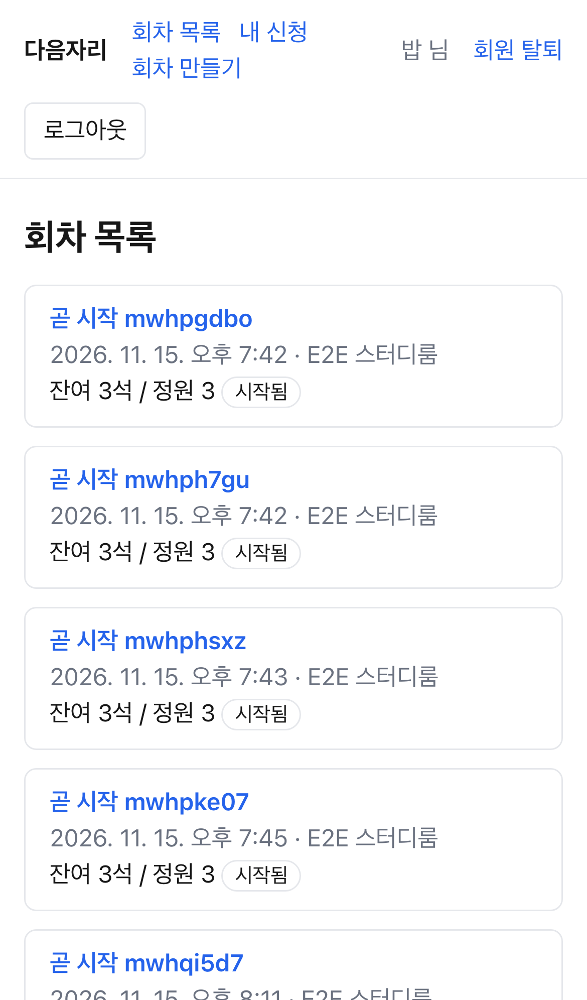 | 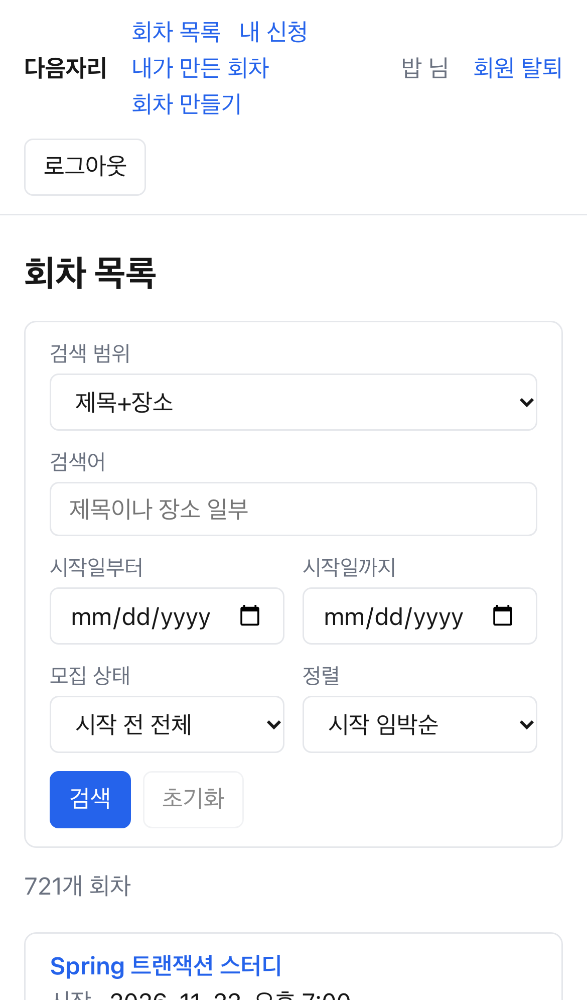 |
| 회차 목록 데스크톱 | 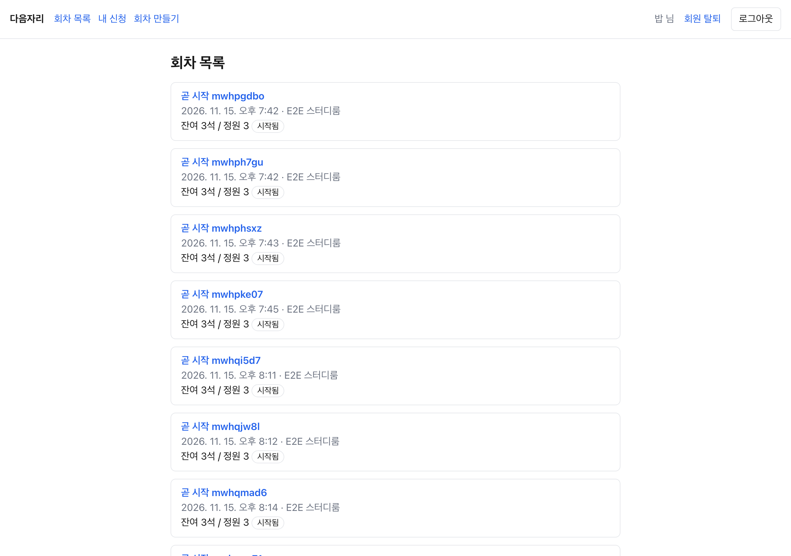 | 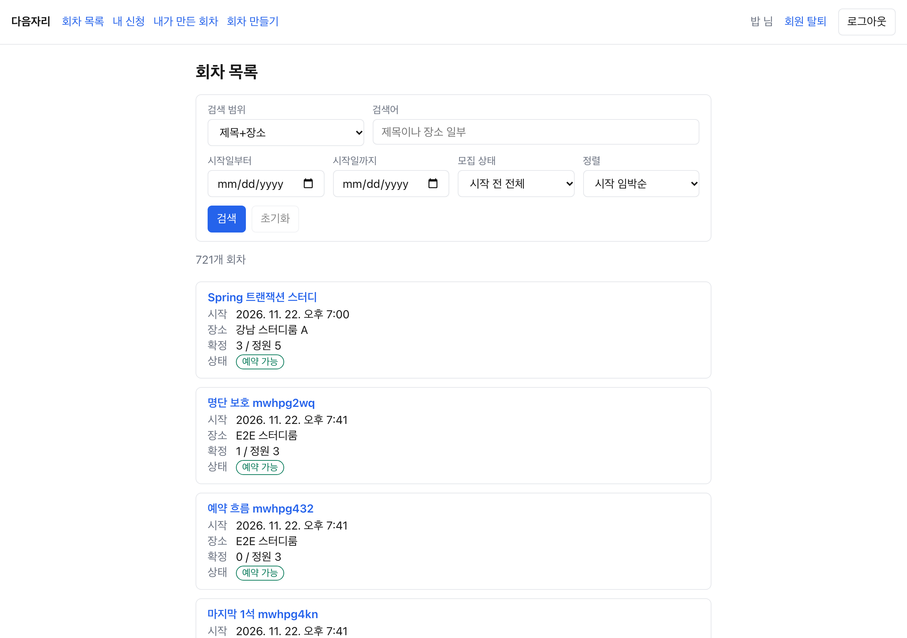 |
| 회차 만들기 | 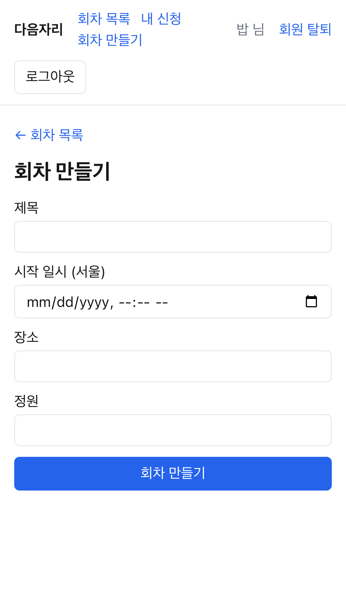 | 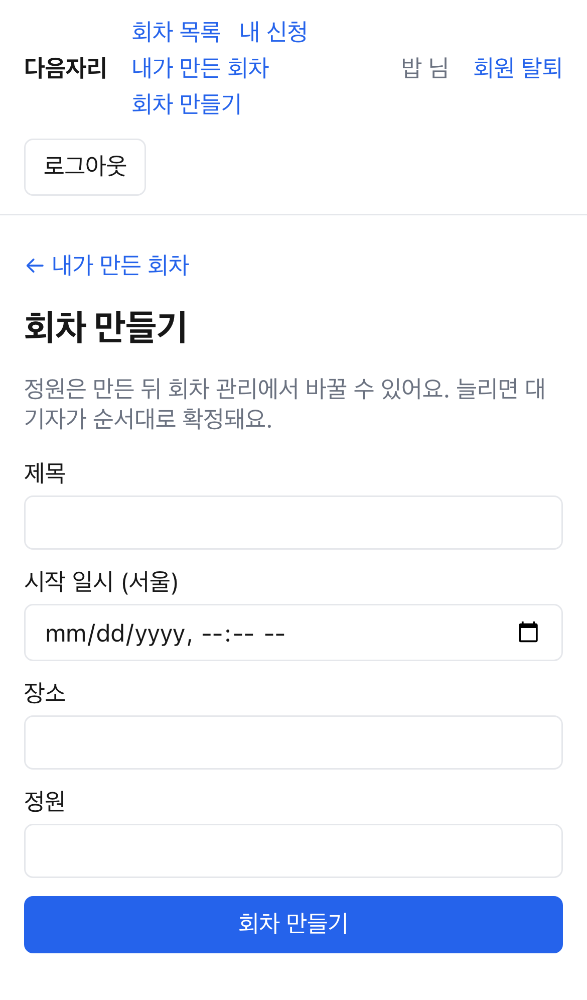 |

변경 후만: 검색(`stage2-after-search-*`), 결과 없음(`stage2-after-empty-*`), 내가 만든 회차(`stage2-after-mine-*`, 2쪽 `stage2-after-mine-page2-*`), 회차 수정(`stage2-after-edit-*`).

검증 (2026-11-22, 로컬): 백엔드 전체 391개 통과(실패 0, Testcontainers PostgreSQL 16), e2e 66개 통과 (`E2E_PORT=3100 E2E_BACKEND_PORT=18080 npm run test:e2e`, 새 [`session-search.spec.ts`](frontend/e2e/session-search.spec.ts) 5개: 상세 왕복·뒤로 가기·새로고침 조건 유지, 페이지·1쪽 초기화·결과 없음, 키보드, 375px, 내가 만든 회차·수정), 프런트 단위 9개 (`npm test`, [`sessionSearch.test.mjs`](frontend/test/sessionSearch.test.mjs) 7개), `tsc --noEmit`·`eslint` 오류 0.

### V9 인덱스와 운영 적용 주의

- `ix_study_session_regular_starts_at on study_session (starts_at, id) where demo_trial_id is null` 하나만 추가한다 (행 변화 없음).
- 근거 (로컬 PostgreSQL 16, 일반 회차 20,000·신청 100,000, `EXPLAIN ANALYZE`): 기본 1쪽 2.6ms → 0.03ms, `예약 가능` 필터 1쪽 143.8ms → 0.2ms (정렬 순서대로 읽다 10개에서 멈추므로 집계도 그만큼만). 내가 만든 회차는 V8 의 `ix_study_session_creator` 를 탄다 (0.1ms).
- 넣지 않은 것: 제목·장소 부분 일치용 `pg_trgm` GIN 인덱스. 같은 데이터에서 검색어 조회가 9.7ms(순차 탐색)라 지금 규모에 필요 없고, 확장 설치가 필요하다. 일반 회차가 수십만 건이 되면 다시 본다. 전체 건수(`count`)는 상태 필터가 확정·대기 수에 기대므로 조건에 맞는 회차 전부를 집계한다 (같은 데이터 최대 43ms).
- Render 배포 때 Flyway 가 자동 적용한다. `CREATE INDEX` 는 그동안 `study_session` 쓰기를 잠깐 막지만 운영 회차 수가 적어 순간이다 (Flyway 트랜잭션 안이라 `CONCURRENTLY` 는 쓰지 않음). 되돌리려면 새 마이그레이션에서 `drop index`.

### 1단계 공개 점검 스크립트

[`loadtest/public-stage1-check.mjs`](loadtest/public-stage1-check.mjs): 일반 계정 A·B·C 를 만들어 생성자 권한(B 의 관리 API 직접 호출 4종 403)·정원 증설 승격·회차 삭제(신청 함께 삭제, 상세 404)를 확인하고 모두 탈퇴한다. 가입 3회, 비밀번호는 실행 중에만 무작위로 만들고 출력하지 않는다. 운영 주소에 비밀번호로 로그인하므로 사용자가 실행한다:

```bash
cd "/Users/wonjun/code/waiting/실시간 예약 대기열" && node loadtest/public-stage1-check.mjs
```

로컬 운영 이미지 리허설(`deploy/docker-compose.prod.yml`, JDBC 세션·프록시 토큰, 2026-11-22 03:17 UTC) 실제 출력:

```
03:17:20 A qa_a11220317 가입 201 / 로그인 200
03:17:20 A 회차 생성 201 /sessions/1: OPEN 확정 0/1 대기 0 canManage=true canDelete=true
03:17:20 B qa_b11220317 가입 201 / 로그인 200
03:17:20 C qa_c11220317 가입 201 / 로그인 200
03:17:20 B 예약 201 CONFIRMED, C 대기 201 WAITING 1번
03:17:20 B 가 본 회차: canManage=false canDelete=false
03:17:21 B 의 관리 API 직접 호출: PATCH 수정 403 NOT_SESSION_OWNER, PATCH 정원 403 NOT_SESSION_OWNER, GET 명단 403 NOT_SESSION_OWNER, DELETE 삭제 403 NOT_SESSION_OWNER
03:17:21 A 명단 200: ["qa_b11220317"]
03:17:21 A 정원 2 증설 200: 승격 1명, FULL 확정 2/2 대기 0 | C 내 신청: ["CONFIRMED"]
03:17:21 A 회차 삭제 204 | B 내 신청에 남음: false, C 내 신청에 남음: false | 상세 404 SESSION_NOT_FOUND "삭제되었거나 찾을 수 없는 회차입니다."
03:17:21 1단계 공개 점검 통과
03:17:21 정리: B 탈퇴 204
03:17:21 정리: C 탈퇴 204
03:17:21 정리: A 탈퇴 204
03:17:21 남은 로그인 계정 없음
```

리허설 뒤 DB: 회차 0·신청 0·남은 일반 계정 0, `usage_daily` 가입 3·회차 생성 1·직접 확정 1·대기 1·승격 1·회차 삭제 1.

공개 반영 확인 (비밀번호 없이, 2026-11-22 03:14 UTC): 잠든 백엔드가 깬 뒤 데모 시작 201 (2.4초), 회차 상세·목록 응답에 `canManage`·`canDelete` 있음, 비로그인 `/api/me/sessions` 401.

## 운영자 계정 관리·사용량 대시보드 (3단계, V10, 2026-11-22)

운영자 화면은 탭 세 개다: `사용량`(`/operator`) · `전체 회차`(`/operator/sessions`, 2단계 검색 목록 + 카드마다 `명단·삭제`) · `계정 관리`(`/operator/accounts`). 머리글 메뉴 이름은 `운영자`. 모든 API 는 OPERATOR 전용(`/api/operator/**`, 참가자 403).

### 계정 관리 API

| 메서드 | 경로 | 설명 |
|---|---|---|
| GET | `/api/operator/accounts?q&status&page&size` | 일반 계정 검색. 아이디·이름 부분 일치(대소문자 무시), `status` = `ALL`(기본)·`ACTIVE`·`SUSPENDED`·`WITHDRAWN`, id 순, 쪽 크기 기본 20(최대 100). 데모 체험 계정은 대상이 아니라 빠진다. 응답 줄: `{id, loginId(탈퇴면 없음), displayName, role, status, createdAt, suspendedAt, deletedAt, activeReservations, createdSessions}` |
| GET | `/api/operator/accounts/{id}/impact` | 조치 전 영향 범위: 시작 전 확정(강제탈퇴 시 취소)·그로 인한 대기자 승격 수·대기 신청(종료)·시작된 회차 확정(남김)·만든 회차 수와 그 신청 수(함께 삭제), `canSuspend`·`canUnsuspend`·`canWithdraw`·`blockedReason` |
| POST | `/api/operator/accounts/{id}/suspend` · `/unsuspend` · `/withdraw` | 본문 `{reason}` 필수 (앞뒤 공백 제외 1~500자, 아니면 400). 응답은 바뀐 계정 줄 |
| GET | `/api/operator/actions?targetId&page&size` | 조치 기록, 최근 순 |

### 정책

- **이용 정지:** 계정 행·신청·만든 회차는 그대로 두고 접근만 막는다. 이미 로그인한 세션은 다음 요청에서 끊긴다(401, 기존 탈퇴 세션 차단 필터가 정지도 확인). 다시 로그인하면 **비밀번호가 맞을 때만** `403 ACCOUNT_SUSPENDED`("이용이 정지된 계정입니다…"), 틀리면 일반 로그인 실패와 같은 401 이라 정지 여부를 비밀번호 없이 알 수 없다. 해제하면 그대로 이어서 쓴다. 정지된 회원의 확정 자리는 유지된다(필요하면 강제탈퇴).
- **강제탈퇴:** 본인 탈퇴와 같은 처리(`ReservationService.releaseAllOf` + 익명화)를 쓴다. 다른 사람 회차의 시작 전 확정 취소(대기자 승격), 대기 종료, 시작된 회차 확정은 참가 기록으로 남김, 본인이 만든 회차는 신청째 삭제(승격 없음). 정지된 계정도 탈퇴시킬 수 있다. 되돌릴 수 없어 화면에서 영향 범위를 한 번 더 확인받는다.
- **보호:** 운영자 본인은 조치할 수 없다(409 `SELF_MODERATION_NOT_ALLOWED`). 조치 트랜잭션은 먼저 **활성 운영자 행을 id 순으로 잠그고** 처리자가 아직 활성인지 본다. 운영자 둘이 서로를 동시에 정지해도 뒤의 요청은 잠금을 기다린 뒤 처리자가 이미 정지돼 401 이 되므로 운영자가 0명이 되지 않는다. 마지막 활성 운영자는 정지·탈퇴시킬 수 없다(409 `LAST_OPERATOR`). 이미 처리된 상태(정지된 계정 재정지, 탈퇴 계정 조치)는 409 `ACCOUNT_STATE_CONFLICT`.
- **잠금 순서:** 활성 운영자 행 → 대상 계정 행 → (강제탈퇴면) 회차 id 순. 예약·대기(계정 → 회차)·본인 탈퇴와 같은 방향이라 교착이 없다.
- **조치 기록(`moderation_action`):** 처리자 계정 id·대상 계정 id·조치·사유·시각·처리 건수(취소한 신청, 삭제한 회차). 대상의 아이디·이름은 복사하지 않는다. 화면 라벨은 지금 계정 행에서 만들어, 탈퇴한 계정은 `탈퇴한 회원 #id` 로만 보인다. 사유는 운영자가 쓰는 글이라 개인정보를 적지 않도록 화면에 안내하지 않고(정책 문서 몫), 길이만 제한한다.

### 사용량 대시보드

`GET /api/operator/usage?from&to` (서울 날짜, 종료일 포함, 기본 오늘까지 30일, 최대 366일).

- **현재 데이터** (`current.regular` / `current.demo`): 지금 남아 있는 회원 계정·운영자 계정·이용 정지 계정·회차·확정 예약·대기 신청 수. 기존 데이터에서 언제든 다시 셀 수 있는 값이고, 삭제·탈퇴되면 줄어든다.
- **누적 사용량** (`totals`, `daily`): V8 의 `usage_daily` 성공 횟수(가입·체험 시작·회차 생성·예약 확정(직접)·예약 확정(자동 승격)·대기 신청·신청 취소·회차 삭제)를 일반/데모로 나눠 기간 합계와 일별로 준다. 원본을 지워도 줄지 않는다. 집계 시작 시각(`countingStartedAt`, V8 적용 시각)을 함께 보이고 그 전 누적치는 만들지 않는다.

### V10 운영 적용 주의

- `account.suspended_at` 칸 추가(전부 null), 새 표 `moderation_action`(빈 표)과 인덱스 2개. 기존 행 변화 없음.
- Render 배포 때 Flyway 가 자동 적용한다. 되돌리려면 새 마이그레이션이 필요하다. 적용 전 백업 권장(위 "백업과 롤백").
- `moderation_action` 의 처리자·대상 FK 는 계정 행을 가리킨다. 계정은 탈퇴해도 행이 남으므로(익명화) 문제없지만, 데모 정리(`DemoService.purgeExpired`)는 데모 계정만 지우고 데모 계정은 조치 대상이 아니라 충돌하지 않는다.
- 배포 직후 기존 로그인 세션은 그대로다 (정지된 계정이 없으므로).

### 함께 고친 운영 버그 (PR #32)

회차를 만든 회원이 탈퇴하면 회차·신청은 지워지지만 계정 익명화가 저장되지 않았다(회차 삭제 쿼리가 영속성 컨텍스트를 비워 계정 엔티티가 분리됨). 정리 뒤 계정을 다시 읽어 익명화한다. 강제탈퇴도 같은 방식이다. 회귀 테스트: `SessionOwnershipApiTests.creatorWithdrawalDeletesTheirSessionsWithApplications`.

### 테스트 (2026-11-22, 로컬)

- 백엔드 전체 439개 통과(실패 0). 새 테스트: [`AccountModerationApiTests`](backend/src/test/java/com/daumjari/AccountModerationApiTests.java) 5 (검색·상태 필터·쪽, 사유 필수·정지 세션 차단·정지 로그인 403·해제, 영향 미리보기 → 강제탈퇴 정리·익명화·조치 기록, 본인·없는 계정, 다른 운영자 정지), [`ModerationConcurrencyTests`](backend/src/test/java/com/daumjari/ModerationConcurrencyTests.java) 40 (강제탈퇴 vs 대상의 예약 20회: 활성 신청 0·승격 1번, 운영자 둘이 서로 정지 20회: 정확히 하나만 성공·운영자 1명 남음), [`UsageDashboardApiTests`](backend/src/test/java/com/daumjari/UsageDashboardApiTests.java) 3 (현재 데이터는 삭제로 줄고 누적은 유지, 날짜 범위 합계·일별·일반/데모, 잘못된 범위 400·참가자 403).
- e2e 70개 통과 (`E2E_PORT=3100 E2E_BACKEND_PORT=18080 npm run test:e2e`). 새 [`operator-accounts.spec.ts`](frontend/e2e/operator-accounts.spec.ts) 4개: 검색 → 영향 → 사유 없으면 거절 → 정지(대상 API 401·재로그인 403) → 해제(로그인 200) → 강제탈퇴(확인창, 대기자 승격, 조치 기록 익명 표시), 대시보드 수치 변화(회차 생성 시 현재·누적 +1, 삭제 시 현재만 -1), 키보드(검색·조치 영역 열기·제목 포커스, 본인에게는 조치 버튼 없음), 375px 가로 스크롤 없음. 운영자 메뉴 이름이 바뀐 기존 e2e 3개 수정.
- 프런트 단위 9개, `tsc`·`eslint` 오류 0.

스크린샷: `docs/screenshots/stage3-usage-*`, `stage3-sessions-*`, `stage3-accounts-impact-*` (desktop·mobile).

| 사용량 (데스크톱) | 계정 조치 (모바일) |
|---|---|
| 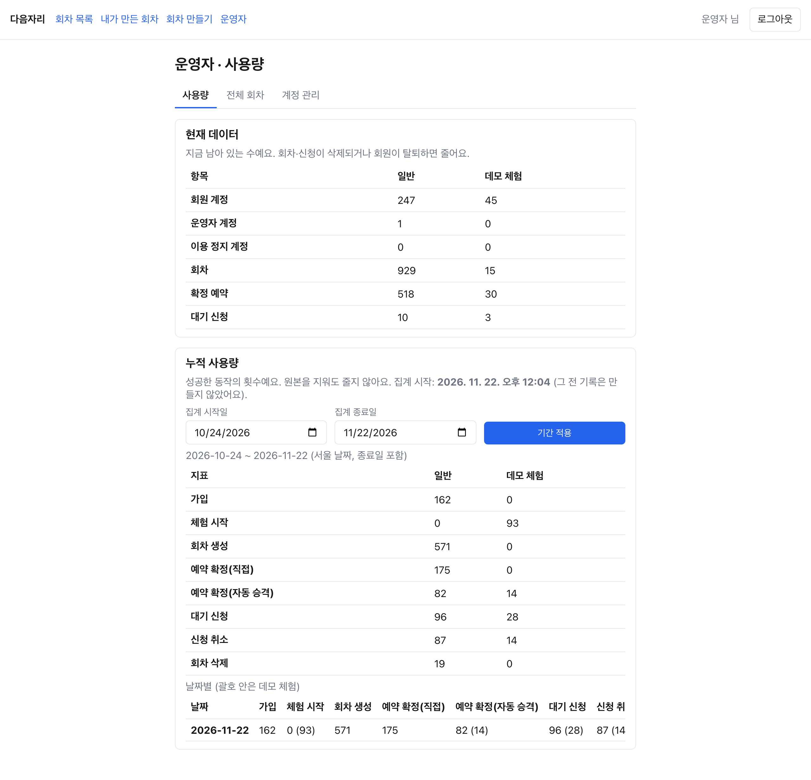 | 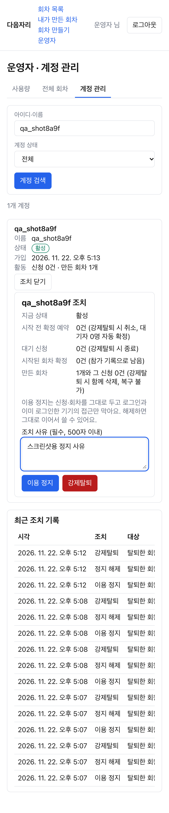 |

### 공개 점검 스크립트

[`loadtest/public-stage3-check.mjs`](loadtest/public-stage3-check.mjs): 운영자 아이디·비밀번호를 실행할 때 입력받고(비밀번호는 화면에 안 보이고 저장·출력하지 않음), 전용 테스트 회원 A·B 와 `[QA]` 회차로 영향 미리보기·정지·차단·해제·강제탈퇴·조치 기록·대시보드를 확인한 뒤 정리한다. 조치 대상은 스크립트가 만든 계정뿐이고, 조치 기록 3행은 감사 기록이라 남는다(익명화된 계정 id 만 가리킴). 사용자가 실행한다:

```bash
cd "/Users/wonjun/code/waiting/실시간 예약 대기열" && node loadtest/public-stage3-check.mjs
```

로컬 운영 이미지 리허설(`deploy/docker-compose.prod.yml`, JDBC 세션·프록시 토큰, 일회용 운영자, 2026-11-22 08:15 UTC) 실제 출력:

```
08:15:52 운영자 로그인 200
08:15:52 A qa_ma11220815 가입 201 / 로그인 200
08:15:52 B qa_mb11220815 가입 201 / 로그인 200
08:15:52 [QA] 회차 1: A 예약 201, B 대기 201 | A 회차 생성 201 /sessions/2
08:15:52 A 검색 200 (계정 #2) | 영향: 시작 전 확정 1, 승격 1, 대기 0, 만든 회차 1(신청 0)
08:15:52 사유 없는 정지 400 VALIDATION_FAILED | 정지 200 → A 기존 세션 401 UNAUTHENTICATED, A 재로그인 403 ACCOUNT_SUSPENDED
08:15:52 해제 200 → A 재로그인 200
08:15:52 강제탈퇴 200 WITHDRAWN → B 신청 ["CONFIRMED"], A 회차 404 SESSION_NOT_FOUND, A 세션 401 UNAUTHENTICATED
08:15:52 조치 기록: [["FORCE_WITHDRAW","탈퇴한 회원 #2","공개 점검: 강제탈퇴 확인",1,1],["UNSUSPEND","탈퇴한 회원 #2","공개 점검: 해제 확인",0,0],["SUSPEND","탈퇴한 회원 #2","공개 점검: 정지 확인",0,0]]
08:15:52 대시보드 200 집계 시작 2026-11-22T08:15:27.757099Z | 현재 일반 회차 1, 정지 계정 0
08:15:52 3단계 공개 점검 통과
08:15:52 정리: [QA] 회차 1 삭제 204
08:15:52 정리: B 탈퇴 204
08:15:53 정리: 운영자 로그아웃 204
```

리허설 뒤 DB: 회차 0·신청 0·남은 활성 회원 0, 탈퇴(익명화) 계정 2, 조치 기록 3. 리허설 컨테이너는 볼륨째 지웠다.

## 공통 디자인·모션·전체 흐름 (4단계, 2026-11-22)

마이그레이션 없음 (화면만).

| 요소 | 규칙 |
|---|---|
| 버튼 | 기본: 채움·포인터 커서. hover: 진한 색(보조 버튼은 배경). 키보드 포커스: 2px 링(`:focus-visible`). 눌림: 1px 내려가고 0.98배. 진행 중(`.loading`): 진행 커서·흐리게, `aria-busy`. 비활성: 50% 투명·금지 커서, hover 없음 |
| 카드 | 제목 링크의 덮개가 카드 전체를 상세 이동 영역으로 만든다. hover: 배경·테두리·그림자·2px 위로. 카드 안 `수정`·`관리`·`명단·삭제` 링크는 덮개 위에 있어 상세로 가지 않는다. 키보드로 제목에 오면 카드 전체에 포커스 링 |
| 메뉴 | 주 메뉴(`aria-label="주 메뉴"`)·운영자 탭은 현재 위치를 `aria-current="page"` 로 표시(굵게·밑줄). hover 배경, 키보드 포커스 링 |
| 입력·선택 | 포커스되면 테두리가 강조색, 3px 링 |
| 순번 변경 | 상세·내 신청에서 다른 사람의 취소로 대기 순번이 앞당겨지거나 확정되면 해당 칸을 1.6초 노란 배경으로 강조(`data-changed`)하고 `role=status` 로 "대기 순번이 2번에서 1번으로 앞당겨졌어요." / "대기 순번이 되어 예약이 확정됐어요." 를 알린다. 처음 본 상태·본인 신청·취소는 알리지 않는다 ([`reservationChange.ts`](frontend/src/lib/reservationChange.ts), 단위 테스트 3) |
| 모션 | 전환 180ms. `prefers-reduced-motion: reduce` 이면 전환·애니메이션을 0.01ms 로, 이동·확대는 없앤다. 강조는 움직임 없는 배경으로만 |
| 터치 | 탭한 뒤 hover 모양이 남지 않게(`hover: none`), 누르는 동안만 눌림 피드백. 탭 강조색은 끈다 |

데모 버튼(로딩·중복 클릭 방지·서버 기동 안내·시간 초과 복구)과 상세 복귀 최신 확인은 그대로다 (기존 e2e 그대로 통과).

### 테스트 (2026-11-22, 로컬)

- 새 e2e: [`design.spec.ts`](frontend/e2e/design.spec.ts) 7 (버튼 기본·hover·포커스·비활성과 150~200ms 전환, 입력·선택 포커스, 메뉴 현재 위치, 카드 클릭 영역과 관리 링크 분리, 기본 모션의 카드 이동, 동작 줄이기에서 이동 없음·전환 즉시, 키보드만으로 로그인→검색→카드→예약→취소), [`full-flow.spec.ts`](frontend/e2e/full-flow.spec.ts) 2 (가입 → 회차 만들기 → 검색 → 대기 2번 → 앞사람 취소로 1번(강조·안내) → 확정(강조·안내, 1.6초 뒤 강조 해제) → 운영자 계정 관리에서 이 회원 확인, 데스크톱·375px 모바일).
- 전체: 백엔드 439 통과(실패 0), e2e 79 통과, 프런트 단위 12, `tsc`·`eslint` 오류 0.

스크린샷 (로컬): `docs/screenshots/stage4-card-hover-desktop.png`(카드 hover·메뉴 현재 위치), `stage4-focus-hover-desktop.png`(검색 버튼 hover·검색어 포커스 링), `stage4-menu-focus-desktop.png`(운영자 탭 키보드 포커스), `stage4-list-mobile.png`, `stage4-position-change-{desktop,mobile}.png`(대기 순번 변경 강조와 안내).

| 카드 hover (데스크톱) | 순번 변경 강조 (모바일) |
|---|---|
| 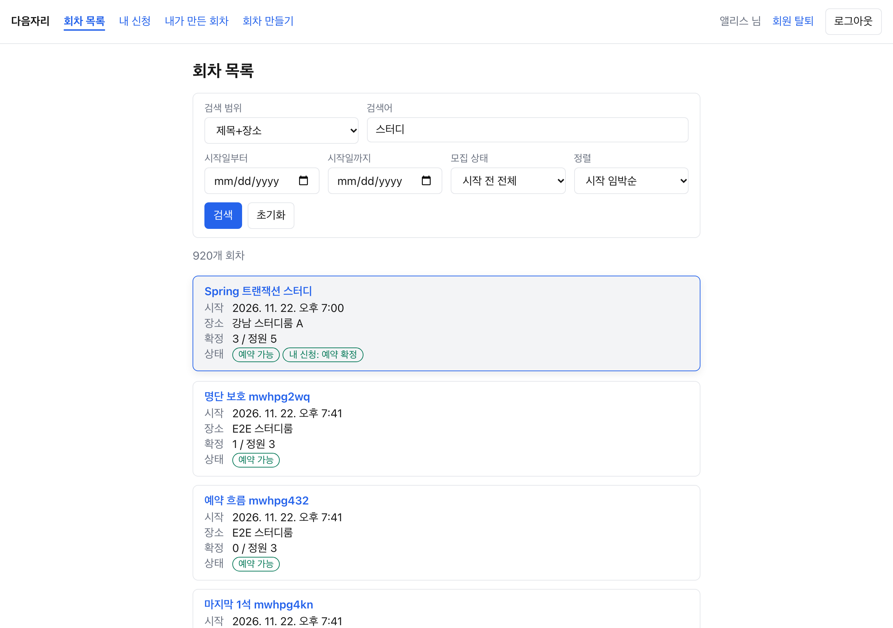 | 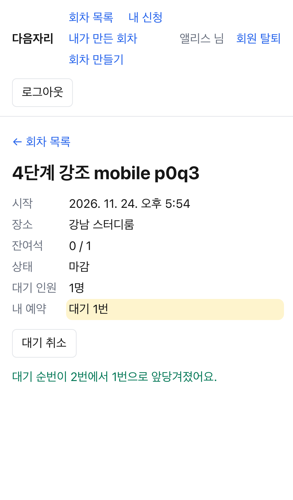 |

후속 작업: 예약 변경 이력 화면 (요청대로 이번 범위에서 제외).

## 공개 검증 (2026-11-22, 개편 4단계 후)

**최종 배포 커밋:** 프런트(Vercel) `5942cf15` (PR #34 병합, 배포 상태 success). 백엔드(Render) `a9d77d4c` (PR #33 병합, V10 포함). GitHub 배포 기록상 백엔드 배포는 08:25:57 시작 → 08:29:50 UTC success 였다. PR #34 는 프런트·문서만 바꿔 백엔드는 다시 배포되지 않았다(백엔드 코드는 `a9d77d4c` 와 같다). 공개 CSS 에 4단계 규칙(`changed-flash`, `aria-current` 메뉴 스타일, `prefers-reduced-motion`)이 들어 있는 것도 확인했다(08:52 UTC).

검증 방법: 비밀번호 없이 [`loadtest/public-stage4-check.mjs`](loadtest/public-stage4-check.mjs) (데모 체험 계정만 사용, 데모 시작 4회, Playwright Chromium 데스크톱 1280px·iPhone 13 에뮬레이션 375px·동작 줄이기). 실제 출력: [`loadtest/results/2026-11-22-public-stage4.txt`](loadtest/results/2026-11-22-public-stage4.txt). 쓴 데이터는 데모 체험 4개뿐이고, 데모 체험은 30분 뒤 서버가 통째로 지운다(별도 정리 불필요).

### 성공 (08:52~08:54 UTC, 실패 0)

| 항목 | 결과 |
|---|---|
| 백엔드 health | 200 (0.26초) |
| 프런트 `/` `/sessions` `/me/sessions` `/operator` `/operator/accounts` `/operator/sessions` | 모두 200 (0.07~0.52초, 화면은 로그인 확인 뒤 그려짐) |
| CSRF·데모 시작 API | 200 (0.2초) · 201 (0.22초) |
| 검색 API 정렬 7종 (`scope=all&status=ALL`) | 7종 모두 200 |
| 없앤 정렬 거절 (`sort=TITLE`) | 400 `VALIDATION_FAILED` |
| 비로그인 보호 API | `/api/operator/usage` `/api/operator/accounts` `/api/operator/actions` `/api/sessions/search` 모두 401 |
| 메뉴 현재 위치 | 데스크톱·모바일·동작 줄이기 모두 `회차 목록` `aria-current=page` |
| 버튼 키보드 포커스 링 (데스크톱) | 정렬 칸에서 Tab → `검색` 버튼, `outline-style: solid` |
| 카드 hover 모션 | 데스크톱 `translateY(-2px)` · 전환 0.18초 / 동작 줄이기 `transform: none` · 전환 0.00001초 |
| 카드 클릭 영역 | 세 환경 모두 장소 글자를 눌러 상세로 이동 |
| 확정 강조·안내 (데모: 대기 신청 → 샘플 참가자 취소) | 세 환경 모두 `data-changed=true` + `role=status` "대기 순번이 되어 예약이 확정됐어요." 1건, 2초 뒤 강조 해제 |
| 가로 스크롤 | 세 환경 모두 0 |

공개 모바일 화면(데모 확정 강조): `docs/screenshots/stage4-public-demo-confirm-mobile.png`.

### 실패

없음. 수정·재검증할 항목이 없었다.

### 미검증 (이유와 확인 방법)

| 항목 | 이유 | 확인 방법 |
|---|---|---|
| V10 마이그레이션 이력 (직접) | **확인 완료** (09:56 UTC, 사용자 Neon 조회): `10 / account moderation / true`, installed_on 08:28:14 UTC | 아래 "V10 적용 확인" |
| 대기 순번 앞당겨짐(2번 → 1번) 공개 확인 | 데모 체험 회차는 대기자가 방문자 1명뿐이라 순번이 앞당겨지는 경우를 만들 수 없다. 이 경우는 로컬 e2e `full-flow.spec.ts`(데스크톱·모바일)로 확인했다 | 일반 계정 셋이 필요하다 (비밀번호 로그인). 아직 미검증 |
| 1단계 공개 점검 [`public-stage1-check.mjs`](loadtest/public-stage1-check.mjs) | **2026-11-22 09:38 UTC 사용자 실행으로 통과** (정리 완료) | 아래 "로그인이 필요한 공개 검증" |
| 3단계 공개 점검 [`public-stage3-check.mjs`](loadtest/public-stage3-check.mjs) (운영자의 다른 회원 회차 삭제·집계 전후·계정 관리·운영자 화면과 API 일치) | **2026-11-22 09:54 UTC 사용자 실행으로 통과** (정리 완료) | 아래 "로그인이 필요한 공개 검증" |
| 공개 운영자 화면 (사용량·전체 회차·계정 관리) | **2026-11-22 09:54 UTC 3단계 점검에서 API 와 일치 확인** (사용량 14개 값·전체 회차·계정 관리·조치 기록) | — |
| 실제 iPhone Safari | 실기기가 없다. 모두 Chromium 기기 에뮬레이션 | 실기기에서 터치 피드백·강조·영상 재생 확인 |

### 스크린샷 교체

`docs/screenshots/stage4-position-change-mobile.png` 를 터치 hover 수정(`6f7d938b`) 뒤 화면으로 다시 찍었다 (**로컬**, iPhone 13 에뮬레이션, 탭으로 조작). 대기 2번 → 1번 앞당겨짐은 공개 데모에서 만들 수 없어 로컬에서 찍었다. 탭한 `대기 취소` 버튼의 배경은 투명(`rgba(0, 0, 0, 0)`)으로 hover 모양이 남지 않는다.

## 로그인이 필요한 공개 검증 (1단계·3단계 통과, Neon 확인 완료)

**1단계 공개 실행 결과 (사용자 실행, 2026-11-22 09:38 UTC): 통과.** 일반 회원의 회차 생성 201·본인 회차 수정 200·내가 만든 회차 검색 1건, 다른 회원(B)의 관리 API 4종 모두 403 `NOT_SESSION_OWNER`, 명단 200, 정원 증설로 대기자 C 승격, 생성자 삭제 204 뒤 B·C 의 신청 행이 취소 이력으로도 남지 않음(물리 삭제), 상세 404 "삭제되었거나 찾을 수 없는 회차입니다." **정리:** 회차 60 삭제, A·B·C 탈퇴 204, 남은 로그인 계정 없음. 앞선 09:17 UTC 시도는 같은 IP 의 가입 한도(15분 5회)로 C 가입에서 429 가 나 멈췄고, 그때도 회차 58 삭제·A·B 탈퇴로 정리됐다(C 는 만들어지지 않음). 출력: [`loadtest/results/2026-11-22-public-stage1.txt`](loadtest/results/2026-11-22-public-stage1.txt).

**3단계 공개 실행 결과 (사용자 실행, 2026-11-22 09:54 UTC, 스크립트 `9b3dab52`): 통과.**
- 운영자가 다른 회원(A)이 만든 회차 63 을 삭제 204, 그 회차의 B 신청 행 0건(취소 이력 포함).
- 삭제 전후 대시보드: 현재 회차 4→3·확정 2→1, 누적 회차 삭제 5→6, 누적 예약 확정 6→6·회차 생성 8→8 (줄지 않음).
- 영향 미리보기(시작 전 확정 1·승격 1·만든 회차 1), 사유 없는 정지 400, 정지 뒤 A 기존 세션 401·재로그인 403 `ACCOUNT_SUSPENDED`, 해제 뒤 재로그인 200, 강제탈퇴 뒤 B 승격 `CONFIRMED`·A 회차 404·A 세션 401, 조치 기록 3행 모두 `탈퇴한 회원 #196`.
- 공개 운영자 화면 = API: 사용량 14개 값 불일치 0, 전체 회차 목록 1건 일치, 계정 관리 카드(`신청 1건 · 만든 회차 0개`)·조치 기록 3행 일치.
- **정리:** `[QA]` 회차 61 삭제, B 탈퇴, A 는 강제탈퇴로 익명화, 운영자 로그아웃. 남는 것: 익명화된 계정 행 2·조치 기록 3행·누적 사용량 증가분.
- 출력: [`loadtest/results/2026-11-22-public-stage3.txt`](loadtest/results/2026-11-22-public-stage3.txt). 09:39 UTC 첫 시도는 비밀번호 안내가 readline 에 지워져 보이지 않던 스크립트 버그로 로그인 401 에서 멈췄다(데이터 변경 없음, `9b3dab52` 에서 원시 입력으로 고침, 실제 pty 로 확인).

**Neon 확인 (사용자 실행, 09:56 UTC): 완료.** 3단계에서 지운 회차 61·62·63 에 대해 `study_session` 0행, `reservation`(`study_session_id`) 0행: 회차와 연결된 신청 행이 공개 DB 에서 물리적으로 지워졌다(DB 직접 확인). 1단계 회차 60 은 API 로 B·C 의 신청 행이 취소 이력으로도 남지 않음을 확인했고, DB 직접 조회 결과로는 세지 않는다. [기록](loadtest/results/2026-11-22-neon-checks.txt)

Claude 는 운영 사이트에 비밀번호로 로그인하지 않는다. 아래 두 스크립트는 사용자가 터미널에서 직접 실행한다. 비밀번호·쿠키·토큰은 출력·저장하지 않는다(테스트 회원 비밀번호는 실행 중 무작위 생성, 운영자 비밀번호는 실행할 때 입력받고 화면에 보이지 않음, 브라우저 확인은 API 로그인 세션 쿠키를 메모리에서 넘김).

**실행 순서** (같은 IP 의 가입 한도 15분 5회: 1단계 3회 + 3단계 2회 = 5회. 다시 돌리려면 15분 기다린다)

```bash
cd "/Users/wonjun/code/waiting/실시간 예약 대기열" && node loadtest/public-stage1-check.mjs
```

```bash
cd "/Users/wonjun/code/waiting/실시간 예약 대기열" && node loadtest/public-stage3-check.mjs
```

| | `public-stage1-check.mjs` | `public-stage3-check.mjs` |
|---|---|---|
| 필요한 권한 | 없음 (일반 회원 3명을 새로 가입) | **운영자 아이디·비밀번호** (실행 중 입력) + 일반 회원 2명 새로 가입 |
| 확인하는 것 | 일반 회원의 회차 생성·수정·내가 만든 회차 조회, 다른 회원의 관리 API 4종 403, 명단·정원 증설(대기자 승격), 생성자 삭제 뒤 신청 행이 취소 이력으로도 남지 않음(물리 삭제)·상세 404 | 운영자가 **다른 회원이 만든 회차**를 삭제(신청 행 0건), 삭제 전후 대시보드(현재 회차·확정 정확히 -1, 누적 회차 삭제 +1, 누적 예약 확정·회차 생성 줄지 않음), 영향 미리보기, 사유 필수, 정지(기존 세션 401·재로그인 403)·해제·강제탈퇴, 조치 기록 익명 표시, **공개 운영자 화면 3개(사용량 14개 값·전체 회차 목록·계정 관리 카드·조치 기록)가 같은 시점 API 응답과 같은지**(헤드리스 Chromium) |
| 만드는·바꾸는 데이터 | 계정 3, `[QA] 1단계 점검 …` 회차 1, 신청 2, 누적 사용량 증가 | 계정 2, `[QA] 3단계 …` 회차 3, 신청 3~4, 조치 기록 3행, 누적 사용량 증가 |
| 정리 | 회차 삭제(신청 함께), 3명 탈퇴 | 회차 모두 삭제, B 탈퇴, A 강제탈퇴(멈췄을 때도 finally 에서), 운영자 로그아웃 |
| 남는 것 | 탈퇴로 익명화된 계정 행 3(`deleted-{id}`), 누적 사용량 증가분 | 익명화된 계정 행 2, **조치 기록 3행**(감사 기록, 대상은 계정 id 만), 누적 사용량 증가분 |
| 끝에 출력되는 확인 | | 지운 회차 id 와 Neon 에서 돌릴 물리 삭제 확인 SQL 2개(기대값 둘 다 0) |

중간에 멈추면 출력의 `중단:` 줄과 `정리:` 줄로 무엇이 남았는지 알 수 있다. 로그인에 실패해 탈퇴할 수 없는 계정이 생기면 아이디가 출력된다.

**로컬 리허설** (로컬 운영 이미지 `deploy/docker-compose.prod.yml`, prod 프로필·JDBC 세션·프록시 토큰, 일회용 운영자, 운영자 비밀번호는 파이프 입력, 2026-11-22 09:09 UTC, 커밋 `a7a26c29`): 두 스크립트 모두 종료 코드 0. 출력에 비밀번호 0건. 운영자 삭제 전후 현재 회차 3→2·확정 2→1, 누적 회차 삭제 1→2·누적 예약 확정 3→3. 운영자 화면 비교 불일치 0. 리허설 DB 에서 지운 회차·신청 0행, 남은 활성 회원 0, 조치 기록 3. 전체 출력: [`loadtest/results/2026-11-22-rehearsal-stage1-stage3.txt`](loadtest/results/2026-11-22-rehearsal-stage1-stage3.txt).

### V10 적용 확인 (확인 완료, 2026-11-22 09:56 UTC 사용자 Neon 조회)

**결과: 확인 완료.** 공개 DB `flyway_schema_history` 맨 위 행이 `10 / account moderation / true` (installed_on 2026-11-22 08:28:14 UTC, Render 배포 08:25:57~08:29:50 UTC 사이), 그 아래 `9 / session search index / true` (04:25:05), `8 / session creator delete usage / true` (03:13:25). [기록](loadtest/results/2026-11-22-neon-checks.txt). Claude 는 Neon·Render 에 로그인하지 않았고 사용자가 실행한 조회 결과다. 사용한 SQL:

```sql
select version, description, success, installed_on
from flyway_schema_history
order by installed_rank desc
limit 3;
```

기대 결과 (맨 위 행): `version = 10`, `description = account moderation`, `success = true`. 그 아래는 `9 / session search index / true`, `8 / session creator delete usage / true`. description 은 파일 이름 `V10__account_moderation.sql` 에서 Flyway 가 만든 값이고, 로컬 운영 이미지 리허설 DB 에서 같은 값을 확인했다.

## 커뮤니티 1단계: 회원 게시판·서비스 공지 (V11, 2026-11-23)

전체 계획(데이터 모델·권한표·API·화면·정책·결정 필요 항목): [`docs/plans/community-plan.md`](docs/plans/community-plan.md).

| 동작 | 비회원 | 데모 | 일반 회원 | 서비스 운영자 |
|---|---|---|---|---|
| 회원 게시판 목록·글 | 401 (화면은 로그인으로) | 조회만 (쓰기 403 `BOARD_WRITE_FORBIDDEN`) | 조회·작성 | 조회·작성 |
| 회원 게시판 글 수정 | ✗ | ✗ | 본인 글만 (남의 글 403 `NOT_POST_AUTHOR`) | 본인 글만 |
| 회원 게시판 글 삭제 | ✗ | ✗ | 본인 글 | 모든 글 |
| 서비스 공지 목록·글 | 조회 | 조회 | 조회 | 조회 |
| 서비스 공지 작성·수정·삭제 | ✗ | ✗ | ✗ 403 | ○ (운영자 공동 관리: 다른 운영자의 공지도 고치고 지움) |

- **API:** `GET /api/boards/{community,notice}/posts?q&field=ALL|TITLE|BODY&page&size`(최신순, 쪽 크기 기본 20·최대 50, 응답에 `canWrite`), `GET /api/posts/{id}`, `POST /api/boards/{board}/posts`, `PATCH /api/posts/{id}`, `DELETE /api/posts/{id}`. 공지 목록·글 상세 `GET` 만 비회원에게 열고(`SecurityConfig`), 회원 게시판 글은 서비스가 로그인 여부를 다시 확인한다. 응답의 `canEdit`·`canDelete` 로 화면이 버튼을 보인다.
- **표시:** 제목·본문·작성자·작성 시각·수정 여부(`edited`, `updatedAt`)·댓글 수(2단계 전 0). 작성자는 공개 라벨만: `운영자`, `탈퇴한 회원`(탈퇴로 익명화된 계정, 글은 남음), 그 밖에는 `회원#{id}` (로그인 아이디를 감추려는 임시 표시, 공개 닉네임은 계획 문서 결정 필요 1번).
- **본문:** 제목 1~100자, 본문 1~5000자. 서버는 원문 텍스트를 그대로 저장·응답하고, 화면은 React 텍스트 노드 + `white-space: pre-wrap` 으로만 그린다(`dangerouslySetInnerHTML` 없음). `<script>`·`` 를 넣은 글이 글자 그대로 보이고 실행되지 않는 것을 e2e 로 확인.
- **삭제:** 물리 삭제. 글 행을 `FOR UPDATE` 로 잠근 뒤 권한을 보고 지운다 (2단계 댓글·추천·멘션·알림은 FK `ON DELETE CASCADE` 로 같은 문장에서 함께 지워질 예정).
- **화면:** `/board`, `/board/new`, `/board/{id}`, `/board/{id}/edit`, `/notices` 같은 구성. 주 메뉴에 `게시판`·`공지사항`. 검색 조건(검색어·범위·쪽)은 주소에 남고 `← 게시판 목록` 은 마지막 목록으로 돌아간다. 목록 한 줄 전체가 상세 이동 영역(카드와 같은 덮개 방식). 로딩·빈 목록·권한 없음·삭제된 글(목록 링크)·오류(다시 시도) 화면. 비회원 공지 화면은 공개 머리글(공지사항·로그인).
- **V11 운영 적용 주의:** 새 표 `board_post`(빈 표)와 인덱스 1개. 기존 표 변경 없음. Render 배포 때 Flyway 자동 적용.

테스트 (2026-11-23, 로컬 Apple M4 Pro macOS 27.2, JDK 17, Testcontainers PostgreSQL 16, Playwright 1.64.1 Chromium, 커밋 `010e6f12`): 백엔드 전체 447개 통과(새 [`BoardPostApiTests`](backend/src/test/java/com/daumjari/BoardPostApiTests.java) 8: 작성·수정·삭제, 타인 403·운영자 삭제, 비회원 공지 열람·게시판 401, 공지 운영자 전용, 데모 조회만, 검증·원문 저장, 검색·쪽, 탈퇴 작성자 표시), e2e 85개 통과(새 [`board.spec.ts`](frontend/e2e/board.spec.ts) 6: 회원 글 흐름·권한별 버튼·삭제된 글 안내, XSS, 검색·쪽 주소 유지, 비회원 공지·공지 쓰기 권한, 데모 조회만, 375px·키보드), 프런트 단위 15(새 `boardSearch.test.mjs` 3), `tsc`·`eslint` 오류 0.

스크린샷 (로컬): `docs/screenshots/community1-board-list-*`, `community1-post-detail-*`, `community1-notice-public-*`(비회원), `community1-post-form-desktop.png`.

### 1단계 공개 검증

- **비밀번호 없는 점검 (2026-11-23 11:33 UTC, PR #39 배포본): 12/12 성공.** [`loadtest/public-community1-open-check.mjs`](loadtest/public-community1-open-check.mjs). 비회원 공지 목록 200(`canWrite=false`), 비회원 회원 게시판 API 401·화면은 로그인으로 이동, 비회원 공지 작성 401, `page=0` 400, 데모 계정 게시판 조회 200·작성 403·공지 작성 403, 비회원 공지·데모 게시판 화면 375px 가로 넘침 0·글쓰기 버튼 없음. 공지가 0건이라 비회원 공지 상세는 아래 로그인 점검에서 확인한다. 쓴 데이터는 데모 체험 2개(30분 뒤 자동 삭제). [기록](loadtest/results/2026-11-23-public-community1-open.txt)
- **로그인 필요한 점검 (사용자 실행 2026-11-23 11:54 UTC): 통과.** [`loadtest/public-community1-check.mjs`](loadtest/public-community1-check.mjs). 본문에 `<script>` 가 든 글이 원문 그대로 저장·응답, 다른 회원의 수정·삭제 403 `NOT_POST_AUTHOR`, 작성자 수정 200(수정됨), 제목 검색 1건, 운영자의 회원 글 삭제 204 → 상세 404, 운영자 공지 작성 201·수정 200, 비회원 공지 상세 200(작성자 `운영자`), 회원의 공지 작성 403·수정 403, 공지 삭제 204. **정리:** 글 3개 모두 삭제, 두 회원 탈퇴 204, 운영자 로그아웃. 남는 것: 익명화된 계정 행 2. Neon 확인(`select count(*) from board_post where id in (1, 2, 3);`) **0 — 공개 DB 에서 물리 삭제 확인** (사용자 조회 11:56 UTC). 작성자가 `회원#207` 로 보인 것은 1단계 배포본의 임시 표시이고, 2단계 배포부터 공개 닉네임(기본 `회원{id}`)으로 바뀐다. [기록](loadtest/results/2026-11-23-public-community1.txt). 로컬 운영 이미지 리허설도 통과 [기록](loadtest/results/2026-11-23-rehearsal-community1.txt).

  ```bash
  cd "/Users/wonjun/code/waiting/실시간 예약 대기열" && node loadtest/public-community1-check.mjs
  ```

- 운영자 입력·공통 HTTP 처리는 [`loadtest/lib/`](loadtest/lib/) 로 옮겨 3단계 점검 스크립트와 함께 쓴다(옮긴 뒤 3단계 점검도 리허설 통과).

| 회원 게시판 (모바일) | 비회원 공지 (데스크톱) |
|---|---|
| 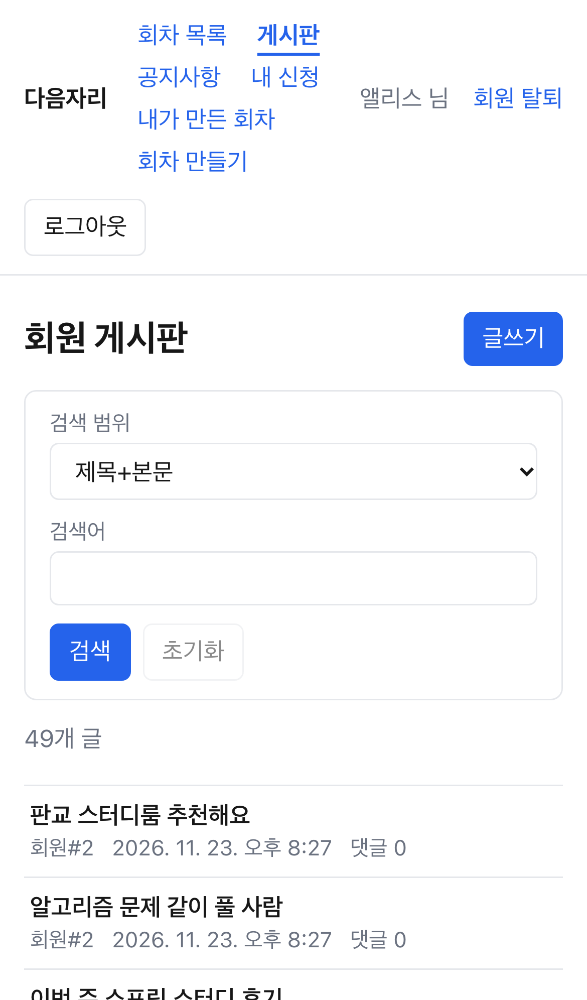 | 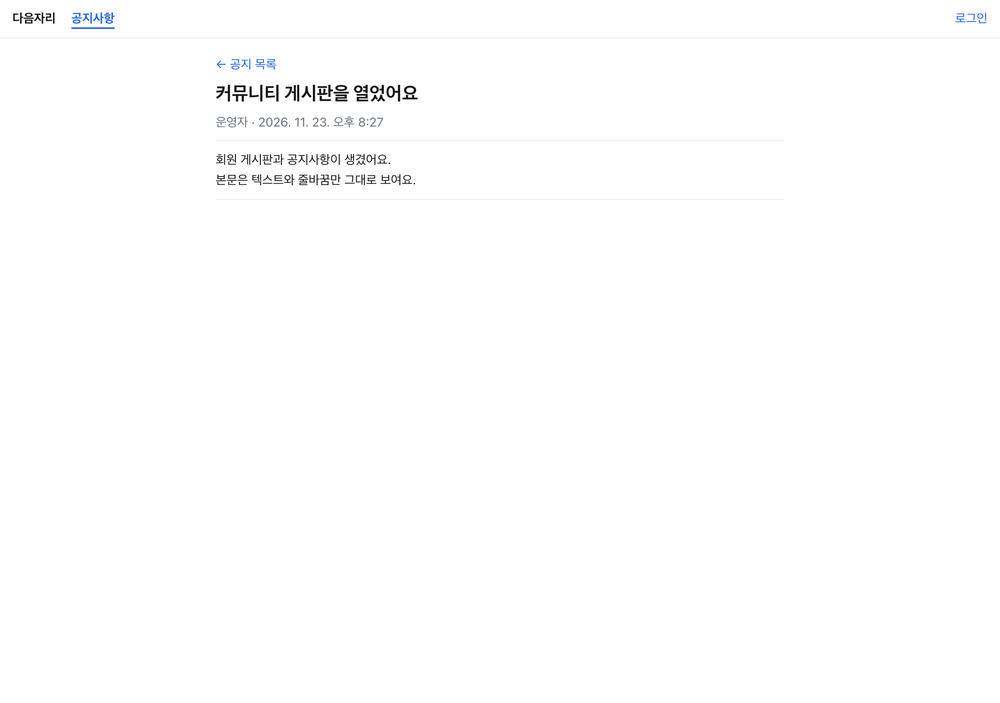 |

## 커뮤니티 2단계: 댓글·한 단계 답글·추천·멘션·공개 닉네임 (V12, 2026-11-23)

| 동작 | 비회원 | 데모 | 일반 회원 | 서비스 운영자 |
|---|---|---|---|---|
| 댓글·답글 조회 | 공지 글만 (회원 게시판 글 401) | 조회 | 조회 | 조회 |
| 댓글·답글 작성, 추천 | ✗ 401 | ✗ 403 `COMMENT_WRITE_FORBIDDEN` | ○ | ○ |
| 수정 | ✗ | ✗ | 본인만 (403 `NOT_COMMENT_AUTHOR`) | 본인만 |
| 삭제 | ✗ | ✗ | 본인 | 모두 |

- **API:** `GET /api/posts/{id}/comments`(댓글과 그 아래 답글, 작성순), `POST /api/posts/{id}/comments {body, parentId?}`, `PATCH`·`DELETE /api/comments/{id}`, `PUT`·`DELETE /api/comments/{id}/like`(추천·취소, 멱등), `GET /api/mentions/candidates?q`(로그인 필요), `GET`·`PATCH /api/me/profile {nickname}`. 응답에 `likeCount`·`liked`·`replyCount`·`canEdit`·`canDelete`·`mentions`.
- **한 단계 답글:** `parentId` 가 답글이면 400 `REPLY_DEPTH_EXCEEDED`, 다른 글의 댓글이면 400. DB 트리거도 같은 규칙으로 막는다(마지막 방어선).
- **추천:** 기본 키 `(comment_id, account_id)` 로 계정당 한 번. 화면은 누르면 바뀌지만 API 는 추천(`PUT`)과 취소(`DELETE`)가 따로라 겹친 요청이 서로를 지우지 않는다.
- **삭제 정책 (요청 기본안):** 글 삭제 → 댓글·답글·추천·멘션, 부모 댓글 삭제 → 답글과 그 추천·멘션을 FK `ON DELETE CASCADE` 로 같은 트랜잭션에서 물리 삭제(승격·복구 없음). 확인창이 함께 지워지는 답글·댓글 수를 안내한다.
- **경합:** 댓글 작성은 글 행을, 답글 작성·추천은 부모 댓글 행을 공유 잠금하고, 글·댓글 삭제는 그 행을 배타 잠금한다. 삭제 전에 끝난 쓰기는 함께 지워지고, 늦은 쓰기는 404. [`CommentConcurrencyTests`](backend/src/test/java/com/daumjari/CommentConcurrencyTests.java): 같은 계정 이중 추천 → 행 1개, 글 삭제 vs 댓글 작성 → 남은 댓글 0, 부모 삭제 vs 답글·추천 → 고아 답글·추천·멘션 0 (각 20회, 실제 PostgreSQL).
- **공개 닉네임 (결정 필요 1번 추천안 A):** `account.nickname`(2~20자, 중복 허용, `@ [ ] #` 와 `운영자`·`탈퇴한 회원`·`회원+숫자` 금지). 비어 있으면 `회원{id}` 로 보인다(기존 회원 백필 없이 같은 표시). 작성자 표시는 운영자 `운영자`, 탈퇴 `탈퇴한 회원`(탈퇴하면 닉네임도 지움), 그 밖에는 닉네임. 로그인 아이디는 어떤 커뮤니티 응답에도 없다. 머리글 `내 정보` 에서 바꾼다.
- **멘션:** 본문의 `@[이름#계정id]` 토큰을 계정 id 로 연결(`mention` 표, 원본 CASCADE). 이름 부분은 쓸 때의 표시일 뿐이고 화면은 현재 닉네임으로 보인다. 탈퇴·데모·정지·없는 계정은 연결하지 않는다(글자 그대로 남음). 고칠 때는 새로 생긴 멘션만 추가하고 사라진 멘션은 연결만 지운다(3단계 알림은 새로 추가된 사람에게만). 후보 검색은 닉네임 부분 일치, 최대 10명, 응답은 `{id, nickname}` 뿐.
- **화면:** 글 상세 아래 댓글 목록·작성칸. 답글은 들여쓰기와 왼쪽 선, 답글에는 답글 버튼 없음. 추천 버튼은 `aria-pressed` 와 `추천 N`/`추천함 N`. `@` 입력 시 후보 목록(combobox·listbox, ↓↑·Enter·Esc). 비회원(공지)·데모는 읽기만 안내. 본문은 텍스트 노드로만 그린다(HTML 해석 없음).
- **V12 운영 적용 주의:** `account.nickname` 칸 추가(전부 null), 새 표 `comment`·`comment_like`·`mention`, 트리거 함수 `check_comment_depth`. 기존 행 변화 없음. Flyway 자동 적용.

테스트 (2026-11-23, 로컬 같은 환경, 커밋 `248d6105`): 백엔드 전체 516개 통과(새 [`CommentApiTests`](backend/src/test/java/com/daumjari/CommentApiTests.java) 9, `CommentConcurrencyTests` 60), e2e 89개 통과(새 [`comments.spec.ts`](frontend/e2e/comments.spec.ts) 4: 댓글·답글·추천·수정·삭제 확인, 키보드 멘션·HTML 글자 그대로, 비회원·데모 읽기만, 닉네임 변경), 프런트 단위 18(새 `mention.test.mjs` 3), `tsc`·`eslint` 오류 0.

스크린샷: `docs/screenshots/community2-comments-{desktop,mobile}.png` (답글 들여쓰기, 추천 상태, 멘션 강조, `@` 후보 목록).

### 2단계 공개 검증

- **비밀번호 없는 점검 (2026-11-23 12:01 UTC, PR #41 배포본): 5/5 성공.** [`loadtest/public-community2-open-check.mjs`](loadtest/public-community2-open-check.mjs). 비회원 댓글 조회 경로 열림(없는 글 404), 비회원 댓글·추천·멘션 후보·내 정보 401, 데모 댓글·추천 403 `COMMENT_WRITE_FORBIDDEN`·닉네임 403, 멘션 후보 응답 필드 `id`·`nickname` 뿐(로그인 아이디 없음). 공개 글이 없어 실제 댓글 열람은 아래 로그인 점검에서 본다. 데모 체험 1개(30분 뒤 자동 삭제). [기록](loadtest/results/2026-11-23-public-community2-open.txt)
- **로그인 필요한 점검 (사용자 실행 2026-11-23 12:07~12:08 UTC, PR #41·#42 배포본): 통과.** [`loadtest/public-community2-check.mjs`](loadtest/public-community2-check.mjs), 운영자 아이디·비밀번호 실행 중 입력, 일반 회원 2명 가입. 댓글·답글·답글의 답글 400, 같은 계정 추천 동시 2번 → 1개·취소 → 0, 닉네임으로 멘션 후보 찾기(필드 확인)·멘션 저장·표시, 남의 댓글 수정·삭제 403, 운영자 댓글 삭제, 부모 삭제 시 답글 함께 삭제, 비회원 공지 댓글 열람, 글 삭제 시 댓글 목록 404. **정리:** 남은 글 삭제, 두 회원 탈퇴, 운영자 로그아웃, 끝에 Neon 확인 SQL(남은 글·댓글·추천·멘션, 기대값 모두 0). 로컬 운영 이미지 리허설 통과(출력에 비밀번호 0건, 리허설 DB 0|0|0|0) [기록](loadtest/results/2026-11-23-rehearsal-community2.txt). 실제 실행: 답글의 답글 400 `REPLY_DEPTH_EXCEEDED`, 동시 추천 200·200 → 1개·취소 → 0, 멘션 후보 필드 `id`·`nickname`(로그인 아이디 없음), 남의 댓글 403 `NOT_COMMENT_AUTHOR`, 부모 삭제 뒤 답글 남음 false, 비회원 공지 댓글 200·쓰기 불가, 글 삭제 뒤 댓글 목록 404, 정리(글 삭제·두 회원 탈퇴·로그아웃) 모두 204. Neon 조회(12:10~12:14 UTC) 남은 글·댓글·추천·멘션 모두 0행(물리 삭제 확인 완료). [기록](loadtest/results/2026-11-23-public-community2.txt)

  ```bash
  cd "/Users/wonjun/code/waiting/실시간 예약 대기열" && node loadtest/public-community2-check.mjs
  ```

## 커뮤니티 3단계: 사이트 알림함 (V13, 2026-11-23)

| 동작 | 비회원 | 데모 | 일반 회원·운영자 |
|---|---|---|---|
| 알림 목록·읽지 않은 수·읽음·모두 읽음·열기 | ✗ 401 | 본인 것 | 본인 것 (남의 알림은 404 `NOTIFICATION_NOT_FOUND`) |

- **알림 종류:** `PROMOTED`(대기자가 취소·정원 증가로 확정됨, 대상 회차), `MENTION`(글·댓글·답글에서 멘션됨, 대상 글·댓글). 문구는 저장하지 않고 읽을 때 대상의 현재 제목·멘션한 사람의 공개 라벨로 만든다(로그인 아이디 없음).
- **API:** `GET /api/me/notifications`(최신 50건과 `unreadCount`), `GET /api/me/notifications/unread-count`, `POST /api/me/notifications/{id}/read`, `POST /api/me/notifications/read-all`, `POST /api/me/notifications/{id}/open` → `{href}`(`/sessions/{id}` 또는 `/board|notices/{글}#comment-{댓글}`).
- **같은 트랜잭션·중복 없음:** 승격 알림은 `WaitlistPromoter` 안에서, 멘션 알림은 글·댓글 저장과 같은 트랜잭션에서 쓴다(`Notifier` 는 `Propagation.MANDATORY`). 취소·정원 변경이 롤백되면 알림도 없다([`PromotionRollbackTests`](backend/src/test/java/com/daumjari/PromotionRollbackTests.java), 실제 PostgreSQL). `event_key` 유니크(`PROMOTED:{신청}`, `MENTION:post:{글}:{계정}`, `MENTION:comment:{댓글}:{계정}`)와 `on conflict do nothing` 으로 반복·재시도에도 한 번만 남는다.
- **멘션 규칙:** 자기 멘션은 알리지 않는다. 고칠 때는 2단계 멘션 동기화가 돌려준 '새로 추가된' 계정에게만 알린다(이미 있던 사람에게 다시 알리지 않음, 지웠다 다시 넣어도 같은 열쇠라 한 번).
- **이동 전 권한 확인:** `열기` 는 그 순간 대상 조회 권한을 다시 본다(회차는 회차 상세 규칙, 글은 게시판 조회 규칙). 대상이 없거나 볼 수 없으면 그 오류를 그대로 돌려주고 읽음으로 바꾸지 않는다. 남의 알림 id 는 없는 것처럼 404.
- **정리:** 대상(회차·글·댓글)이나 받는 계정이 지워지면 FK `ON DELETE CASCADE` 로 같은 문장에서 함께 지워진다. 회원 탈퇴는 계정 행이 남으므로(익명화) 탈퇴 트랜잭션 안에서 받은 알림을 지운다(중간 실패 시 함께 롤백).
- **화면:** 머리글 `알림` 버튼에 읽지 않은 수(버튼 이름도 "알림, 읽지 않은 알림 N개" 로 글자 제공). 보이는 탭에서만 30초마다(`NEXT_PUBLIC_NOTIFICATION_POLL_MS`), 탭 복귀·재연결 때 즉시 `useVisiblePolling` 으로 다시 읽고, 앞 요청이 끝나기 전에는 새 요청을 보내지 않는다. `/me/notifications` 는 읽음 상태를 색(왼쪽 선·배지)과 글자(`읽지 않음`/`읽음`)로 함께 보이고, 열기·읽음 표시·모두 읽음 결과를 `role=status` 로 알린다. 댓글 알림을 열면 그 댓글로 옮겨 가 초점을 둔다. 불러오기 실패는 다시 시도 버튼, 알림 없음은 빈 안내.
- **V13 운영 적용 주의:** 새 표 `notification` 과 인덱스 2개만 추가(기존 행 변화 없음). Flyway 자동 적용.
- **한계(shortcut):** 목록은 쪽 나눔 없이 최신 50건. 읽은 알림 보관 기간 정리는 없음(대상 삭제 시에만 지워짐). 필요해지면 후속.

테스트 (2026-11-23, 로컬, 커밋 `6ef3eb2d`): 백엔드 전체 524개 통과(새 [`NotificationApiTests`](backend/src/test/java/com/daumjari/NotificationApiTests.java) 8: 글 멘션·자기 제외, 수정 시 새 멘션만, 댓글·답글 멘션과 대상 삭제 시 정리, 읽음·모두 읽음·열기 주소, 남의 알림 404·비회원 401, 취소 승격 1건·열기, 정원 증가 승격·회차 삭제 정리, 탈퇴 시 정리 / `PromotionRollbackTests` 에 롤백 시 알림 0·성공 시 1 추가), e2e 92개 통과(새 [`notifications.spec.ts`](frontend/e2e/notifications.spec.ts) 3: 탭 복귀 즉시 갱신·열기 → 댓글 초점·읽음, 승격 알림 → 회차·모두 읽음, 글 삭제 시 알림 사라짐), 프런트 단위 21(새 `notification.test.mjs` 3), `tsc`·`eslint` 오류 0.

스크린샷: `docs/screenshots/community3-inbox-{desktop,mobile}.png` (머리글 읽지 않은 수, 읽지 않음·읽음 배지, 열기·읽음 표시).

### 3단계 공개 검증

- **비밀번호 없는 점검 (2026-11-24 19:53 UTC, 배포 `6caf8492`): 4/4 성공.** [`loadtest/public-community3-open-check.mjs`](loadtest/public-community3-open-check.mjs). 비회원 알림 API 401, 데모 알림함 200·읽지 않은 수 일치, 없는·남의 알림 읽기·열기 404. 데모 체험 1개(30분 뒤 자동 삭제). [기록](loadtest/results/2026-11-24-public-community3-open.txt)
- **배포 기록:** PR #43 병합 직후 Render 배포(`48f1dacc`)가 31초 만에 실패해 이전 백엔드가 남았고(2026-11-23 12:26 UTC), 그때 사용자가 돌린 로그인 점검은 알림 API 404 로 멈췄다(정리는 모두 204). 로컬에서 같은 커밋 운영 이미지는 정상 기동·V13 적용. PR #44 병합 배포(`6caf8492`, 2026-11-24 19:48~19:52 UTC)에서 V13·V14 가 함께 적용됐다. 점검 스크립트는 이제 가입 전에 새 API 배포를 확인한다.
- **로그인 필요한 점검 (사용자 실행 2026-11-24 19:57 UTC): 통과.** 자기 멘션 제외(A 0·B 1), 수정 시 중복 없음, 댓글 멘션 열기 `/board/8#comment-6`, 남의 알림 404, 취소 두 번에도 승격 알림 1건·열기 `/sessions/72`, 모두 읽음 0, 글 삭제 뒤 알림 0건. Neon 조회(20:00 UTC) 남은 행 모두 0(물리 삭제 확인 완료). [기록](loadtest/results/2026-11-24-public-community3.txt) [`loadtest/public-community3-check.mjs`](loadtest/public-community3-check.mjs), 운영자 아이디·비밀번호 실행 중 입력, 일반 회원 2명 가입. 글 멘션(자기 제외)·수정 시 중복 없음·댓글 멘션 열기 주소·남의 알림 404·취소 두 번에도 승격 알림 1건·열기 주소·모두 읽음·글 삭제 시 알림 사라짐. **정리:** 회차 삭제, 남은 글 삭제, 두 회원 탈퇴(받은 알림 삭제), 운영자 로그아웃, 끝에 Neon 확인 SQL(남은 알림·글·회차, 기대값 모두 0). 로컬 리허설 통과(출력에 비밀번호 0건, 리허설 DB 0|0|0) [기록](loadtest/results/2026-11-23-rehearsal-community3.txt).

  ```bash
  cd "/Users/wonjun/code/waiting/실시간 예약 대기열" && node loadtest/public-community3-check.mjs
  ```

## 커뮤니티 4단계: 모임 신청·승인·가입 (V14, 2026-11-23)

| 동작 | 비회원 | 데모 | 일반 회원 | 서비스 운영자 | 모임 생성자 |
|---|---|---|---|---|---|
| 승인 모임 목록·소개·홍보 | ✗ 401 | 조회만 | ○ | ○ | ○ |
| 승인 전(대기·반려·취소) 신청 보기 | ✗ | ✗ 404 | ✗ 404 | ○ | ○ |
| 신청·수정·신청 취소 | ✗ | ✗ 403 `CLUB_FORBIDDEN` | 신청 ○ | 신청 ○ | 수정·취소는 생성자만 (403 `NOT_CLUB_CREATOR`) |
| 승인·반려 | ✗ | ✗ | ✗ 403 | ○ (사유 필수) | ✗ |
| 가입·탈퇴 | ✗ | ✗ 403 | ○ | ○ | 탈퇴 ✗ 409 `CREATOR_CANNOT_LEAVE` |
| 모임 삭제 | ✗ | ✗ | ✗ 403 | ○ | ○ |

- **상태:** `PENDING`(승인 대기) → `APPROVED`(승인됨) · `REJECTED`(반려됨, 사유 표시) / `CANCELLED`(신청자 취소, 대기 중에만). 임시 저장(`DRAFT`)은 두지 않았다: 신청서가 네 칸뿐이라 제출이 곧 신청이다.
- **수정 정책 (계획 문서 정책안 그대로):** 대기 중 수정은 그대로 대기, 반려·취소된 신청은 고치면 다시 `PENDING`(재신청, 반려 사유 지움), 승인된 모임은 **재승인 없이 즉시 반영**(서비스 운영자는 사후 삭제 가능).
- **승인·반려 vs 신청자 수정 경합:** 모임 행의 `version`. 운영자 화면은 본 `version` 을 함께 보내고, 그 사이 신청자가 고치거나 취소했거나 이미 결정됐으면 409 `CLUB_CHANGED`(화면: "바뀌었어요, 다시 확인" 뒤 새로 읽음). 결정·수정·취소는 모두 모임 행 `FOR UPDATE` 로 줄을 선다.
- **결과 알림:** 승인·반려는 결정과 같은 트랜잭션에서 3단계 알림함에 `CLUB_APPROVED`·`CLUB_REJECTED` 로 남는다. 사건 열쇠 `CLUB_{결과}:{모임}:{결정 뒤 version}` 이라 같은 결정은 한 번, 반려 뒤 재신청의 다음 결정은 따로 알린다. 열기는 그 순간 볼 수 있는지 다시 확인하고 승인 모임은 `/clubs/{id}`, 그 밖에는 `/me/clubs` 로 보낸다.
- **가입:** 즉시 가입, `club_member` 기본 키 `(club_id, account_id)` 로 중복 없음(겹친 요청도 200·200, 행 1개). 가입·탈퇴는 모임 행 `FOR SHARE`, 삭제는 `FOR UPDATE` 라 삭제 전에 끝난 가입은 함께 지워지고 늦은 가입은 404. 승인될 때 생성자가 첫 모임 운영자(`MANAGER`)로 들어간다(임명·회수는 5단계).
- **생성자 정책 (결정 4 추천안 B):** 생성자는 모임 탈퇴 불가(5단계에서 이전 기능 전까지는 삭제). 계정을 탈퇴하면 만든 모임은 상태와 관계없이 회원·알림과 함께 삭제되고, 가입한 모임에서는 빠진다. 기존 탈퇴 트랜잭션(계정 잠금 → 신청 정리 → 알림 정리 → 모임 정리 → 익명화) 안이라 중간 실패 시 전부 롤백. 탈퇴 화면에 안내 추가.
- **API:** `POST /api/clubs {name, intro, place, mode}`, `PATCH /api/clubs/{id}`, `POST /api/clubs/{id}/cancel`, `DELETE /api/clubs/{id}`, `GET /api/clubs?q&page&size&sort=members`, `GET /api/clubs/{id}`, `GET /api/me/clubs`(`applications`·`joined`), `POST /api/clubs/{id}/join`·`/leave`, 운영자 `GET /api/operator/clubs?status`, `POST /api/operator/clubs/{id}/approve {version}`·`/reject {version, reason}`. 응답의 `rejectReason`·`version` 은 생성자·운영자에게만, 생성자는 공개 라벨만.
- **화면:** 메뉴 `모임 홍보`(회원 많은 순 소개 탐색) · `모임 목록`(이름·소개 검색, 쪽, 주소 유지) · `내 모임`(내가 낸 신청의 진행 단계를 색 배지와 글자로, 반려 사유, 가입한 모임). 신청 `/clubs/new` 과 수정 `/clubs/{id}/edit` 은 따로, 소개 화면에서 가입·탈퇴·수정·신청 취소·삭제(확인창에 지워질 회원 수). 운영자 `운영자 → 모임 승인` 탭. 데모는 목록·소개만(안내 문구, 신청·가입 버튼 없음).
- **V14 운영 적용 주의:** 새 표 `club`·`club_member`(빈 표)와 인덱스 3개, `notification` 에 `club_id` 칸(전부 null)과 종류·대상 체크 제약 교체. 기존 행 변화 없음. Flyway 자동 적용.

테스트 (2026-11-23, 로컬, 커밋 `f02c7619`): 백엔드 전체 614개 통과(새 [`ClubApiTests`](backend/src/test/java/com/daumjari/ClubApiTests.java) 10, [`ClubConcurrencyTests`](backend/src/test/java/com/daumjari/ClubConcurrencyTests.java) 4×20: 승인 vs 수정 경합에서 본 적 없는 내용 승인 없음, 이중 승인 → 결정·알림·운영자 행 1개, 같은 계정 이중 가입 → 행 1개, 삭제 vs 가입 → 남은 회원 0, 실제 PostgreSQL), e2e 96개 통과(새 [`clubs.spec.ts`](frontend/e2e/clubs.spec.ts) 4), 프런트 단위 25, `tsc`·`eslint` 오류 0. 고친 것: 운영자 카드의 이름에 `.title` 을 쓰면 카드 덮개 링크가 승인·반려 버튼을 가려 `strong` 으로 바꿈.

스크린샷: `docs/screenshots/community4-{promo,my-clubs,apply,operator}-{desktop,mobile}.png`.

### 4단계 공개 검증

- **비밀번호 없는 점검 (2026-11-24 19:53 UTC, 배포 `6caf8492`): 5/5 성공.** [`loadtest/public-community4-open-check.mjs`](loadtest/public-community4-open-check.mjs). 비회원 401, 데모 승인 모임 목록 200(승인 모임 0개)·신청·가입 403 `CLUB_FORBIDDEN`, 없는 모임 404, 운영자 목록 403. [기록](loadtest/results/2026-11-24-public-community4-open.txt)
- **로그인 필요한 점검 (사용자 실행 2026-11-24 19:59 UTC): 통과.** 신청 대기 404(남), 반려 사유·재신청, 낡은 version 승인 409, 승인 알림 열기 `/clubs/1`, 동시 가입 2번 → 회원 2명, 생성자 탈퇴 409, 삭제 뒤 404. Neon 조회(20:00 UTC) 남은 행 모두 0(물리 삭제 확인 완료). [기록](loadtest/results/2026-11-24-public-community4.txt) [`loadtest/public-community4-check.mjs`](loadtest/public-community4-check.mjs). 모임 API 배포를 먼저 확인(404 면 최대 10분 대기, 가입 한도 쓰기 전). 신청 → 남에게 404 → 반려 사유 → 재신청 → 낡은 version 승인 409 → 승인 → 알림 열기 → 검색·동시 가입 2번에 회원 2명 → 탈퇴 → 생성자 탈퇴 409 → 삭제 → 404. **정리:** 남은 모임 삭제, 두 회원 탈퇴, 운영자 로그아웃, 끝에 Neon 확인 SQL(남은 모임·회원·알림 0). 로컬 리허설 통과(출력에 비밀번호 0건, 리허설 DB 0|0|0) [기록](loadtest/results/2026-11-23-rehearsal-community4.txt).

  ```bash
  cd "/Users/wonjun/code/waiting/실시간 예약 대기열" && node loadtest/public-community4-check.mjs
  ```

## 커뮤니티 5단계: 모임 역할·내부 게시판·모임 공지 (V15, 2026-11-24)

| 동작 | 비회원·데모 | 모임 밖 회원 | 모임 회원 | 모임 운영자 | 만든 사람 | 서비스 운영자 |
|---|---|---|---|---|---|---|
| 모임 게시판·공지·회원 목록 조회 | ✗ 401·403 | ✗ 403 `CLUB_MEMBERS_ONLY` | ○ | ○ | ○ | ○ |
| 모임 게시판 글쓰기 | ✗ | ✗ | ○ | ○ | ○ | ✗ |
| 모임 게시판 글 수정 / 삭제 | ✗ | ✗ | 본인 / 본인 | 본인 / 모두 | 본인 / 모두 | ✗ / 모두 |
| 모임 공지 쓰기·수정·삭제 | ✗ | ✗ | ✗ 403 | ○ | ○ | 삭제만 |
| 모임 안 댓글·답글·추천 | ✗ | ✗ | ○ | ○ | ○ | ✗ (삭제는 ○) |
| 댓글 삭제 | ✗ | ✗ | 본인 | 모두 | 모두 | 모두 |
| 모임 운영자 임명·회수, 생성자 넘기기 | ✗ | ✗ | ✗ 403 | ✗ 403 `NOT_CLUB_CREATOR` | ○ | ✗ |
| 모임 삭제 | ✗ | ✗ | ✗ | ✗ | ○ | ○ |

- **역할:** 만든 사람은 승인될 때 첫 모임 운영자(`MANAGER`)가 된다. 만든 사람만 회원을 모임 운영자로 임명·회수하고(만든 사람 자신의 운영자 권한은 회수 불가 409 `CREATOR_ROLE_FIXED`), 일반 모임 운영자는 임명하지 못한다. 대상은 지금 그 모임 회원이어야 한다(아니면 404 `CLUB_MEMBER_NOT_FOUND`).
- **위조 방지:** 역할·생성자 판단은 요청 본문이 아니라 세션 계정과 DB 의 지금 역할로만 한다. 본문에 `role`·다른 `accountId` 를 넣어도 쓰지 않는다(테스트로 확인).
- **매 요청 재확인:** 모임 글·댓글·추천·멘션 후보·회원 목록·알림 열기는 요청마다 지금 가입·역할을 다시 읽는다(`ClubRoles`). 모임을 탈퇴하면 그 즉시 글·댓글·그 글의 알림 열기가 403.
- **잠금 순서(경합):** 모임 글·댓글 쓰기·수정·삭제와 추천은 모임 행·회원 행을 `FOR SHARE` 로 먼저 잠그고 글·댓글을 잠근다. 임명·회수·생성자 이전·모임 삭제는 모임 행 `FOR UPDATE`. 그래서 회수와 그 운영자의 삭제가 겹치면 회수 전 권한으로 끝나거나(204) 회수 뒤에 막힌다(403). 모임 삭제와 내부 글 작성이 겹치면 함께 지워지거나 늦은 쪽이 404. 모임 삭제와 같은 순서라 교착이 없다. 생성자 이전 두 건이 겹치면 하나만 성공한다.
- **고친 것:** 모임 행을 계정과 조인한 쿼리에 `FOR UPDATE` 를 걸면, 앞선 트랜잭션이 생성자를 바꾼 뒤 다시 확인할 때 조인이 어긋나 행이 사라진 것처럼(404) 보였다(이전 경합 테스트에서 발견). 모임 행만 단독으로 잠근 뒤 읽게 바꿨다.
- **재사용:** 모임 글은 `board_post` 에 `board` ∈ `CLUB_BOARD`·`CLUB_NOTICE` 와 `club_id` 로 들어가 상세·수정·삭제·댓글·답글·추천·멘션·알림 API(1~3단계)를 그대로 쓴다. 모임 안 멘션은 그 모임 회원에게만 연결·알림하고 후보 검색도 `clubId` 로 회원만(묻는 사람도 회원이어야 함). 알림 열기 주소는 `/clubs/{모임}/board/{글}`·`/clubs/{모임}/notices/{글}`.
- **삭제:** 모임 삭제는 모임 글 → 댓글·답글·추천·멘션·알림까지 FK `ON DELETE CASCADE` 로 같은 문장에서 물리 삭제(고아 0, 테스트로 확인).
- **생성자 정책 (제안 그대로):** 모임 탈퇴는 생성자를 다른 회원에게 넘긴 뒤에 할 수 있다(`POST /api/clubs/{id}/transfer {accountId}`, 받는 사람은 모임 운영자가 되고 넘긴 사람도 모임 운영자로 남는다). 계정 탈퇴는 4단계대로 만든 모임을 모두 삭제(결정 4 추천안 B)하고 다른 모임에서는 빠지며, 기존 탈퇴 트랜잭션 하나라 중간 실패 시 전부 롤백된다. 다른 선택지(A: 탈퇴 시 가장 먼저 임명된 운영자에게 자동 이전)는 계획 문서 "결정 필요 4" 에 남겨 두었다.
- **API:** `GET`·`POST /api/clubs/{id}/boards/{board|notice}/posts`(목록·작성), `GET /api/clubs/{id}/members`, `PUT`·`DELETE /api/clubs/{id}/managers/{accountId}`, `POST /api/clubs/{id}/transfer`, `GET /api/mentions/candidates?q&clubId`. 모임 응답에 `myRole`.
- **화면:** 모임 소개에 회원·서비스 운영자에게만 `모임 안 메뉴`(모임 공지·모임 게시판·회원 N명)와 내 역할. 모임 게시판·공지 목록·상세·글쓰기·수정은 1·2단계 화면을 그대로 쓰고(검색·쪽·댓글·추천·멘션), 회원이 아니면 "모임 회원만 볼 수 있습니다." 안내와 모임 소개 링크. 회원 목록은 역할을 글자 배지로(만든 사람·모임 운영자·회원), 만든 사람에게만 운영자 임명·회수·생성자 넘기기(확인창) 버튼, 결과는 `role=status` 로 알린다.
- **고친 것(화면):** 권한 없음(403)이면 다시 시도·검색을 감추고 안내와 모임 소개 링크만 보인다(다시 해도 같은 결과라서).
- **V15 운영 적용 주의:** `board_post` 에 `club_id` 칸(전부 null)·부분 인덱스 1개, 게시판 종류 체크 제약 교체와 `club_id` 짝 제약 추가. 기존 행 변화 없음(모두 `COMMUNITY`·`NOTICE` 에 `club_id` null 이라 새 제약을 만족). Flyway 자동 적용.

테스트 (2026-11-24, 로컬, 커밋 `e986bdf8`): 백엔드 전체 681개 통과(새 [`ClubBoardApiTests`](backend/src/test/java/com/daumjari/ClubBoardApiTests.java) 7: 회원만 조회·운영자 조회·삭제만, 작성자 수정·모임 운영자 삭제·공지, 모임 안 댓글·추천·멘션 제한·댓글 삭제, 생성자만 임명·회수·위조 거부, 생성자 이전 뒤 탈퇴, 탈퇴 즉시 접근·알림 열기 403, 모임 삭제 시 글·댓글·알림 정리 / [`ClubBoardConcurrencyTests`](backend/src/test/java/com/daumjari/ClubBoardConcurrencyTests.java) 3×20: 회수 vs 그 운영자의 삭제, 모임 삭제 vs 내부 글 작성, 생성자 이전 두 건, 실제 PostgreSQL), e2e 98개 통과(새 [`club-board.spec.ts`](frontend/e2e/club-board.spec.ts) 2), 프런트 단위 29, `tsc`·`eslint` 오류 0.

스크린샷: `docs/screenshots/community5-{members,club-board,forbidden}-{desktop,mobile}.png`.

**병합 후 검토 (PR #45, 2026-11-24):** 요청 항목을 기존 테스트와 대조해 빠진 것을 [`ClubPolicyReviewTests`](backend/src/test/java/com/daumjari/ClubPolicyReviewTests.java) 4개와 경합 테스트 1종(20회)·단언으로 더했다. 모두 처음부터 통과해 앱 결함은 없었다(백엔드 전체 705개 통과).

| 항목 | 확인 |
|---|---|
| 운영자 권한 회수 직후 같은 세션의 공지 작성·수정·삭제 | 작성 403(기존) + 자기 공지 수정·삭제, 남의 공지·글 삭제 모두 403, 글은 그대로(새) |
| 모임 탈퇴 직후 내부 접근 | 글 단건·게시판 목록(기존) + 공지 목록·회원 목록·공지 단건·댓글 목록·멘션 후보·글쓰기·수정·삭제·댓글 작성·수정·삭제·추천 모두 403, 모임 소개는 보이되 `joined=false`(새) |
| 알림 링크의 현재 권한 재검사 | 탈퇴 뒤 열기 403(기존) + 운영자→회원 회수 뒤에도 회원이면 열리고 수정 권한 없음, 글 삭제 뒤 알림도 지워져 404(새) |
| 생성자 이전 동시 요청 | 200·403 하나씩·새 생성자 `MANAGER`(기존) + 이전 생성자는 `MANAGER` 유지·생성자 아님·이제 모임 탈퇴 200(새, 20회) |
| 모임 삭제 vs 글·댓글 작성 | 글 0건(기존) + 댓글·멘션·알림 고아 0건(새, 20회) |
| 삭제 중 실패 시 롤백 | 테스트에서 댓글 삭제 때 예외를 던지는 PostgreSQL 트리거를 잠시 걸고 모임을 지우면 500, 모임·회원·글·댓글·알림 행 수가 그대로(새). 트리거는 테스트 끝에 제거 |

남은 한계: 롤백 확인은 DB 트리거로 만든 실패 한 가지다(네트워크 끊김·서버 중단 같은 실패는 같은 트랜잭션 원리에 기대며 따로 재현하지 않았다).

### 5단계 공개 검증

- **배포:** PR #45 병합 커밋 `60392b46`. Vercel 성공(20:18 UTC), Render 20:17:48~20:21:33 UTC 성공(V15 적용).
- **비밀번호 없는 점검 (2026-11-24 20:22 UTC, 배포 `60392b46`): 4/4 성공.** [`loadtest/public-community5-open-check.mjs`](loadtest/public-community5-open-check.mjs). 비회원 401, 없는 모임 게시판 404·없는 게시판 이름 404, 데모 임명·이전 403. [기록](loadtest/results/2026-11-24-public-community5-open.txt)
- **로그인 필요한 점검 (사용자 실행 2026-11-24 20:41~20:42 UTC): 통과.** API 확인: 다섯 흐름 모두 기대 결과(회수 뒤 같은 세션 공지 작성·수정·삭제 403, 이전 생성자 `MANAGER`·생성자 아님·탈퇴 200, 삭제 뒤 글·공지 404·멘션 알림 1→0건), 정리(세 회원 탈퇴·운영자 로그아웃) 모두 204. Neon SQL 확인(20:42 UTC): 모임 2·글 9·10·회원·관련 알림 모두 0행. [기록](loadtest/results/2026-11-24-public-community5.txt) [`loadtest/public-community5-check.mjs`](loadtest/public-community5-check.mjs), 일반 회원 3명 가입. 모임 게시판 API 배포를 먼저 확인. 요청한 다섯 흐름: ① 가입·내부 접근(게시판·공지·회원 목록 200, 회원 글의 멘션은 회원만 연결, 밖 회원 403, 서비스 운영자 조회·삭제 가능·쓰기 403) ② 임명·회수(스스로 임명 403, 만든 사람의 임명·회수) ③ 운영자 공지와 회수 뒤 거절(임명 뒤 공지 201, 회수 뒤 같은 세션 작성·수정·삭제 403) ④ 이전 뒤 이전 생성자 탈퇴(이전 전 409, 이전 뒤 모임 운영자·생성자 아님, 탈퇴 200) ⑤ 모임 삭제와 정리(글·공지 404, 멘션 알림 1건 → 0건). **정리:** 남은 모임 삭제, 세 회원 탈퇴, 운영자 로그아웃, 끝에 Neon 확인 SQL(남은 모임·글·회원·알림 0). 로컬 리허설 두 번 통과(보강 뒤 20:29 UTC, 출력에 비밀번호 0건, 리허설 DB 0|0|0|0) [기록](loadtest/results/2026-11-24-rehearsal-community5.txt).

  ```bash
  cd "/Users/wonjun/code/waiting/실시간 예약 대기열" && node loadtest/public-community5-check.mjs
  ```

## 커뮤니티 6단계: 전체 흐름·화면 상태·공개 검증 (2026-11-24)

- **전체 흐름 e2e** ([`community-flow.spec.ts`](frontend/e2e/community-flow.spec.ts), 실제 Spring Boot + PostgreSQL + Next 프로덕션 빌드): 화면 가입 → 회원 게시판 글 → 다른 회원의 멘션 댓글 → 추천(`aria-pressed`) → 머리글 알림 수(탭 복귀 즉시) → 알림 열기로 그 댓글에 초점 → 모임 신청 → 운영자 승인 → 승인 알림 → 다른 회원 가입 → 모임 안 메뉴·회원 목록 → 운영자 임명 → 그 회원의 모임 공지 → 회수 → 공지 403 → 생성자 넘기기(확인창) → 모임 탈퇴 → 모임 게시판 권한 없음 안내(다시 시도 없음) → 새 생성자의 모임 삭제(공지 404·승인 알림 사라짐) → 계정 탈퇴(글 작성자 '탈퇴한 회원') → 글 정리.
- **화면 상태:** 불러오는 중(응답 지연), 빈 목록(`아직 글이 없어요.`), 권한 없음(회원 아님, 다시 시도 버튼 없음), 삭제됨(없는 글), 오류 뒤 다시 시도(첫 요청 500 → 버튼 → 정상)를 같은 파일에서 확인.
- **375px·키보드·동작 줄이기:** 375px 에서 게시판·공지·알림함·모임 홍보·목록·소개·모임 게시판·회원 목록·내 모임·신청 화면 10곳 가로 넘침 0, Tab 만으로 머리글 알림 버튼까지 가서 초점 테두리가 보이고 Enter 로 알림함, 동작 줄이기에서 카드·알림 전환 0.02초 미만.
- **앱 변경 없음:** 테스트를 먼저 썼고 모두 통과했다(테스트 쪽 고친 것은 Tab 횟수 한도뿐).
- **기본 정책·남은 미검증:** 계획 문서 "최종 정리" 표에 한곳으로 모았다([`docs/plans/community-plan.md`](docs/plans/community-plan.md)).

테스트 (2026-11-24, 로컬): e2e 전체 101개 통과(새 3), 백엔드 705개(변경 없음, PR #46 기준), 프런트 단위 29.

### 6단계 공개 검증

- **배포:** PR #46 병합 커밋 `6b769d2a`, Render 2026-11-24 20:48:39 UTC 성공.
- **비밀번호 없는 점검 (2026-11-24 20:52 UTC): 4/4 성공.** [`loadtest/public-community-flow-open-check.mjs`](loadtest/public-community-flow-open-check.mjs). 커뮤니티 화면 주소 9곳 200, 비회원 공지 200·나머지 401, 데모 읽기 200·글·댓글·모임 신청·닉네임 403. [기록](loadtest/results/2026-11-24-public-community-flow-open.txt)
- **전체 흐름 점검 (사용자 실행 2026-11-24 20:59:46~21:00:06 UTC, PR #47 병합 직후): 통과.** API 확인: 글·멘션 댓글·추천 1 → 멘션 알림 열기 `/board/11#comment-7` → 모임 신청·승인·승인 알림 → 가입 → 내부 글 → 임명·공지 201 → 회수·공지 403 → 이전·이전 생성자 모임 탈퇴·내부 403 → 모임 삭제(내부 글 404·모임 알림 0건) → 계정 탈퇴(작성자 '탈퇴한 회원'), 정리(글 삭제·회원 탈퇴·운영자 로그아웃) 모두 204. Neon SQL 확인(21:00 UTC): 글 11·12·13, 댓글 7, 추천, 멘션, 계정 243·244 관련 알림, 모임 3, 회원 모두 0행. [기록](loadtest/results/2026-11-24-public-community-flow.txt) [`loadtest/public-community-flow-check.mjs`](loadtest/public-community-flow-check.mjs), 운영자 아이디·비밀번호 실행 중 숨김 입력, 일반 회원 2명 가입. 위 e2e 와 같은 흐름을 공개 API 로 확인하고, 끝나면 남은 모임·글 삭제·두 회원 탈퇴·운영자 로그아웃 뒤 Neon 확인 SQL(글·댓글·추천·멘션·알림·모임·회원, 기대값 모두 0)을 출력한다. 로컬 리허설 통과(출력에 비밀번호 0건, 리허설 DB 0|0|0|0|0|0|0) [기록](loadtest/results/2026-11-24-rehearsal-community-flow.txt).

  ```bash
  cd "/Users/wonjun/code/waiting/실시간 예약 대기열" && git pull && node loadtest/public-community-flow-check.mjs
  ```

## 회차 API

시각은 ISO-8601 UTC(`2026-11-22T10:00:00Z`)로 주고받는다. 화면에서 서울 시간으로 바꿔 표시한다.

| 메서드 | 경로 | 권한 | 설명 |
|---|---|---|---|
| GET | `/api/sessions` | 로그인 | 회차 목록 (시작 시각순, 전부) |
| GET | `/api/sessions/search` | 로그인 | 검색·필터·정렬·페이지 (위 "회차 검색") |
| GET | `/api/sessions/{id}` | 로그인 | 회차 상세 |
| POST | `/api/operator/sessions` | OPERATOR | 회차 등록 `{title, startsAt, location, capacity}`, 201 |
| GET | `/api/operator/sessions/{id}/roster` | OPERATOR | 확정 명단 `[{reservationId, accountId, loginId, displayName, reservedAt}]` |
| PATCH | `/api/operator/sessions/{id}/capacity` | OPERATOR | 정원 변경 `{capacity}` (1~1000 정수). 응답 `{session, promotedCount}` — 변경 후 회차와 늘어난 자리로 확정된 대기 인원 |

회차 응답: `{id, title, startsAt, location, capacity, confirmedCount, remainingSeats, waitingCount, status, myReservation}`

- `status`: `OPEN`(예약 가능) · `FULL`(잔여석 0) · `STARTED`(시작 시각 이후, 예약·취소 불가)
- `status` 는 대기자가 있으면 빈자리가 보여도 `FULL` 이다 (대기자 우선).
- `waitingCount`: 대기 인원.
- `myReservation`: 조회한 본인의 활성 신청 `{id, status, waitingPosition}`, 없으면 `null`. `waitingPosition` 은 `WAITING` 일 때만 1부터. 다른 참가자 정보는 포함하지 않는다.
- 등록 시 `capacity` 는 1~1000, `startsAt` 은 현재 이후여야 한다 (아니면 400 `VALIDATION_FAILED`).

## 예약 API (PARTICIPANT 전용)

대상 계정은 항상 세션 사용자다. 운영자 계정은 403 `FORBIDDEN`.

| 메서드 | 경로 | 설명 |
|---|---|---|
| POST | `/api/sessions/{id}/reservations` | 예약. 새로 확정하면 201, 이미 활성 신청이 있으면 그 신청을 200 으로 반환 |
| POST | `/api/reservations/{id}/cancel` | 본인 예약 취소. 이미 취소된 건이면 변경 없이 200 |
| GET | `/api/me/reservations` | 내 신청 목록 (최근순, 취소 포함). 세션 계정 기준이라 경로에 사용자 id 를 받지 않는다. 항목: 회차 id·제목·시작·장소, 상태, 대기 순번(대기일 때만). 데모 방문자는 자기 체험만, 체험 만료 뒤 410 |

| POST | `/api/sessions/{id}/waitlist` | 마감 회차 대기 신청. 새로 대기하면 201, 이미 활성 신청(확정·대기)이 있으면 그 신청을 200. 빈자리가 있으면 409 `SEATS_AVAILABLE` |

예약 응답: `{id, sessionId, sessionTitle, startsAt, status, waitingPosition, createdAt, cancelledAt}` (`status`: `CONFIRMED`·`WAITING`·`CANCELLED`, `waitingPosition` 은 대기일 때만)

- 예약 API(`/reservations`)의 계약은 그대로다. 마감이면 409 `SESSION_FULL` 을 주고, 대기는 별도 API 로 명시적으로 신청한다. 사용자가 원하지 않는 대기에 자동으로 들어가지 않게 하고, 기존 화면·테스트의 `SESSION_FULL` 처리와 충돌하지 않게 하려는 선택이다.
- 대기 취소도 `POST /api/reservations/{id}/cancel` 을 쓴다.

## 로그인 시도 제한

| 항목 | 기본값 | 설정 (환경변수) |
|---|---|---|
| 같은 아이디 + 같은 클라이언트 IP | 15분 창에 5회 | `daumjari.login-throttle.max-per-account-ip` (`LOGIN_MAX_PER_ACCOUNT_IP`) |
| 같은 클라이언트 IP (아이디 무관 실패) | 15분 창에 50회 | `daumjari.login-throttle.max-per-ip` (`LOGIN_MAX_PER_IP`) |
| 창 | 15분 (고정 창, 첫 시도부터) | `daumjari.login-throttle.window` (`LOGIN_THROTTLE_WINDOW`) |

- **응답:** 한도 안에서는 기존과 같은 401 `INVALID_CREDENTIALS`. 한도를 넘으면 429 `TOO_MANY_ATTEMPTS` 와 `Retry-After`(창이 끝날 때까지 남은 초). 제한 중에는 올바른 비밀번호여도 비밀번호를 확인하기 전에 429 다.
- **존재하지 않는 아이디:** 같은 키 규칙·같은 401·같은 429 본문. 계정 존재 여부를 드러내지 않는다.
- **키 설계:** 계정 단독으로 잠그지 않는다. 계정만으로 세면 누구나 남의 아이디로 5번 틀려 그 사람을 막을 수 있기 때문이다. 대신 (정규화한 아이디 + 클라이언트 IP) 로 세서 다른 곳의 정상 사용자는 영향이 없고, IP 단독 상한(50)으로 한 IP 가 아이디를 바꿔 가며 대는 시도를 늦춘다.
- **성공 시:** 그 (아이디+IP) 카운터를 지우고, IP 카운터에서는 성공한 시도 1회만 뺀다 (IP 카운터는 실패만 남는다).
- **집계 방식:** 시도를 비밀번호 확인 전에 PostgreSQL `INSERT ... ON CONFLICT DO UPDATE` 로 원자적으로 센다. 동시에 실패 요청이 몰려도 누락되거나 한도를 넘겨 통과하지 않는다 (10개 동시 요청 → 정확히 5개만 401, 5개 429). 키는 원문 대신 SHA-256 으로 저장한다 (아이디 칸에 비밀번호를 잘못 넣는 경우 대비).
- **근거:** OWASP Authentication Cheat Sheet 와 NIST SP 800-63B 는 온라인 추측 공격에 시도 제한을 두되, 계정 잠금이 서비스 거부로 악용되지 않게 하라고 권한다. 5회/15분은 사람이 비밀번호를 몇 번 틀리는 경우는 막지 않으면서 자동 대입을 하루 수백 회 수준으로 줄이는 값으로 골랐다.
- **재시작·다중 인스턴스:** 집계가 DB 테이블(`login_attempt`, V4)에 있으므로 백엔드를 재시작해도 유지되고, 같은 DB 를 쓰는 여러 인스턴스가 함께 센다. 창이 지난 행은 10분마다 지운다 (여러 인스턴스가 같이 지워도 결과는 같음).
- **알려진 한계:** 고정 창이라 창 경계 앞뒤로 최대 2배까지 몰아서 시도할 수 있다. 여러 IP 에서 한 계정을 나눠 대는 분산 시도는 (아이디+IP) 키만으로는 막지 못한다 (후속 작업).

## 클라이언트 IP 판별

제한 키의 IP 는 백엔드 `HttpServletRequest#getRemoteAddr()` 이고, Tomcat RemoteIpValve(`server.forward-headers-strategy: native`)가 정한다. **접속한 쪽이 신뢰 프록시일 때만** `X-Forwarded-For` 를 오른쪽부터 읽어 신뢰 프록시가 아닌 첫 주소를 클라이언트 IP 로 쓴다. 그 밖에는 실제 접속 주소다.

Next `/api` 프록시 실측 (Next 16.4.6, 에코 서버로 캡처):

| 브라우저가 보낸 헤더 | `next start` 그대로일 때 백엔드가 받은 XFF | `server.mjs` 를 거칠 때 |
|---|---|---|
| 없음 | 없음 (접속 주소만 `::1`) | `::1` (실제 접속 주소) |
| `X-Forwarded-For: 6.6.6.6` | `6.6.6.6` (그대로 통과) | `::1` |
| `X-Forwarded-For: 1.1.1.1, 2.2.2.2`, `Forwarded: for=9.9.9.9` | 둘 다 그대로 통과 | `::1`, `Forwarded`·`X-Forwarded-Proto` 제거 |

Next rewrite 프록시는 XFF 를 붙이지 않고 클라이언트 값을 그대로 넘긴다. 그래서 `frontend/server.mjs` 로 Next 를 감싸 클라이언트가 보낸 전달 헤더를 버리고 실제 접속 주소로 다시 쓴다 (`npm run dev`·`npm run start` 가 이 서버를 쓴다). `next dev`·`next start` 를 직접 실행하면 이 보호가 빠진다.

| 환경 | 프런트 (`server.mjs`) | 백엔드 (`TRUSTED_PROXIES`, Tomcat internal-proxies) |
|---|---|---|
| 로컬 (브라우저 → Next → 백엔드, 모두 localhost) | `FRONT_TRUSTED_PROXIES` 비움: XFF = 실제 접속 주소 | 기본값 loopback(`127.0.0.1`, `::1`)만 신뢰 → Next 가 넘긴 XFF 사용 |
| 배포 (LB → Next → 백엔드) | `FRONT_TRUSTED_PROXIES` = LB 주소: LB 가 붙인 XFF 의 맨 오른쪽 비신뢰 값 사용 | `TRUSTED_PROXIES` = Next 서버 주소만 (정규식). 백엔드는 공개 인터넷에서 직접 닿지 않게 둔다 |

백엔드에 직접 접속한 클라이언트(신뢰 프록시가 아님)가 보낸 `X-Forwarded-For` 는 무시된다 (`ForwardedHeaderTrustTests`). e2e 는 제한 창을 10초로 줄여 띄운다 (`E2E_THROTTLE_WINDOW_SECONDS`).

## CSRF 정책

- 쿠키 이중 제출 방식. 서버가 `XSRF-TOKEN` 쿠키(JS에서 읽기 가능)를 내려주고, 상태 변경 요청(POST/PUT/PATCH/DELETE)은 같은 값을 `X-XSRF-TOKEN` 헤더로 보내야 한다. 로그인 요청도 포함.
- 프런트 흐름: `GET /api/auth/csrf` → 로그인 → 로그인 응답이 토큰 쿠키를 만료시키므로 다음 상태 변경 전에 다시 `GET /api/auth/csrf`.
- 로그인 시 세션 ID를 교체한다(세션 고정 방지).
- 쿠키를 같은 출처로 쓰기 위해 프런트는 Next rewrites 로 `/api/*` 를 `BACKEND_URL` 로 프록시한다 (`frontend/next.config.ts`). 브라우저는 백엔드 주소를 직접 부르지 않으므로 CORS 설정이 필요 없다.

## API 오류 규칙

오류 응답 본문은 항상 `{"code": "...", "message": "..."}` 이다. 화면은 `code` 로 분기하고 `message` 는 표시용이다.

| HTTP | code | 상황 |
|---|---|---|
| 400 | `VALIDATION_FAILED` | 요청 형식·값 오류 (가입은 칸별 `fields` 포함) |
| 409 | `LOGIN_ID_TAKEN` | 이미 사용 중인 아이디 (가입) |
| 400 | `PASSWORD_MISMATCH` | 탈퇴 비밀번호 재확인 실패 |
| 403 | `WITHDRAWAL_NOT_ALLOWED` | 운영자·데모 계정의 탈퇴 |
| 401 | `UNAUTHENTICATED` | 로그인 필요 (세션 없음·만료) |
| 401 | `INVALID_CREDENTIALS` | 아이디 또는 비밀번호 불일치 (계정 존재 여부는 구분하지 않음) |
| 403 | `FORBIDDEN` | 권한 없음 (참가자의 운영자 API 접근 등) |
| 403 | `CSRF_INVALID` | CSRF 토큰 누락·불일치 |
| 429 | `TOO_MANY_ATTEMPTS` | 로그인·가입·데모 시작 시도 제한. `Retry-After`(초) 헤더와 본문 `retryAfterSeconds` (아래 "로그인 시도 제한") |
| 404 | `SESSION_NOT_FOUND` | 회차 없음 |
| 404 | `RESERVATION_NOT_FOUND` | 예약 없음, 또는 다른 사람의 예약 (존재 여부를 구분하지 않음) |
| 409 | `SESSION_FULL` | 정원 마감 |
| 409 | `SESSION_STARTED` | 회차 시작 시각 이후의 예약·대기·취소 |
| 409 | `SEATS_AVAILABLE` | 빈자리가 있는 회차에 대기 신청 (바로 예약하면 됨) |
| 409 | `CAPACITY_BELOW_CONFIRMED` | 현재 확정 인원보다 적게 정원 변경 |
| 404 | `DEMO_NOT_FOUND` | 데모 체험이 없는 계정의 샘플 취소 |
| 410 | `DEMO_EXPIRED` | 데모 체험 시간이 지난 방문자의 요청 |

정원 변경의 `VALIDATION_FAILED` 는 0·음수·1000 초과·소수(`2.5`)·문자·`null` 을 모두 포함한다. 정수 필드에 소수가 와도 잘라 받지 않는다 (`spring.jackson.deserialization.accept-float-as-int: false`). 시작 시각 이후 변경은 `SESSION_STARTED`, 참가자 요청은 `FORBIDDEN` 이며, 거절되면 정원과 신청 상태는 바뀌지 않는다.

## 마감 정책

- **시작 시각 기준 마감:** 회차 `startsAt` 이 되는 순간부터(`now >= startsAt`) 예약과 취소를 모두 거절한다 (409 `SESSION_STARTED`). 시각 비교는 서버 UTC `Clock` 기준.
- **정원:** 확정(`CONFIRMED`) 수가 정원과 같으면 새 예약은 409 `SESSION_FULL`. 잔여석 = 정원 − 확정 수로 매번 계산하므로 취소를 반복해도 좌석은 한 번만 돌아온다.
- **1인 1건:** 회차·계정별 활성 신청(확정·대기)은 하나. 중복 요청은 기존 신청을 돌려주고, DB 부분 유니크 인덱스가 한 번 더 막는다. 취소 후 시작 전이고 자리가 있으면 다시 예약할 수 있다 (새 신청 행 생성).
- **대기 순번:** 저장하지 않고 같은 회차 `WAITING` 행 중 id 가 더 작은 수 + 1 로 계산한다. 신청은 회차 행 잠금 아래 하나씩 들어오므로 id 순서가 곧 신청 순서다 (같은 시각이어도 순서가 갈림). 대기를 취소하고 다시 신청하면 새 행이라 맨 뒤로 간다.
- **자동 승격:** 확정자가 취소하면 같은 트랜잭션·같은 회차 잠금 아래에서 가장 앞 대기자를 확정한다. 승격이 실패하면 취소도 함께 롤백된다. 대기 취소나 이미 취소된 건의 재취소는 승격하지 않는다. 시작 시각 이후에는 취소·승격 모두 일어나지 않는다.
- **대기자 우선:** 대기자가 있으면 빈자리가 보여도 새 예약은 409 `SESSION_FULL` 이고 대기로만 들어올 수 있다.
- **정원 변경:** 시작 전에만, 운영자만, 현재 확정 인원 이상으로만 바꿀 수 있다. 회차 행 잠금 아래 한 트랜잭션에서 정원을 바꾸고, 늘어난 자리만큼 기존 승격 로직(`WaitlistPromoter`)을 대기 순서대로 반복해 확정한다. 예: 정원 3·확정 3·대기 3 에서 5 로 늘리면 대기 1·2번 확정, 3번은 대기 1번. 대기자를 모두 확정하고도 자리가 남으면 일반 예약이 열린다(`OPEN`). 승격 중 실패하면 정원 변경과 앞선 승격이 함께 롤백된다. 줄일 때 대기자는 그대로 둔다.
- **동시성:** 예약·대기·취소는 회차 행을 `SELECT ... FOR UPDATE` 로 잠근 트랜잭션 안에서 잔여석·대기열 판단과 상태 변경을 함께 한다. 잠금 순서는 회차 → 신청.


## 공개 데모 (가입 없는 체험)

| 단계 | 경로 |
|---|---|
| 첫 화면 | `/` (비로그인) → `데모 체험하기`. `/login` 에도 같은 버튼 |
| 체험 시작 | `POST /api/demo/start` (CSRF 필요, 로그인 불필요) → 201 `{sessionId, expiresAt}`, 방문자 세션 발급 → `/sessions/{sessionId}` |
| 대기 | 체험 회차 상세에서 `대기 신청` → `대기 1번` |
| 샘플 취소 | `샘플 참가자 취소` → `POST /api/demo/sample-cancel` → 기존 취소·승격 로직 → 새로고침 없이 `예약 확정` |
| 다시 체험 | `처음부터 다시 체험` 또는 첫 화면 버튼 → 새 체험 (세션 ID 재발급, 이전 체험은 만료 때 삭제) |

- **체험 하나:** `demo_trial` 행, 방문자 계정, 샘플 참가자 계정 2개, 정원 2 체험 회차(샘플 2명 확정, 시작은 7일 뒤), 지정 샘플 예약 1건. 체험에 속한 계정·회차는 `demo_trial_id` 로 묶인다.
- **격리 (서버 강제):** 회차는 `demo_trial_id` 가 같은 계정에게만 보인다. 일반 계정은 일반 회차만, 방문자는 자기 체험 회차만 목록·상세·예약·대기할 수 있고, 아니면 404 (존재 비노출). 남의 예약 취소는 기존대로 404. 샘플 취소는 파라미터를 받지 않고 세션의 체험에서 지정 샘플을 찾으므로 다른 체험을 가리킬 수 없다 (일반 계정은 404 `DEMO_NOT_FOUND`). 운영자 목록·명단·정원 변경에서 체험 회차는 보이지 않고(404), 방문자는 운영자 API 에 403. 데모 계정은 비밀번호 로그인이 막혀 있다.
- **만료·정리:** 기본 30분(`DEMO_TTL`). 지나면 방문자의 API 요청은 410 `DEMO_EXPIRED`(체험 시작·인증 API 제외)이고 화면은 새 체험 시작 버튼을 보여준다. 10분마다 만료 체험의 예약 → 회차 → 계정 → 체험 순으로 지운다 (여러 인스턴스가 함께 돌아도 결과가 같다).
- **남용 제한:** 체험 시작은 클라이언트 IP 당 15분에 10회 (`DEMO_MAX_STARTS_PER_IP`, 로그인 제한과 같은 집계·IP 판별). 넘으면 429 와 남은 시간 안내.

## 배포 (무료 구성, 월 0원)

아직 배포하지 않았다 (계정 생성·결제수단 등록 없음). 아래는 무료 구성 기준 설정과 절차다.

| 역할 | 서비스 | 무료 조건 (2026-11-18 공식 문서 확인) |
|---|---|---|
| 프런트 (공개 HTTPS 주소) | Vercel Hobby (`*.vercel.app`) | 무료·결제 주기 없음. 월 Fast Data Transfer 100GB, Function 호출 100만, Active CPU 4시간. 초과 시 과금 없이 30일 사용 중지. Function 최대 300초 (`/api` Route Handler `maxDuration` 90초). 절전 없음 |
| 백엔드 | Render Free web service (Docker) | 워크스페이스당 월 750 인스턴스 시간(1개 상시 실행 가능). 15분 무요청 시 절전, 깨는 데 1~3분 (2026-11-20 실측: 첫 요청부터 사용 가능까지 약 2분 40초~2분 52초). private service 없음 → 공개 주소. 트래픽·빌드 한도 수치는 대시보드에서 확인. 초과 시 결제수단이 없으면 그달 정지, 있으면 추가 과금 |
| DB | Neon Free (PostgreSQL) | $0, 만료·비활성 삭제 없음. 프로젝트당 저장 1GB, 월 100 CU-시간, 전송 5GB. 5분 무활동 시 절전(끌 수 없음). 복원 이력 6시간. CU·전송 초과 시 다음 달까지 정지, 저장 초과 시 쓰기 실패 (과금 없음, 데이터 유지) |

Render Free Postgres 는 30일 뒤 만료되어 쓰지 않는다. Render 에는 결제수단을 등록하지 않는다 (등록하면 한도 초과분이 과금되고, 미등록이면 정지만 된다).

구성: `브라우저 → Vercel(Next, /api Route Handler) → Render 백엔드(공개 주소지만 프록시 토큰 필요) → Neon`

- **백엔드 직접 호출 차단:** prod 프로필은 `/actuator/health` 외 모든 요청에 `X-Daumjari-Proxy-Token`(= `PROXY_SHARED_SECRET`)을 요구하고, 없거나 틀리면 403 `PROXY_REQUIRED` (상수 시간 비교).
- **방문자 IP:** Vercel 이 `x-forwarded-for` 를 자기가 본 주소로 덮어쓰고, Route Handler 가 그 첫 값을 `X-Daumjari-Client-IP` 로 넘긴다. 백엔드는 토큰이 맞을 때만 이 값을 쓰고 다른 전달 헤더는 보지 않는다 (`forward-headers-strategy: none`).
- **세션:** prod 는 Spring Session JDBC (`spring_session`, V6). 백엔드 절전·재시작 뒤에도 로그인·데모 세션이 남는다. 쿠키 `JSESSIONID`·`XSRF-TOKEN` 은 Secure, `JSESSIONID` 는 HttpOnly·SameSite=Lax, 도메인 미지정 (브라우저는 vercel.app 쿠키로만 본다).
- **시드:** `local` 프로필 전용이라 prod 에서는 만들어지지 않는다 (`ProdProfileTests`).
- **절전과 스케줄:** 만료 체험·로그인 집계·세션 정리는 백엔드가 깨어 있을 때만 돈다. 잠든 동안 쌓인 만료 행은 다음 기동 뒤 정리된다. DB 커넥션은 쉬는 것을 남기지 않아(`minimum-idle: 0`) Neon 이 절전할 수 있다.

### 환경변수

| 위치 | 변수 | 값 |
|---|---|---|
| Render | `SPRING_PROFILES_ACTIVE` | `prod` (Dockerfile 기본값) |
| Render | `DB_URL` | Neon direct(비 pooled) 연결 JDBC URL, `?sslmode=require` |
| Render | `DB_USERNAME`, `DB_PASSWORD` | Neon 역할 |
| Render | `PROXY_SHARED_SECRET` | 32자 이상 무작위, Vercel 과 같은 값 |
| Render | `BOOTSTRAP_OPERATOR_LOGIN_ID`, `BOOTSTRAP_OPERATOR_PASSWORD` | 첫 배포 때만 (아래 운영자 계정) |
| Render (선택) | `DEMO_TTL`, `DEMO_MAX_STARTS_PER_IP`, `LOGIN_*` | 기본 30m / 10 / 5·50·15m |
| Vercel | `BACKEND_URL` | `https://<render 서비스>.onrender.com` |
| Vercel | `PROXY_SHARED_SECRET` | Render 와 같은 값 |
| Vercel (선택) | `NEXT_PUBLIC_SESSION_POLL_MS` | 기본 5000 |

### 배포 순서

1. Neon: 프로젝트 생성 — PostgreSQL 16, 리전 AWS Asia Pacific (Singapore), Neon Auth 끔. Connect 에서 Connection pooling 을 끈 direct 연결 문자열을 쓴다 (Flyway 마이그레이션·Hikari 풀이 PgBouncer 를 거치지 않게, 풀은 최대 5개라 연결 수 여유 충분). Render·Vercel Function 리전도 Singapore 로 맞춘다.
2. Render: 저장소 연결 → `render.yaml` Blueprint (또는 `backend` 디렉터리 Docker web service, plan free, health check `/actuator/health`) → 위 환경변수. 첫 기동 때 Flyway 가 V1~V6 을 적용한다. 마이그레이션이 실패하면 앱이 뜨지 않고 이전 배포가 계속 서비스된다.
3. Vercel: 저장소 import, Root Directory `frontend`, 프레임워크 Next.js → 환경변수 → 배포. 기본 주소 `https://<프로젝트>.vercel.app` 이 포트폴리오 링크.

### 운영자 계정 생성

Render 에 `BOOTSTRAP_OPERATOR_LOGIN_ID`·`BOOTSTRAP_OPERATOR_PASSWORD`(12자 이상)를 넣고 재배포 → 로그 `operator bootstrap created account '<id>'` 확인 → 두 변수를 지우고 다시 배포. 이미 있는 아이디면 아무것도 바꾸지 않고, 비밀번호는 로그에 남지 않는다.

### 백업과 롤백

- **백업:** Neon Free 는 최근 시점 복원 범위가 짧다 (요금 페이지 확인). 배포 전마다 수동 덤프: `pg_dump "postgresql://<user>:<pw>@<host>/<db>?sslmode=require" -Fc -f daumjari-$(date +%F).dump`, 복원은 `pg_restore -d <url> --clean daumjari-YYYY-MM-DD.dump`.
- **롤백:** Vercel·Render 모두 대시보드에서 이전 배포로 되돌린다. Flyway 는 전진 전용이라, 새 마이그레이션이 들어간 배포를 되돌릴 때는 배포 전 덤프로 DB 를 복원한 뒤 이전 배포로 돌린다 (V1~V6 은 모두 추가형).

### 로컬에서 운영 이미지 확인 (VM 대안과 같은 구성)

```bash
cd deploy
DB_PASSWORD=... PROXY_SHARED_SECRET=... SESSION_COOKIE_SECURE=false WEB_PORT=3400 docker compose -f docker-compose.prod.yml up -d --build
```

2026-11-18 로컬 실측 (Apple M4 Pro, 백엔드 컨테이너 메모리 512MB 제한): 기동 3.2초, 데모 흐름 뒤 메모리 358MiB/512MiB, 토큰 없는 직접 호출 403·health 200, 백엔드 재시작(4초) 뒤 같은 쿠키로 세션 유지. Render Free 의 실제 기동 시간은 CPU 가 작아 이보다 길다 (배포 후 실측).

VM 대안 (월 약 $7~12, 예: Lightsail 1~2GB): 위 compose 앞에 Caddy 를 두면 Let's Encrypt HTTPS 가 붙지만 도메인(또는 sslip.io 같은 IP 기반 이름)이 필요하고, OS·백업을 직접 관리해야 한다.

### 배포 후 검증 체크리스트

- [ ] 모바일·시크릿 창: 첫 화면 → `데모 체험하기` → `대기 1번` → `샘플 참가자 취소` → 새로고침 없이 `예약 확정`
- [ ] 다른 기기(다른 방문자)의 체험이 그대로인지
- [ ] `JSESSIONID`·`XSRF-TOKEN` 이 Secure 이고 `JSESSIONID` 가 HttpOnly·SameSite=Lax 인지
- [ ] 방문자 IP 집계: 서로 다른 네트워크 두 기기에서 같은 아이디로 6번 틀리면 한쪽만 429 (Vercel 주소 하나로 모이지 않는지), 위조 `X-Forwarded-For` 를 붙여도 한도가 그대로인지
- [ ] 백엔드 직접 호출: `curl https://<render>.onrender.com/api/auth/csrf` → 403 `PROXY_REQUIRED`, `/actuator/health` → 200
- [ ] 콜드 스타트: 15분 이상 쉰 뒤 첫 화면에 `데모 체험하기`가 바로 보이는지, 누르면 "서버를 깨우는 중이에요" 안내가 뜨고 자동 재시도 끝에 체험 화면으로 들어가는지

콜드 스타트 처리: 백엔드가 깨는 동안 프록시는 `maxDuration`(90초)보다 5초 먼저 업스트림을 끊고 `503 BACKEND_UNAVAILABLE` + `Retry-After: 5` 로 답한다 (Vercel 504 대신). 브라우저는 502/503/504·연결 실패를 받으면 안내를 띄우고 `Retry-After`(없으면 5초) 간격으로 최대 5분까지 다시 보낸다 (실측 기동 약 2분 50초에 여유를 둔 값). 조회(GET)만 다시 보내고, 변경 요청은 데모 시작만 예외로 다시 보낸다: 두 번 처리돼 체험이 하나 더 생겨도 아무도 쓰지 않고 만료(30분) 뒤 정리 작업이 지우며, IP 한도(15분 10회)를 1회 더 쓸 뿐이다. 예약·대기·취소 같은 변경은 다시 보내지 않고 오류를 보여준다.

한계: 무료 백엔드는 절전 뒤 첫 요청이 1~3분 걸리고, 한 인스턴스라 재시작 중 짧게 끊길 수 있다. 무료 한도를 넘으면 서비스가 정지된다.

### 공개 배포 검증 (2026-11-21)

- **배포 커밋:** `5489d26c` (PR #17 병합: 데모 버튼 로딩 상태, 회원가입, 회원탈퇴). 프런트 반영 02:46 UTC, 백엔드 반영 02:48 UTC (가입 API 가 칸별 `fields` 로 응답, `ddl-auto: validate` 로 기동하므로 V7 적용).
- **URL:** https://waiting-mauve.vercel.app
- **방법:** Mac 에서 Playwright(Chromium)로 공개 URL 을 실제로 조작. 테스트 계정은 `qa_` 접두로 만들고 검증 뒤 모두 탈퇴. 운영자 비밀번호는 쓰지 않았다 (회차 20 은 사용자가 운영자 화면에서 만들고 정원을 1 로 바꿨다).

| 항목 | 결과 (UTC) |
|---|---|
| 데모 버튼, 데스크톱 키보드 | Space 직후 `체험 준비 중…`, `aria-busy=true`, 포커스 유지. Enter·Space 를 더 눌러도 `/api/demo/start` 1회. 체험 화면까지 7.4초 (02:49) |
| 데모 버튼, iPhone 13 | 탭 직후 `체험 준비 중…`, `aria-busy=true`. 다시 탭해도 요청 1회. 체험 화면까지 2.8초 |
| 데모 버튼, 절전 상태 | 아래 "절전 후 첫 접속" 참고 (04:20 UTC 실측, 클릭→체험 시작 170.9초) |
| 가입 칸별 오류 | 형식·8자 미만·확인 불일치가 보내기 전에 칸별로 표시, 가입 요청 0회 |
| 가입 → 로그인 | `qa_apt72g1` 가입 → 로그인 화면에 완료 안내·아이디 채움 → 로그인 → `/sessions` (7.6초) |
| 중복 아이디 | 409 → "이미 사용 중인 아이디예요" |
| 키보드만 가입 | `qa_kpt72g1` Tab·입력·Enter 로 가입 (1.6초) |
| 탈퇴 (브라우저 A·B 두 세션) | A 탈퇴 3.1초 → `/login?withdrawn=1` 완료 안내. A `/api/auth/me` 401, B 다음 요청 401 → `/sessions` 가 `/login` 으로 이동 |
| 탈퇴 후 재로그인·재가입 | 같은 아이디·비밀번호 로그인 401 `INVALID_CREDENTIALS`. 같은 아이디 재가입 후 로그인 성공 |
| 대기자 승격 (회차 20, 정원 1) | A 예약 201 확정 → B 대기 201 `대기 1번` → A 탈퇴 4.9초 뒤 B 화면이 새로고침·페이지 이동 없이 `예약 확정`. API: B 확정, 확정 1/1, 대기 0 (03:19) |
| 대기 취소 | C 대기 201 `대기 1번` → C 탈퇴 → 대기 1명 → 0명 |
| 정리 후 회차 20 | 참가자 화면(새 확인용 참가자 계정 `qa_vpuhzk5`, 확인 후 탈퇴)에서 확인: 모집 중(`OPEN`), 확정 0/1, 남은 1, 대기 0 (03:25:28, 참가자 화면이 쓰는 `GET /api/sessions/20` 응답) |
| 정리 후 테스트 계정 | `qa_apu9hsx`·`qa_bpu9hsx`·`qa_cpu9hsx` (03:25:25~26), `qa_apt72g1`·`qa_kpt72g1` (03:25:36) 모두 원래 비밀번호로 로그인 401 `INVALID_CREDENTIALS` (탈퇴로 아이디가 `deleted-{id}` 로 바뀜) |

운영자 화면(회차 20 명단·정원·탈퇴한 회원 표시)은 **미검증**이다 (운영자 비밀번호를 쓰지 않았다).

#### 절전 후 첫 접속 (2026-11-21 04:20 UTC)

- **배포:** 커밋 `4ed83a75` (PR #18 병합, 문서만 변경). 앱 코드는 `5489d26c` (PR #17) 와 같다.
- **절전 조건:** 마지막 공개 접속 03:25:36 UTC 뒤 약 55분 동안 요청 없음 (재배포는 03:28 병합이 마지막, 저장소에 cron·keep-alive 없음). 브라우저·스크립트·curl 모두 종료한 상태에서 시작했다.
- **방법:** Playwright 새 컨텍스트(저장 상태 없음, 시크릿 창과 같음), 1280x800. 홈 로드 → 버튼이 보이자마자 마우스 클릭 → 곧바로 추가 클릭 2회 + Enter.
- **콜드였다는 근거:** 첫 `/api/auth/me`·`/api/auth/csrf` 가 87.3초에 `503 BACKEND_UNAVAILABLE` + `Retry-After: 5` (프록시가 85초에 끊음). 깨어 있을 때는 같은 요청이 0.2초 안팎이다.

| 항목 | 결과 (홈 로드 시작 기준 초) |
|---|---|
| 홈·버튼 노출 | 1.6초 (로그인 확인을 기다리지 않음) |
| 클릭 직후 (300ms) | 문구 `체험 준비 중…`, `aria-busy=true`, `aria-disabled=true`, 포커스가 버튼에 그대로, `disabled` 아님 |
| 눌린 모양 | 클릭 전 `opacity 1`·`cursor pointer` → 클릭 뒤 `opacity 0.8`·`cursor progress`·`class=loading` (로딩 스타일). `transform`·`box-shadow`·`filter`·배경색 변화 없음, `:active` 아님, 탭 강조 투명. 3초 뒤에도 같음 |
| 중복 클릭 | 추가 클릭 2회 + Enter 에도 `/api/demo/start` 는 1회 (사용자발 1회, 자동 재시도 0회: 재시도는 앞선 `/api/auth/csrf` 에서 일어남), 201 |
| 서버 기동 안내 | 4.7초 (클릭 3.1초 뒤): 상단 "서버를 깨우는 중이에요…", 버튼 아래 "서버를 켜는 중이라 자동으로 다시 시도하고 있어요…" |
| 응답 순서 | 87.3초 `me` 503 · `csrf` 503 → 92.3초 둘 다 자동 재시도 → 164.3초 `csrf` 200 → `POST /api/demo/start` → 164.6초 `me` 401 → 166.8초 `demo/start` 201 → 172.4초 `GET /api/sessions/21` 200 |
| 체험 화면 | 172.5초에 `/sessions/21` 도착, 안내가 사라짐. **클릭→체험 시작 170.9초** (약 2분 51초) |

#### 최대 대기 초과 후 복구 (시뮬레이션, 04:24 UTC)

실서버를 5분 넘게 못 쓰게 만들 수 없어 **시뮬레이션**으로 확인했다. 공개 프런트(같은 배포)에서 Playwright `route` 로 `/api/demo/start` 를 `503 BACKEND_UNAVAILABLE` + `Retry-After: 5` 로 가로채고(실서버 미호출), `page.clock` 으로 페이지 시계를 5초씩 진행했다.

- 가로챈 요청 61회 (첫 요청 + 5초 간격 재시도 60회 = 5분 상한) 뒤 버튼이 `다시 시도하기` 로 돌아오고 `aria-busy`·`aria-disabled` 가 풀림. 오류 안내 "서버에 연결하지 못했어요. 잠시 후 다시 시도해 주세요."
- 가로채기를 풀고 `다시 시도하기` 를 누르자 2.2초 만에 체험 화면(`/sessions/23`)으로 이동.

스크린샷: `docs/screenshots/cold-start-loading-desktop.png` (클릭 3초 뒤 로딩·안내), `cold-start-arrived-desktop.png` (체험 화면 도착), `timeout-recovered-simulated-desktop.png` (상한 초과 뒤 복구, 시뮬레이션).

#### 2026-11-22 PR #23: 첫 화면 재구성·내 신청 (2026-11-21 21:22~21:23 UTC, 서울 2026-11-22 06:22)

- **배포:** `main` `cd6d49e6` (PR #23 병합, 21:18 UTC). 프런트는 21:18:39 UTC 에 새 화면(`/me/reservations` 200, 첫 화면 새 구조)을 확인. 백엔드는 21:22:08 UTC 에 데모 시작 뒤 `GET /api/me/reservations` 응답에 새 필드 `location: "온라인 체험룸"` 이 있어 반영을 확인했다.
- **방법:** Playwright 새 컨텍스트, 데스크톱 1280x800 과 **iPhone 13 에뮬레이션**(Chromium, 실제 기기 아님). 서버는 이미 깨어 있었다 (첫 `/api` 응답이 바로 옴). 데모 시작은 확인용 3회만.

| 항목 | 결과 |
|---|---|
| 첫 화면 순서 | 통과. 데스크톱·모바일 모두 소개 → 3단계 흐름 → 데모 버튼 → 첫 접속 대기 안내("무료 서버라 … 첫 시작에 1~3분") → 1분 시연 보기 → 로그인·회원가입(같은 줄) |
| 상단 전역 기동 안내 | 통과. 첫 화면에 없음 (안내는 버튼 아래 상태 영역) |
| 3단계 카드 | 통과. 데스크톱 가로 한 줄, 모바일 세로. 카드 제목 글자 줄 수 1·1·1 (중간 끊김 없음) |
| 가로 넘침 | 통과. 데스크톱·모바일 없음 |
| 데모 체험 (모바일) | 통과. 탭 직후 `체험 준비 중…`·`aria-busy=true`, 체험 화면까지 1.5초 / 재측정 1.0초 (서버 깨어 있음) |
| 내 신청 | 통과. 대기 신청 뒤 메뉴 `내 신청` → 1건 "체험 회차 · 마감된 스터디, 시작 일시 · 온라인 체험룸, 대기 1번", 상세 링크 `/sessions/{id}`. 머리글 메뉴 글자 줄 수 1·1, 가로 넘침 없음 |
| 승격 반영 | 통과. 같은 방문자의 다른 탭에서 `샘플 참가자 취소` → 내 신청 탭이 새로고침·페이지 이동 없이 `예약 확정` (2.3초 / 재측정 2.8초) |
| 상세와 일치 | 통과(관찰 있음). 내 신청에서 상세로 가면 최종 `예약 확정` 으로 일치. 다만 같은 탭에서 전에 연 상세라 **도착 직후 0.79초 동안 이전 상태 `대기 1번`** 이 보였다가 다시 조회돼 바뀌었다 (`cacheComponents` 가 떠난 화면을 남겨 두는 동작). → 이후 수정: 복귀 즉시 재조회, 응답 전 "최신 상태 확인 중…" ([회차 상세 자동 갱신](#회차-상세-자동-갱신)) |
| 비로그인 `/me/reservations` | 통과. `/login` 으로 이동 |

스크린샷: `docs/screenshots/public-home-desktop.png`, `public-home-mobile.png`, `public-my-reservations-waiting-mobile.png`, `public-my-reservations-confirmed-mobile.png`, `public-detail-confirmed-mobile.png`.

못 한 범위: 실제 iPhone Safari(실기기), 공개 운영자 화면, 절전 상태에서의 새 첫 화면 기동 안내(서버가 깨어 있어 로컬 e2e·시뮬레이션으로만 확인), 일반 가입 계정으로 공개 환경의 내 신청(데모 방문자로만 확인).

#### 2026-11-22 PR #25: 상세 복귀 시 이전 상태 표시 수정 (2026-11-21 21:47~21:49 UTC, 서울 2026-11-22 06:47)

- **배포:** `main` PR #25 병합(21:46 UTC). 21:46:54 UTC 에 공개 페이지의 JS 에 새 안내 문구("최신 상태 확인 중")가 들어 있는 것으로 프런트 반영을 확인했다.
- **방법:** Playwright 새 컨텍스트, **iPhone 13 에뮬레이션**(Chromium, 실제 기기 아님), 데모 방문자만 사용(비밀번호 로그인 없음), 데모 시작 1회.
  - 대기 신청한 상세 → `내 신청` → 같은 방문자의 다른 탭에서 `샘플 참가자 취소` 로 승격 → `내 신청` 이 `예약 확정` 이 된 뒤 같은 탭에서 상세로 복귀.
  - 복귀 직후 4초 동안 화면 프레임마다(requestAnimationFrame) 보이는 `내 예약` 값과 확인 중 안내를 기록했다.
- **참고:** 데모 시작에 135.4초가 걸렸다. 재배포 직후라 백엔드가 기동 중이었다 (자동 재시도로 체험 화면 진입).

| 항목 | 결과 |
|---|---|
| 옛 상태 노출 | **통과.** 241 프레임 중 `대기 1번` 이 보인 프레임 0개. 보인 값은 `확인 중…` → `예약 확정` 뿐 (수정 전 같은 흐름에서 0.79초 동안 `대기 1번`) |
| 확인 중 안내 | **통과.** 복귀 직후 "최신 상태 확인 중…" 표시 (11 프레임) |
| 확정까지 시간 | 복귀 탭부터 `예약 확정` 표시까지 293ms (프레임 기준 252ms), 서버가 깨어 있던 상태 |
| 불필요한 요청 | **통과.** 복귀 뒤 4초 동안 상세 조회 1회 (폴링 5초 간격 안, 중복 없음) |

스크린샷: `docs/screenshots/public-detail-return-1-my-confirmed-mobile.png` (내 신청 확정), `public-detail-return-2-checking-mobile.png` (복귀 직후 확인 중), `public-detail-return-3-confirmed-mobile.png` (확정).

남은 항목: 일반 가입 계정으로 공개 내 신청 확인은 운영 환경 비밀번호 로그인이 필요해, 사용자가 [`loadtest/public-my-reservations-check.mjs`](loadtest/public-my-reservations-check.mjs) 를 실행하기를 기다린다 (로컬 리허설은 아래 소절에서 통과). 실제 iPhone Safari·공개 운영자 화면도 확인 대기.

#### 일반 가입 계정 '내 신청' 점검: 로컬 리허설 완료, 공개 실행은 사용자 대기 (2026-11-21 21:57 UTC)

스크립트 [`loadtest/public-my-reservations-check.mjs`](loadtest/public-my-reservations-check.mjs) `[회차id]`:

- **인자:** 점검할 회차의 id (기본 20 = 사용자가 운영자 화면에서 만든 정원 1 공개 회차).
- **회차에 가하는 변경:** B 가 예약 → A 가 대기 → B 취소로 A 승격 → A·B 탈퇴(A 의 확정도 취소). 회차의 확정·대기 수는 시작 전으로 돌아오고, 취소된 신청 2건이 '탈퇴한 회원' 기록으로 남는다.
- **계정:** `qa_a…`·`qa_b…`·확인용 `qa_c…` 3개 가입(IP 15분 5회 한도 안) → 모두 탈퇴. 비밀번호는 실행 중에만 무작위로 만들고 출력·저장하지 않는다.
- **안전장치:** 시작 전 회차가 "모집 중·남은 자리 1·대기 0" 이 아니면 신청 전에 멈춘다. 오류가 나도 `finally` 에서 A·B 탈퇴, C 로 회차 상태 확인 뒤 C 탈퇴.

로컬 리허설 (로컬 프런트 3100·백엔드 18080·PostgreSQL 16, 정원 1 새 회차 503, `BASE_URL=http://localhost:3100`) 실제 출력:

```
21:57:02 가입·로그인 A 201/200 B 201/200
21:57:02 회차 503 시작 전 (참가자 화면 값): OPEN 확정 0/1 대기 0
21:57:02 B 예약 201 CONFIRMED, A 대기 201 WAITING 1번
21:57:02 A 내 신청: [[871,"공개 점검 리허설","로컬 리허설룸","WAITING",1]]
21:57:02 B 내 신청: [[870,"공개 점검 리허설","로컬 리허설룸","CONFIRMED",null]]
21:57:02 A 목록에 B 신청 없음: true | B 목록에 A 신청 없음: true
21:57:02 B 취소 뒤 A 내 신청: [[871,"CONFIRMED"]]
21:57:02 정리: A 탈퇴 204 B 탈퇴 204
21:57:02 확인용 C 가입·로그인 201/200
21:57:02 회차 503 정리 뒤 (참가자 화면 값): OPEN 확정 0/1 대기 0
21:57:02 C 탈퇴 204
```

결과: 일반 계정의 예약(B: 예약 확정)·대기(A: 대기 1번, 장소 포함)가 각자의 내 신청에 보이고, 서로의 신청은 보이지 않았다. 승격 뒤 A 는 예약 확정. 정리 뒤 회차는 시작 전과 같은 확정 0/1·대기 0, DB 에는 취소된 신청 2건만 남고 활성 테스트 계정은 0개.

공개 실행을 Claude 가 하지 않은 이유: 이 점검은 공개 운영 주소에 비밀번호로 로그인한다. Claude 의 안전 규칙은 운영 환경에서 비밀번호로 인증하는 일을 사용자가 요청해도 하지 않으며, 로컬이나 이름에 staging·preview 같은 테스트 표시가 있는 주소에서만 허용한다. 회차 20 의 적합성 확인(회차 조회)도 로그인이 필요해 같은 이유로 하지 않았다 (스크립트가 신청 전에 직접 확인하고, 맞지 않으면 멈춘다). 사용자가 실행할 명령:

```bash
cd "/Users/wonjun/code/waiting/실시간 예약 대기열" && node loadtest/public-my-reservations-check.mjs 20
```

#### 일반 가입 계정 '내 신청' 공개 실행 (사용자 실행, 2026-11-21 22:12 UTC): 운영 로그인 500 발견·수정

사용자가 공개 주소에서 `node loadtest/public-my-reservations-check.mjs 20` 을 실행한 출력:

```
22:12:02 가입·로그인 A 403/401 B 201/500
22:12:03 회차 20 시작 전 (참가자 화면 값): undefined 확정 undefined/undefined 대기 undefined
22:12:03 중단: 남은 자리 1·대기 0 인 시작 전 회차가 아니라 멈춤
22:12:04 정리: A 탈퇴 401 B 탈퇴 401
22:12:08 확인용 C 가입·로그인 201/500
22:12:08 회차 20 정리 뒤 (참가자 화면 값): undefined 확정 undefined/undefined 대기 undefined
22:12:08 C 탈퇴 401
```

- **A 가입 403:** 백엔드가 잠들어 있어(직전 접속 21:49 UTC) 첫 CSRF 토큰 요청이 503 이었고, 스크립트가 토큰 없이 가입을 보내 `403 CSRF_INVALID`. 스크립트 문제 (계정은 만들어지지 않음).
- **B·C 로그인 500: 실제 서버 버그.** prod 프로필(Spring Session JDBC)을 로컬에서 띄워 같은 스크립트로 재현했다. 로그: `DataIntegrityViolationException … INSERT INTO SPRING_SESSION … value too long for type character varying(100)`.
  - `SessionUser` 가 인증 이름을 정의하지 않아 세션 저장소의 `principal_name`(varchar(100)) 에 record 의 `toString()` 전체(약 76자 + 아이디 길이 x2)가 들어갔다.
  - **아이디가 11자 이상인 일반 회원은 운영에서 로그인할 수 없었다** (가입은 4~20자 허용). 메모리 세션을 쓰는 로컬·e2e, 짧은 아이디(이전 공개 검증의 10자 `qa_apt72g1` 등), 이름이 짧은 데모 계정에서는 드러나지 않았다.
  - **수정:** `SessionUser` 가 `AuthenticatedPrincipal` 을 구현해 인증 이름을 아이디(최대 50자)로 한다. 회귀 테스트 [`ProdSessionTests`](backend/src/test/java/com/daumjari/ProdSessionTests.java) `signedUpMemberWithTheLongestAllowedLoginIdCanLogIn`: prod 프로필에서 20자 아이디 가입 → 로그인 200, `principal_name` = 아이디. 수정 전 500 으로 실패하는 것을 먼저 확인했다.
- **회차 조회 undefined:** 로그인 실패로 비로그인 요청이 401 이었다. 스크립트가 상태 코드를 확인하지 않아 `undefined` 로 찍혔다.
- **남은 계정:** 가입만 되고 로그인에 실패한 `qa_b…`·`qa_c…` 2개는 비밀번호를 남기지 않아 탈퇴할 수 없다. 신청은 하지 않아(안전 중단) 회차 20 은 바뀌지 않았다. 정리는 아래 SQL 초안으로 사용자가 Neon SQL 콘솔에서 한다 (Claude 는 실행하지 않음).

스크립트 보강:
- CSRF 토큰을 서버가 깰 때까지 최대 5분 다시 받는다.
- 응답 코드·오류 코드를 출력한다.
- 계정마다 가입 → 로그인 200 을 확인한 뒤에만 다음 단계로 간다. 로그인이 실패하면 남는 아이디를 알리고 멈춘다.
- 확인용 세 번째 계정 없이 B 로 최종 상태를 본다.

수정 뒤 prod 프로필 로컬 실행 결과:

```
22:22:08 A qa_a11212222 가입 201 / 로그인 200
22:22:08 회차 2 시작 전 (참가자 화면 값): OPEN 확정 0/1 대기 0
22:22:09 B qa_b11212222 가입 201 / 로그인 200
22:22:09 B 예약 201 CONFIRMED, A 대기 201 WAITING 1번
22:22:09 A 내 신청: [[2,"운영 프로필 재현 2","재현룸","WAITING",1]]
22:22:09 B 내 신청: [[1,"운영 프로필 재현 2","재현룸","CONFIRMED",null]]
22:22:09 A 목록에 B 신청 없음: true | B 목록에 A 신청 없음: true
22:22:09 B 취소 200 뒤 A 내 신청: [[2,"CONFIRMED"]]
22:22:09 정리: A 탈퇴 204
22:22:09 회차 2 정리 뒤 (참가자 화면 값): OPEN 확정 0/1 대기 0
22:22:09 정리: B 탈퇴 204
22:22:09 남은 로그인 계정 없음
```

공개 재실행은 이 수정이 배포된 뒤 사용자가 한다: `cd "/Users/wonjun/code/waiting/실시간 예약 대기열" && node loadtest/public-my-reservations-check.mjs 20`.

남은 공개 계정 정리 SQL 초안 (Neon SQL 콘솔, 사용자가 실행). 탈퇴와 같은 익명화이고, 활성 신청이 없는 계정만 바꾼다. 아이디는 스크립트가 실행 시각으로 만든 `qa_[bc]` + `MMDDHHmm` 이다 (`1121221x`, 22:11~22:12 UTC 시작).

```sql
-- 1) 먼저 확인: 대상 2행, active_reservations 모두 0 이어야 한다
select a.id, a.login_id, a.created_at, a.deleted_at,
       (select count(*) from reservation r where r.account_id = a.id and r.status <> 'CANCELLED') as active_reservations
from account a
where a.login_id ~ '^qa_[bc]1121221[0-9]$'
  and a.created_at between '2026-11-21 22:05:00+00' and '2026-11-21 22:20:00+00'
  and a.deleted_at is null;

-- 2) 위 결과가 맞으면 탈퇴와 같은 방식으로 익명화 (영향 행 수 2 확인 뒤 commit)
begin;
update account
set login_id = 'deleted-' || id,
    display_name = '탈퇴한 회원',
    password_hash = '!withdrawn-no-password',
    deleted_at = now()
where login_id ~ '^qa_[bc]1121221[0-9]$'
  and created_at between '2026-11-21 22:05:00+00' and '2026-11-21 22:20:00+00'
  and deleted_at is null
  and not exists (select 1 from reservation r where r.account_id = account.id and r.status <> 'CANCELLED');
commit;
```

#### 일반 가입 계정 '내 신청' 공개 실행 완료 (2026-11-21 22:36 UTC, 사용자 실행, PR #28 배포 뒤)

로그인 500 수정(PR #28, `main` `19a7ee25`, 22:29 UTC 병합)이 배포된 뒤 보강한 스크립트를 공개 주소에서 다시 실행한 출력 전문. 그 전에 22:12 실행의 남은 `qa_b`·`qa_c` 계정은 사용자가 위 SQL 로 익명화했다 (결과 행 수 `UPDATE 2` 는 기록으로 확인하지 못함).

```
22:36:14 A qa_a11212236 가입 201 / 로그인 200
22:36:16 회차 20 시작 전 (참가자 화면 값): OPEN 확정 0/1 대기 0
22:36:19 B qa_b11212236 가입 201 / 로그인 200
22:36:21 B 예약 201 CONFIRMED, A 대기 201 WAITING 1번
22:36:23 A 내 신청: [[102,"테스트입니다","잠실","WAITING",1]]
22:36:23 B 내 신청: [[101,"테스트입니다","잠실","CONFIRMED",null]]
22:36:23 A 목록에 B 신청 없음: true | B 목록에 A 신청 없음: true
22:36:24 B 취소 200 뒤 A 내 신청: [[102,"CONFIRMED"]]
22:36:26 정리: A 탈퇴 204
22:36:26 회차 20 정리 뒤 (참가자 화면 값): OPEN 확정 0/1 대기 0
22:36:27 정리: B 탈퇴 204
22:36:27 남은 로그인 계정 없음
```

| 항목 | 결과 |
|---|---|
| 12자 아이디 가입·로그인 (운영, JDBC 세션) | **통과.** A·B 모두 가입 201 / 로그인 200 (수정 전 500) |
| 일반 계정 예약·대기가 내 신청에 표시 | **통과.** B 예약 확정, A 대기 1번 (회차 "테스트입니다", 장소 "잠실") |
| 계정 간 비노출 | **통과.** A 목록에 B 신청 없음, B 목록에 A 신청 없음 |
| 승격 반영 | **통과.** B 취소 200 뒤 A 내 신청이 예약 확정 |
| 정리 | **통과.** A·B 탈퇴 204, 남은 로그인 계정 없음. 회차 20 은 시작 전과 같은 모집 중·확정 0/1·대기 0 (참가자 화면 값). 남는 것은 취소된 신청 기록 2건과 익명화된 계정 2개 |

## 미검증·확인 대기 항목

| 항목 | 상태 | 비고 |
|---|---|---|
| 휴대폰 화면 (공개 배포) | **에뮬레이션 통과**: Playwright Chromium 의 iPhone 13 기기 에뮬레이션, 2026-11-21 11:01 UTC (배포 `f985ac24`), 21:22 UTC (배포 `cd6d49e6`, 첫 화면·내 신청) | 첫 화면 흐름·가로 넘침 없음, `/tour` `/api` 0건·mp4 `readyState 4`·이미지 4/4, 데모 시작 2.1초. 실제 기기 아님 |
| 실제 iPhone Safari 영상 재생 | **확인 대기** (실기기 미확인) | 2026-11-28 다시 찍은 영상도 H.264 mp4(Main, yuv420p, faststart)를 먼저, webm 을 대체로 제공한다. 실제 iOS Safari 재생은 확인하지 못했다. 실기기 확인 뒤 이 행을 갱신한다 |
| 공개 내 신청 (일반 가입 계정) | **완료** (2026-11-21 22:36 UTC, 사용자 실행) | 예약·대기 표시, 계정 간 비노출, 승격, 탈퇴 정리 모두 통과. 위 "일반 가입 계정 '내 신청' 공개 실행 완료" |
| 공개 운영자 화면 (개편 뒤 사용량·전체 회차·계정 관리) | **통과** (2026-11-22 09:54 UTC, 3단계 점검이 화면과 API 를 비교, 사용자 실행) | 회차 명단·정원 변경 화면은 공개에서 운영자로 직접 보지는 않았다(1단계 점검이 생성자 API 로 명단·정원 증설을 확인) |
| 개편 1·3단계 공개 점검 스크립트 | **1단계 통과**(2026-11-22 09:38 UTC) · **3단계 통과**(09:54 UTC), 모두 사용자 실행·정리 완료 | `public-stage1-check.mjs`(일반 계정 비밀번호), `public-stage3-check.mjs`(운영자 비밀번호). 로컬 운영 이미지 리허설은 통과 |
| V10 마이그레이션 이력 | **확인 완료** (2026-11-22 09:56 UTC, 사용자 Neon 조회) | `10 / account moderation / true`, installed_on 08:28:14 UTC (Render 배포 08:25:57 시작~08:29:50 success 와 일치) |
| 공개 회차 삭제의 물리 삭제 | **확인 완료** (3단계 회차 61~63: Neon 직접 조회 `study_session`·`reservation` 0행 / 1단계 회차 60: API 로 신청 행 0건) | 위 "로그인이 필요한 공개 검증" |
| 공개 환경의 대기 순번 앞당김(2번 → 1번) 강조 | **미검증** | 데모 회차는 대기자가 방문자 1명뿐이라 공개에서 만들 수 없다. 로컬 e2e `full-flow.spec.ts`(데스크톱·375px)로만 확인. 확정 강조는 공개에서 확인 |
| 예약 변경 이력 화면 | **후속 과제** (이번 범위 밖) | 누가 언제 확정·대기·취소했는지 보는 화면. 누적 집계는 횟수만 남겨 이력으로 쓸 수 없다 |
| 개편 4단계 공개 화면 | **통과** (2026-11-22 08:54 UTC, 23/23) | 비밀번호 없는 데모 체험으로 확인. 위 절 |
| 공개 서버 부하 | **하지 않음** (의도) | 무료 서버라 소수 요청 점검만 했다. 부하는 로컬 결과만 있다 |
| 실제 iPhone 18 Pro Safari 날짜 입력·다크 모드 (2026-11-28) | **확인 대기** (사용자) | 사용자가 iPhone 18 Pro 에서 날짜 입력 넘침을 발견. WebKit iPhone 에뮬레이션에서는 넘침이 재현되지 않아 iOS 전용 방어 규칙을 넣었다 ([화면 정리](docs/plans/layout-fix.md#남은-확인-사용자)) |
| 운영자 화면 배치 (사용량·전체 회차·계정 관리, 2026-11-28) | **확인 대기** (사용자, 운영자 로그인 필요) | 비회원·데모 화면은 공개 점검 18/18. 로컬 e2e 는 운영자 화면까지 통과 |
| 로그인이 필요한 채팅 이전 기록·사진 업로드 공개 회귀 | **로컬만** | 100개 넘는 이전 기록, 탈퇴·정지 뒤 거부는 로컬 테스트. 공개는 비회원·데모 거부만 확인 |

## 후속 작업

| 작업 | 메모 |
|---|---|
| Sentry 켜기 | 코드는 배포돼 있고 `SENTRY_DSN` 이 없어 꺼져 있다. DSN 만 넣으면 된다(카드 필요 여부 미확인) |
| 모임 내보내기(강퇴) | 아직 없다. 생성자·모임 운영자 권한과 탈퇴 정리 규칙을 그대로 따르면 된다 |
| 최초 소셜 가입 | 지금은 기존 아이디 계정에 연결만. 가입 시 닉네임·약관 흐름이 필요 |
| 데모 체험 범위 | 체험은 회차 예약·대기 흐름만 만든다(모임·채팅은 승인된 모임 보기만). 모임·채팅 체험 데이터를 추가할지 검토 |
| 분산 로그인 시도 대응 | 여러 IP 에서 한 계정을 나눠 대는 시도: 계정 단위 지연·추가 확인(CAPTCHA)·알림 |
| 예약 변경 이력 | 지금은 신청의 현재 상태만 저장해, 언제 대기 → 확정(승격)·취소됐는지 사후에 알 수 없다 (부하 검사 ③도 "직접 확정"과 "늦은 승격"을 구분 못 함). 상태 변경 이력 테이블(신청 id, 이전·이후 상태, 원인: 예약·취소·승격·정원 변경·탈퇴, 시각)을 같은 트랜잭션에서 남기고, 내 신청·운영자 명단에 이력 보기를 붙인다 |
| 실시간 푸시 | 지금은 회차 5초·채팅 폴링. Vercel WebSocket 은 베타·Hobby 300초 제한이라 보류([근거](docs/plans/platform-plan.md)). 동시 접속이 커지면 SSE 등과 부하 측정 검토 |
